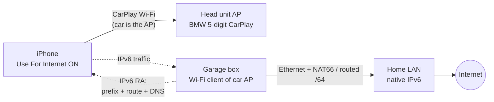

# bmw-f32-carplay-wan

Give the iPhone internet while it's on **wireless CarPlay** in the basement garage, where there's no LTE/GSM.

## The problem

Wireless CarPlay puts the iPhone's Wi-Fi on the car's own access point (`BMW<5 digits> CarPlay`). That network hands out an address but no router and no DNS, so the phone keeps cellular as its internet path. Underground there's no cellular, so Google Maps can't search or route until you drive out.

## The key facts

| Fact | Source | Checked |
|---|---|---|
| Car DHCP gives the phone an address in **172.16.224.0/24** (typically `.100`) and **no default gateway**. The car's LTE hotspot (if fitted) hands out 172.16.222.x and can't reach the CarPlay network | Bimmerfest poster, copied at [gearshifters](https://gearshifters.org/bmw/how-to-find-bmw-carplay-password/); BMW 540 owner, [Apple forum 76449](https://developer.apple.com/forums/thread/76449) (2017: "no router IP and no DNS entries") | ✅ 2026-11-01 |
| **A second client works**: a laptop on the CarPlay Wi-Fi pinged the iPhone (no client isolation) | same gearshifters copy | ✅ |
| SSID digits = last 5 of the VIN. PSK = 10 random alphanumerics, sent to the phone over Bluetooth at pairing (read out on a jailbroken phone back then) | same | ✅ |
| **It has been done on this head unit (NBT EVO), Feb 2022.** ksweber read the PSK, had a Teltonika RUT850 LTE router "dial into the Carplay hotspot and provide gateway functionality to its network" at `172.16.224.254`, and set the iPhone's CarPlay Wi-Fi to manual `172.16.224.5/24`, gateway + DNS `.254`: "Finally the iPhone providing Carplay with the NBT head unit was able to fetch internet". Jan 2025 update: "Apple allows to view CarPlay password in the WIFI properties of iPhone. No need to jailbreak any more"; Wi-Fi Calling worked through it too. Earlier (2017, BMW 540) a manual router/DNS on the phone removed "No Internet" with CarPlay still running | [Bimmerfest thread](https://www.bimmerfest.com/threads/nbt-evo-carplay-wifi-password.1376809/) (read in full via a reader proxy, 2026-11-02; [Teltonika howto](https://wiki.teltonika-networks.com/view/WAN_as_LAN_(Legacy_Firmware))); [Apple forum 76449](https://developer.apple.com/forums/thread/76449) | ✅ |
| iOS showed **Configure IP → Manual** on a car's CarPlay Wi-Fi as late as March 2025 (Mercedes MBUX) | [Apple Community 255998108](https://discussions.apple.com/thread/255998108) | ✅ |
| This iPhone's CarPlay network page has **no IP/router/DNS settings**, only a **Check For Internet Access** button ("If your car offers hotspot internet access… you may be able to use that hotspot") | the iPhone | 2026-11-01 |
| **iOS 27 added this page.** Beta 2 put a CarPlay icon on the network, beta 3 added a setting that "lets you choose to use your Car's Hotspot or your Cellular Data". Tapping **Check For Internet Access** makes iOS test the network; if it can reach the internet, the page turns into a **Use For Internet** switch ("your iPhone will also use your vehicle's hotspot to access the internet. If the hotspot loses connectivity, the iPhone will use its cellular connection"), plus Auto-Join, **Password**, Low Data Mode | [betaprofiles iOS 27 beta notes](https://forum.betaprofiles.com/t/whats-new-in-ios-27-beta-3/23195?page=2); before/after screenshots in [DiPlay #393](https://github.com/shihabal3amri/DiPlay/issues/393) | ✅ 2026-11-02 |
| **A non-factory CarPlay receiver gets "Use For Internet".** DiPlay (Android head units acting as CarPlay receivers) shows the switch once its hotspot has internet; owners of other cars (Zeekr, MG) use or disable the same switch (Facebook group posts, seen as search snippets only). iOS also re-checks on its own: an iPhone on cellular moved to the car Wi-Fi once that network "appeared to offer internet" | [DiPlay #393](https://github.com/shihabal3amri/DiPlay/issues/393), [#657](https://github.com/shihabal3amri/DiPlay/issues/657) | ✅ |
| What hasn't been done: the same on **iOS 27**, where the CarPlay page dropped Configure IP, i.e. with the route coming from the network (IPv6 RA) instead of manual IPv4. No other report of a box on a factory CarPlay network turned up | ~30 Google searches via SerpAPI (EN/DE/ZH/JA), GitHub code search, 2026-11-02 | |
| The head unit announces internet availability to the iPhone in its Wi-Fi beacon (Apple Device IE). A box on the network can't change that | [WWDC17 session 717](https://developer.apple.com/videos/play/wwdc2017/717/) | ✅ |
| Two ways cars do wireless CarPlay. **Wi-Fi pairing**: the phone joins the car's normal hotspot and CarPlay runs over it, so "the phone always attempts to use the Wi-Fi hotspot data". **Bluetooth pairing**: the car sends private Wi-Fi credentials over Bluetooth and "a private channel for communication is set up … ONLY for Wireless CarPlay", with no hotspot data. BMW's NBT EVO is the second kind: the CarPlay network is separate from the hotspot (172.16.222.x) | Audi TSBs [2021](https://static.nhtsa.gov/odi/tsbs/2021/MC-10189148-0001.pdf), [2024](https://static.nhtsa.gov/odi/tsbs/2024/MC-10250567-0001.pdf) | ✅ |
| iOS labels the car network **Weak Security**: WPA/WPA2 mixed or TKIP. The box must allow it | the iPhone | 2026-11-01 |
| Home LAN is 172.16.0.0/16, which overlaps the car's 172.16.224.0/24. Nothing at home uses .224.x and the box NATs, so it's harmless (the PoC script refuses to start unless it's really on .224.x) | Kea config | |
| Home has native IPv6 (Spectrum); Google Maps APIs answer over IPv6 | AAAA lookups | ✅ 2026-11-01 |

The Bimmerfest thread blocks bots; `https://r.jina.ai/<url>` (a public reader proxy) returns its text.

If iOS still exposes IP settings for the CarPlay network somewhere (Settings → Wi-Fi → **Edit** → the network's ⓘ), the manual-IPv4 setup is enough. If not, the route has to come from the network. **Plan: IPv6 router advertisements.** A box on the car Wi-Fi advertises an IPv6 prefix, a default route and DNS (RDNSS), and NAT66es (or routes) to the home connection. The car's IPv4 is left alone, so there's no DHCP fight. Then tap **Check For Internet Access**: iOS tests the network, finds internet through the box, and offers **Use For Internet**. IPv4 options that work with the car instead of racing its DHCP: [docs/ipv4-options.md](docs/ipv4-options.md). **Design, reachability table and the permanent-box recipe: [docs/ipv6-route.md](docs/ipv6-route.md).**

## Biggest risk

The car very likely tells the iPhone "no internet here" in every beacon (Apple Device IE flag bit 11, `InternetAccess`, clear), and that's what makes the phone keep cellular. `scripts/car-ie.sh` reads the actual bits in P1. iOS 27 gives a way past that: tapping **Check For Internet Access** makes iOS test the network, and a network that passes gets a **Use For Internet** switch. A non-factory CarPlay receiver (DiPlay) gets it, so iOS evidently goes by the test rather than trusting the car's beacon. The remaining unknowns are narrower:

1. **Does iOS's test pass over our route?** The box offers IPv6 only (the car owns IPv4 and gives no router). `captive.apple.com` has an AAAA record, but nobody has reported the check over an IPv6-only path.
2. **Does "Use For Internet" make the car Wi-Fi the default for apps?** Apple's configd suggests why a CarPlay network normally doesn't carry internet: a service ranked `Never` (how wired CarPlay is configured) keeps only a *scoped* default route. The switch presumably lifts that. CarNet Probe's bound-vs-default probes show it either way ([docs/iphone-diagnostics.md](docs/iphone-diagnostics.md#reading-the-probes)).

P2 answers both in an afternoon with a laptop, so nothing gets bought before then.

## Approaches, ranked

| # | Approach | Cost | Touches car | Expected | Status |
|---|---|---|---|---|---|
| 0 | Offline maps + start the route on home Wi-Fi before CarPlay connects. **Apple Maps** (iOS 17+): offline search with hours/ratings, turn-by-turn, ETA; turn on *Only Use Offline Maps* so it doesn't wait on the car Wi-Fi ([105084](https://support.apple.com/en-us/105084)). **Google Maps**: driving directions offline only if the whole route is inside the area, no traffic or alternate routes, areas expire unless updated on Wi-Fi ([6291838](https://support.google.com/maps/answer/6291838?hl=en&co=GENIE.Platform%3DiOS)) | $0 | no | Works today for known places; no live traffic | to test |
| 0b | **Manual IPv4 on the iPhone (the proven 2022 setup).** Settings → Wi-Fi → Edit → Known Networks → `BMW… CarPlay` → Configure IP → Manual: `172.16.224.5` / `255.255.255.0`, Router `172.16.224.254` (the box), DNS `1.1.1.1`. `poc-mac-nat.sh` already puts the Mac at `.254` with NAT44. Catch: the setting stays when you drive off, so outside the garage the phone has a Wi-Fi router that isn't there; ksweber's router rode in the car, so nobody has tested that (P4) | $0 + the box | no | Proven on NBT EVO 2022; **Configure IP confirmed on iOS 27** via Known Networks | **test first in P2** |
| 1 | **Garage Wi-Fi bridge**: box joins the car's CarPlay SSID as a client, advertises an IPv6 route + DNS, NAT66 or a routed /64 to garage Ethernet. No phone settings, and the route expires 60 s after the car leaves | ~$70–90 | no | Cleanest if iOS accepts an IPv6-only route | **main track for the permanent box** |
| 1b | iPhone + wired Ethernet (USB-C adapter, or Lightning→USB 3 Camera Adapter + USB Ethernet), cabled to a small travel router in the car that's a client of the garage Wi-Fi. Wi-Fi stays on CarPlay. Doesn't depend on iOS trusting the car Wi-Fi: in the garage cellular is dead, and if iOS ranks the CarPlay Wi-Fi `Never` it can't be primary, so Ethernet is the only candidate. No PSK, no car-network tricks. Nobody has documented USB Ethernet + wireless CarPlay together | ~$50 | no | Likely works; adds a cable to the phone. 10-minute test with CarNet Probe | **backup, test early** |
| 2 | Cellular booster (donor antenna outside, indoor antenna in garage): weBoost Home MultiRoom ~$570, Cel-Fi GO ~$1,300 (one carrier); FCC rules need carrier registration. Femtocells are mostly gone: T-Mobile CellSpot end-of-life Feb 2025, AT&T Cell Booster Pro discontinued; Verizon's LTE Network Extender carried data but Verizon says it's no longer sold | $570–1,400 + install | no | Works for everyone and every app | fallback |
| 3 | OBD-II ENET: talk to the ZGW/head unit over the diagnostic Ethernet and look for an IP path to the head unit's Wi-Fi | ENET cable ~$15 | read-only | Learning; a usable route is unlikely without rooting the head unit | exploration |
| 4 | Root the head unit (QNX) and NAT Wi-Fi ↔ ENET | time + risk | yes | Possible in theory, high risk of bricking | not planned |

## Plan

| Phase | Do | Proves |
|---|---|---|
| **P0** | ✅ CarPlay network page checked (no IP settings, Weak Security, Check For Internet Access button). ✅ PSK via Edit → Known Networks, no jailbreak; Configure IP is there too. ☐ Tap **Check For Internet Access** now (no box) and note what iOS says. ☐ Offline maps in the garage | The free options, and the PSK |
| **P1** | Mac in the garage, car on: scan the car AP (band, channel, security). Commands in [docs/test-log.md](docs/test-log.md) | Box radio requirements (5 GHz? DFS? TKIP?) |
| **P2** | **MacBook proof of concept**, two ways in one session. (a) **IPv4, proven**: `up`, then set the phone's Configure IP to manual `.5` / router `.254` and try Maps; set it back to Automatic afterwards. (b) **IPv6**: with the phone on Automatic, tap Check For Internet Access. First a passive capture (does the head unit send RAs? what's its address?), then `sudo scripts/poc-mac-nat.sh up`: the Mac joins the car SSID, runs `rtadvd` (ULA /64, 60 s router lifetime, RDNSS) and NAT66 out of USB-C Ethernet. If the iPhone takes the address but stays offline, rerun with `PREFIX6=` a routed public /64. Watch the phone's side with an `rvictl` capture, iOS logs and the **CarNet Probe** app ([docs/iphone-diagnostics.md](docs/iphone-diagnostics.md)) | Second client allowed, iOS takes the IPv6 route, Check For Internet Access passes → Use For Internet, CarPlay survives, Maps works |
| **P3** | Permanent box: GL.iNet GL-MT3000 on vanilla OpenWrt as a Wi-Fi client of the car SSID, odhcpd RA + RDNSS + PREF64, routed /64 from OPNsense, DNS64 + NAT64 | Hands-off: car on → internet |
| **P4** | Exit test: drive out; the 60 s router lifetime should hand the phone back to cellular within a minute | No dead zone when leaving |
| **P5** | OBD ENET exploration ([docs/obd-enet.md](docs/obd-enet.md)) | What's reachable from the OBD port |

Car: factory NBT EVO (wireless CarPlay only). Garage: Ethernet, home Wi-Fi and power at the parking spot.

## The CarPlay Wi-Fi password (PSK): solved

**Route 1 worked on iOS 27 (2026-11-02):** Settings → Wi-Fi → Edit → Known Networks → `BMW… CarPlay` shows the Password (with a Copy button) *and* the full settings page, including **Configure IP**. The PSK is in `secrets/carplay.env`. The rest of the table is kept for other cars and future iOS versions.

The box (and the Mac in P2) has to join the car's Wi-Fi, so it needs the PSK. **No jailbreak needed**: ksweber reports iOS has shown the CarPlay password "in the WIFI properties of iPhone" since early 2025. Try these in order; 1–4 take minutes, in the car with CarPlay connected:

| # | Route | Notes |
|---|---|---|
| 1 | Settings → Wi-Fi → **Edit** (top right) → Known Networks → ⓘ next to `BMW… CarPlay` → tap **Password** (Face ID) | Apple's documented path for saved networks ([104961](https://support.apple.com/en-us/104961)). The Edit list may show the classic page that the CarPlay page itself hides |
| 2 | **Passwords app → Wi-Fi** → `BMW… CarPlay` → Password, or *Show Network QR Code* | iOS 18+ |
| 3 | On the CarPlay network page, tap **Check For Internet Access** | On iOS 27 a CarPlay page that passes the check shows a Password row ([DiPlay #393](https://github.com/shihabal3amri/DiPlay/issues/393) screenshots). Whether a *failed* check also expands the page is unknown: look |
| 4 | **Share Password to the Mac.** Mac in the car, iPhone unlocked and on CarPlay. On the Mac, pick `BMW… CarPlay` in the Wi-Fi menu; the iPhone should offer **Share Password**; tap it. The Mac joins, and the PSK lands in its keychain: `security find-generic-password -D "AirPort network password" -a "BMW##### CarPlay" -w` | Apple's standard sharing ([102635](https://support.apple.com/en-us/102635)): Wi-Fi + Bluetooth on, Personal Hotspot off on both, devices close, iPhone unlocked. Untested for CarPlay networks. Even without reading the PSK, the Mac is now on the car Wi-Fi, which is all P2 needs: `poc-mac-nat.sh up` with no `CAR_PSK` uses the current network |
| 5 | Mac **Passwords app → Wi-Fi** | Only if iCloud Keychain syncs CarPlay networks; this Mac's known-network list didn't have it (2026-11-01), so probably not |
| 6 | Encrypted local backup of the iPhone (Finder, or `idevicebackup2`) → decrypt `keychain-backup.plist` with the backup password | Works without a jailbreak because it's your own backup, but no maintained open-source tool documents Wi-Fi password extraction for current iOS; it would mean writing a decryptor. Last resort |
| — | Approach 1b (USB-C Ethernet on the phone) | Needs no PSK at all |

Not possible: sniffing it (the WPA handshake only allows guessing, and 62^10 is out of reach) or reading it from Bluetooth (the iAP2 link is encrypted).

## Rules

- Never commit the car's PSK, VIN, SSID digits (they're the end of the VIN) or keys. Put them in `secrets/` (gitignored), captures included.
- Car work is read-only unless a step says otherwise: no coding, no flashing.
- Log every test in [docs/test-log.md](docs/test-log.md): date, firmware, what was run, result.
