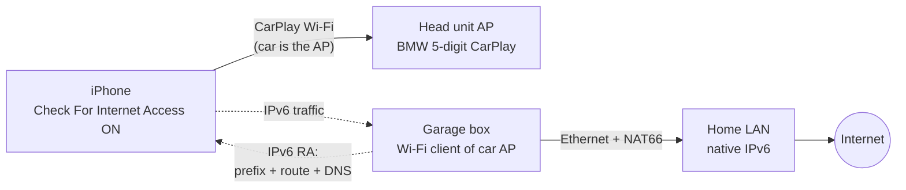

# bmw-f32-carplay-wan

Give the iPhone internet while it's on **wireless CarPlay** in the basement garage, where there's no LTE/GSM.

## The problem

Wireless CarPlay puts the iPhone's Wi-Fi on the car's own access point (`BMW<5 digits> CarPlay`). That network hands out an address but no router and no DNS, so the phone keeps cellular as its internet path. Underground there's no cellular, so Google Maps can't search or route until you drive out.

## The key facts

| Fact | Source |
|---|---|
| Car DHCP gives the phone an address but **no router, no DNS** | [Apple dev forum, BMW G30](https://developer.apple.com/forums/thread/76449) |
| iOS shows **no IP/router/DNS settings** for CarPlay networks, only a **Check For Internet Access** toggle ("If your car offers hotspot internet access… you may be able to use that hotspot") | the iPhone, 2026-11-01 |
| iOS labels the car network **Weak Security**: probably WPA/TKIP or WPA/WPA2 mixed. The bridge box must allow legacy WPA | the iPhone, 2026-11-01 |
| Home has native IPv6 (Spectrum); Google Maps APIs answer over IPv6 | tested from the Mac |

So the route has to come from the network, not from phone settings. **Plan: IPv6 router advertisements.** A box on the car Wi-Fi advertises an IPv6 prefix, a default route and DNS (RDNSS), and NAT66es to the home connection. The car's IPv4 is left alone, so there's no DHCP fight. With Check For Internet Access on, iOS should use it. Fallback if iOS ignores an IPv6-only route: answer DHCPv4 faster than the car, with a router option (racy).

## Approaches, ranked

| # | Approach | Cost | Touches car | Expected | Status |
|---|---|---|---|---|---|
| 0 | Offline maps (Google Maps offline area / Apple Maps offline) + start the route on home Wi-Fi before CarPlay connects | $0 | no | Works today for known places; search outside the area fails | to test |
| 1 | **Garage Wi-Fi bridge**: box joins the car's CarPlay SSID as a client, advertises an IPv6 route + DNS, NAT66 to garage Ethernet | ~$40–90 | no | Best bet | **main track** |
| 1b | iPhone (USB-C models) + USB Ethernet adapter, cabled to a small travel router in the car that's a client of the garage Wi-Fi. Wi-Fi stays on CarPlay; internet goes over Ethernet. No PSK needed | ~$50 | no | Should work; adds a cable to the phone | backup if the PSK can't be found |
| 2 | Cellular booster (donor antenna outside, indoor antenna in garage) | $400–1,000 | no | Works for everyone and every app | fallback |
| 3 | OBD-II ENET: talk to the ZGW/head unit over the diagnostic Ethernet and look for an IP path to the head unit's Wi-Fi | ENET cable ~$15 | read-only | Learning; a usable route is unlikely without rooting the head unit | exploration |
| 4 | Root the head unit (QNX) and NAT Wi-Fi ↔ ENET | time + risk | yes | Possible in theory, high risk of bricking | not planned |

## Plan

| Phase | Do | Proves |
|---|---|---|
| **P0** | ✅ iPhone car-network page checked (no IP settings, Weak Security, toggle exists). Turn **Check For Internet Access** on; test offline maps in the garage | The free option |
| **P1** | Mac in the garage, car on: scan the car AP (band, channel, security, BSSID). Commands in `docs/test-log.md` | Box radio requirements (5 GHz? DFS? WPA/TKIP?) |
| **P2** | **MacBook proof of concept**: `sudo scripts/poc-mac-nat.sh up`. The Mac joins the car SSID, runs `rtadvd` (ULA /64, 60 s router lifetime, RDNSS) and NAT66 out of USB-C Ethernet | Second client allowed, no client isolation, iOS takes the IPv6 route, CarPlay survives, Maps works |
| **P3** | Permanent box: OpenWrt travel router (e.g. GL.iNet) as a Wi-Fi client of the car SSID (legacy WPA allowed), odhcpd RA + RDNSS, NAT66 (or a routed /64 from OPNsense) | Hands-off: car on → internet |
| **P4** | Exit test: drive out; the 60 s router lifetime should hand the phone back to cellular within a minute | No dead zone when leaving |
| **P5** | OBD ENET exploration (`docs/obd-enet.md`) | What's reachable from the OBD port |

## Known

- **Head unit:** factory NBT EVO (wireless CarPlay).
- **Garage:** Ethernet, home Wi-Fi and power at the parking spot.
- **iPhone:** CarPlay network page has no IP settings and no password field.

## Blocker: the CarPlay Wi-Fi password (PSK)

The box has to join the car's Wi-Fi, so it needs the PSK. The iPhone doesn't show it, and the Mac's iCloud keychain has no car entry. Ways to get it, in order:

| # | Route | Notes |
|---|---|---|
| 1 | [Bimmerfest: "NBT EVO CarPlay WiFi password"](https://www.bimmerfest.com/threads/nbt-evo-carplay-wifi-password.1376809/) | Linked from the Apple thread as a working method. Paywalled for bots (HTTP 402), so open it in a browser |
| 2 | Encrypted Finder backup of the iPhone → decrypt its keychain | The phone has the PSK saved for the car network. Needs a backup decryptor (small Go tool); the CarPlay entry may be device-only and excluded |
| 3 | NBT EVO service menu ([BMW SIB B65 09 16](https://bmwtechinfo.bmwgroup.com/sib_attachments/B65%2009%2016%20Service%20Menu%20for%20NBT%20and%20NBT%20EVO%20Head%20Units.pdf)) | Look for a WLAN/CarPlay page. Read-only browsing |
| 4 | Approach 1b | Avoids the PSK entirely |

Still unknown: whether the car AP allows a second client, whether it isolates clients, and whether iOS accepts an IPv6-only internet route on a CarPlay network (P2 answers all three).

## Rules

- Never commit the car's PSK, VIN, SSID digits or keys. Put them in `secrets/` (gitignored).
- Car work is read-only unless a step says otherwise: no coding, no flashing.
- Log every test in `docs/test-log.md`: date, firmware, what was run, result.
