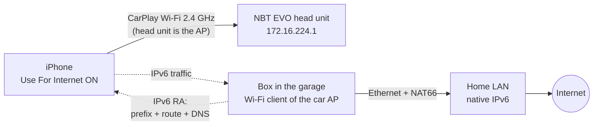

# internet-over-wireless-carplay

[](https://github.com/ParkWardRR/internet-over-wireless-carplay/releases)
[](https://go.dev/)
[](https://www.kernel.org/)
[](https://openwrt.org/)
[](https://developer.apple.com/ios/)
[](https://www.bmw.com/)
[](https://www.apple.com/ios/carplay/)
[](https://github.com/ParkWardRR/internet-over-wireless-carplay/blob/main/docs/status.md)
[](https://en.wikipedia.org/wiki/IEEE_802.11n)
[](https://en.wikipedia.org/wiki/IPv6)

**Give your iPhone real internet on wireless CarPlay, in a garage with no cell signal.**

Wireless CarPlay works by having the car run its own little Wi-Fi network, just for the phone and the dashboard. That network deliberately carries no internet — the car is not a hotspot, it is a cable replacement. Normally that is invisible, because your phone keeps using cellular for everything that needs the network. Park underground, lose cellular, and the illusion breaks: CarPlay still shows Maps, but Maps cannot search, cannot route, and cannot load a tile.

This project puts a small Linux box on that same car network as a second client, and has it hand the phone a working IPv6 route out to a wired internet connection. The car is untouched. The phone's IP settings are untouched. You tap one switch on the phone the first time, and Maps works underground.

> [!NOTE]
> **This is a working experiment, not a product.** It is proven end to end on two separate cars' hardware, but never yet on both at the same time, and the second car's proof is four days old. Read *Where this stands* before you build one. Everything in this repo is dated and sourced; where something is believed rather than measured, it says so.

## Where this stands

Measured on the box and the phone, not inferred. Full detail: [docs/status.md](docs/status.md), raw log: [docs/test-log.md](docs/test-log.md).

| | F22 M240i (`car B`) | F32 (`car A`) |
|---|---|---|
| **Box joins the car's CarPlay Wi-Fi** | ✅ repeatedly, 2026-11-14, on its own USB radio | ✅ 2026-11-02/03, on the old shared radio |
| **Phone gets a route and real app traffic** | ✅ **44,327 packets / 6.2 MB forwarded** in one day, 5 × `validated` | ✅ 2026-11-02, Maps search + routing on CarPlay |
| **On the current two-radio build** | ✅ this is the build in service | ⬜ **never served** — the car has not been in RF range during any logged window |
| **Clean departures (goodbye before the link dies)** | ✅ 3/3 on a real drive | ⚠️ 1 early departure stranded a route; fixed and re-tested on the F22 only |

So: **one car at a time is proven, and "both cars at once" is not.** The two cars have never been served simultaneously, because they have not been in the garage together since the per-car radios went in on 2026-11-13. The F32 is simply away — its radio on the box is healthy (`cara` sees 23 neighbouring networks, same as `carb`) and its `wpa_supplicant` is hunting; the car's SSID has just never appeared in a scan.

Also still unproven, despite being built and deployed: **a real phone using NAT64** to reach IPv4-only hosts. The translator is up and five names resolve, but its tunnel has carried **3 packets, all outbound** — no phone has ever used it.

## The one thing that will catch you out

iOS gives a CarPlay network the service rank `Never`. It gets a scoped route and nothing more, which is enough for background daemons and useless for your apps. The box can be flawless and Maps will still fail.

**You have to tap it once:** Settings → Wi-Fi → the car's network → **Check For Internet Access**, then turn on **Use For Internet**.

**After that first tap, iOS mostly re-validates by itself** — this is new as of 2026-11-14 and is the main thing that changed since the earlier write-ups. Across separate serving sessions on the F22, separated by 15–29 minutes of the car being gone, the box saw the phone re-validate **4 to 24 seconds** after it started serving again. Nobody taps a phone within four seconds of association, so iOS is doing that on its own.

It is not unconditional, so do not plan around it:

- Two sessions the same morning sat `phone_unvalidated` with **0 bytes** forwarded, and stayed that way.
- A genuine car restart still needs the tap. The 2026-11-11 capture has the car off for 54 minutes, and on the next start nothing reached the apps until it was tapped — the whole point of that instrumented drive.
- The gaps where re-validation worked were short. A 29-minute absence is not the same thing as a cold start the next morning.

The box tells you which state you are in rather than leaving you to guess: it logs `phone_unvalidated` with the fix in the hint, and `validated` once the phone's probe traffic appears. The signal is live, not just forensic — `nft list counters` answers "did the tap land?" directly.

Whether a beacon could remove the tap entirely is an open question with a staged plan and a cheap first test in [docs/ap-signalling.md](docs/ap-signalling.md). Nothing in it is measured, and the two cars that work today advertise no internet capability at all.

## Quick start

1. **Get the CarPlay Wi-Fi password.** iOS 27: Settings → Wi-Fi → Edit → Known Networks → the car's network → Password. Face ID, then Copy. No jailbreak.

2. **Get a Linux box** with wired Ethernet to your internet and a 2.4 GHz Wi-Fi adapter that can be a station. A Raspberry Pi, Orange Pi or similar. One USB radio per car if you want more than one car served at once — they cannot share.

3. **Put the car's details in `secrets/carplay.env`** (copy `secrets.example.env`):

   ```
   CAR_SSID='BMW12345 CarPlay'
   CAR_PSK='your-password-here'
   ```

4. **Install:**

   ```sh
   sudo scripts/carplay-box.sh install
   ```

   The box now joins that car whenever it appears and shares the wired connection automatically. For a one-shot test instead, use `scripts/poc-linux.sh up`.

5. **In the car,** start CarPlay as usual, then on the phone: Settings → Wi-Fi → the car's network → **Check For Internet Access** → **Use For Internet**.

6. **Open Maps on CarPlay.** Search and routing work with no cell signal.

For the real deployment — one daemon per car, learned thresholds, departure handling — install `carplayd` instead; see [docs/status.md](docs/status.md) and `carplayd/`.

## How it works



The car hands out IPv4 with no router and no DNS, and sends no router advertisements of its own. So the box does not fight it: it leaves IPv4 alone and becomes the only IPv6 router on the link, advertising a ULA prefix, itself as the route, and a DNS server, then NATs out to the house. The phone picks that up with plain SLAAC — nothing is configured on the phone beyond the one switch.

## What the box does

- **Serves whichever configured car turns up**, one daemon per radio, with an nftables table per car link that permits the internet and nothing else: not the box, not the home LAN, not the other car.
- **Leaves before the link dies, and says goodbye.** Departures here do not fade politely — the signal stays flat and then the link drops. So it leaves on the driver's `tx_failed` rate climbing, which buys about 8 seconds of warning where RSSI gives none. On a real drive: 3 leaves, 3 goodbye RAs, no stranded routes.
- **Learns its own thresholds.** Fixed dBm cannot work here: the box is behind a cinderblock wall where "parked" and "dying" overlap, and every number moves when a car parks differently or a radio is swapped. Each car's healthy band is learned at runtime, persisted, and re-learned when the world changes.
- **Recovers a deaf radio.** The AR9271 sometimes stops receiving while reporting itself healthy. A run of empty scans on a channel that always has neighbours means the radio, not the world, and it gets rebuilt without disturbing the other car.
- **Reaches IPv4-only hosts** through DNS64 + NAT64, allowlisted to named hosts, because a car link that is IPv6-only cannot otherwise reach half a homelab. Deployed, not yet exercised by a phone.
- **Records both sides of a drive.** `carrecon` runs in the car in monitor mode, so a departure can be reconstructed from the air rather than only from the box's point of view.

See [docs/findings.md](docs/findings.md) for what the measurements actually showed — including a leading hypothesis the data killed.

## Key facts

| Fact | Source | Checked |
|---|---|---|
| **The CarPlay AP** (both cars): 2.4 GHz channel 11, HT20, one stream; beacon offers WPA + WPA2 with a **TKIP group cipher** (iOS calls it "Weak Security"); negotiated **WPA2-PSK / CCMP pairwise / TKIP group**, Wi-Fi 4. The 802.11u Interworking **Internet bit is clear**; no Apple Device IE | `iw` scan + carplayd on both cars | ✅ 2026-11-03, re-confirmed on the F22 2026-11-14 |
| DHCP gives 172.16.224.0/24 with **no router and no DNS**. Head unit is the AP at `172.16.224.1` and sends **no IPv6 RAs**. A **second client is allowed** and there is no client isolation, so the box can sit next to the phone | the box; [gearshifters](https://gearshifters.org/bmw/how-to-find-bmw-carplay-password/) copy of the Bimmerfest post; [Apple forum 76449](https://developer.apple.com/forums/thread/76449) | ✅ |
| Phone ↔ box traffic is **relayed by the head unit**, so the box's RSSI to the car is not the phone's path quality | measured | ✅ |
| SSID digits are the last 5 of the VIN. The PSK is 10 random alphanumerics, delivered to the phone over Bluetooth, and **iOS 27 will show it** | the iPhone | ✅ 2026-11-02 |
| **iOS 27** hides IP settings on the CarPlay network page and offers **Check For Internet Access**; passing it reveals **Use For Internet**. Known Networks still has **Configure IP** | the iPhone; [betaprofiles notes](https://forum.betaprofiles.com/t/whats-new-in-ios-27-beta-3/23195?page=2); [DiPlay #393](https://github.com/shihabal3amri/DiPlay/issues/393) | ✅ |
| Why such a network carries no internet by default: configd gives a service ranked `Never` only a scoped default route, and *Use For Internet* lifts it. **Hypothesis from Apple's open source, not traced on the device.** Darwin asks for AAAA on a ULA-only network, so no public prefix is needed | configd, Libinfo, xnu ([iphone-diagnostics.md](docs/iphone-diagnostics.md#reading-the-probes)) | source only |
| **Prior art, Feb 2022, same head unit**: ksweber put a Teltonika LTE router on the CarPlay Wi-Fi at `.254` with the iPhone set to manual `.5` and got internet. We found no other public implementation, and none at all of the IPv6 / iOS 27 route | [Bimmerfest](https://www.bimmerfest.com/threads/nbt-evo-carplay-wifi-password.1376809/) (via `r.jina.ai`); ~30 searches in 4 languages | ✅ |
| Two kinds of wireless CarPlay car. **Wi-Fi pairing**: CarPlay rides the car's own hotspot, internet included. **Bluetooth pairing**: a private CarPlay-only network with none. The NBT EVO is the second kind, which is why this project exists | Audi TSBs [2021](https://static.nhtsa.gov/odi/tsbs/2021/MC-10189148-0001.pdf), [2024](https://static.nhtsa.gov/odi/tsbs/2024/MC-10250567-0001.pdf) | ✅ |
| The home LAN overlaps the car's 172.16.224.0/24. Harmless: the box NATs, and the scripts refuse to start unless they really got a car address | config | |

## Approaches considered

| # | Approach | Cost | Touches car | Status |
|---|---|---|---|---|
| **1** | **Box on the CarPlay Wi-Fi, IPv6 RA + RDNSS + NAT66 to Ethernet.** No phone IP settings; the route leaves with a goodbye RA, or expires on its own after an abrupt loss | a Linux SBC, or ~$70–90 travel router | no | ✅ **the one that works** |
| 0b | Manual IPv4: box at `.254` with NAT44, phone set to Configure IP → Manual | same box | no | proven by ksweber (2022); not needed, and a static router setting outlives the garage |
| 1b | USB-C Ethernet on the phone, cabled to a travel router | ~$50 | no | untested backup; needs no PSK |
| 0 | Offline maps ([Apple](https://support.apple.com/en-us/105084), [Google](https://support.google.com/maps/answer/6291838?hl=en&co=GENIE.Platform%3DiOS)) | $0 | no | works for known places, no live traffic |
| 2 | Cellular booster (weBoost ~$570, Cel-Fi GO ~$1,300) | $570–1,400 + install | no | fallback |
| 3 | OBD-II ENET recon ([obd-enet.md](docs/obd-enet.md)) | ~$15 | read-only | exploration |
| 4 | Root the head unit | time + risk | yes | not planned |

## Roadmap

The short version: **get both cars in the garage at once.** That single drive settles the three things standing open — the F32 on the two-radio build, two cars served simultaneously, and a phone actually using NAT64.

Full roadmap, acceptance criteria and open items: **[docs/status.md](docs/status.md)**.

## Repo

| Path | What |
|---|---|
| [docs/status.md](docs/status.md) | Status, roadmap, open items, risks |
| [docs/findings.md](docs/findings.md) | What we learned and why it works |
| [docs/test-log.md](docs/test-log.md) | Every test, dated. The primary evidence |
| [docs/two-cars.md](docs/two-cars.md) | Two cars: scenarios, per-car prefixes, arbitration, simulator |
| [docs/usb-radios.md](docs/usb-radios.md) | One radio per car: two AR9271 dongles, stable naming, the traps |
| [docs/kernel-modules.md](docs/kernel-modules.md) | Building modules the vendor kernel left out (TUN, ath9k) |
| [docs/ipv4-options.md](docs/ipv4-options.md) | Reaching IPv4-only hosts: DNS64 + NAT64, and why a plain DNS relay cannot work |
| [docs/ap-signalling.md](docs/ap-signalling.md) | Could a beacon remove the *Use For Internet* tap? Staged, gated, unmeasured |
| [docs/ipv6-route.md](docs/ipv6-route.md) | The IPv6 design and the permanent-box recipe |
| [docs/fast-connect-plan.md](docs/fast-connect-plan.md) | Lab telemetry + fast connect/leave/reconnect (EnGenius OpenWrt) |
| [docs/emulator.md](docs/emulator.md), [docs/emulator-results.md](docs/emulator-results.md) | The box emulated in hwsim; stock vs carplayd numbers |
| [docs/iphone-diagnostics.md](docs/iphone-diagnostics.md) | rvictl capture, iOS logs, CarNet Probe |
| [docs/openwrt-box.md](docs/openwrt-box.md) | The OpenWrt replacement box |
| [docs/review-response.md](docs/review-response.md) | External reviews: findings, changes, evidence |
| `carplayd/` | The Go controller that runs in production |
| `carrecon/`, `tbeam/` | In-car recorder and the GPS/IMU beacon that timestamps a drive |
| `emu/` | Emulator: OpenWrt image, `emu.sh`, Go agent and harness |
| `recon/ieaudit/` | Decoder/validator for the Interworking and Apple Device elements |
| `test-ap/`, `scripts/ap-signal-test.sh` | Controlled hostapd AP for the signalling experiment |
| `ios/CarNetProbe` | iPhone diagnostics app |
| `scripts/poc-linux.sh` | The one-shot setup on Linux (`ie`, `up`, `capture`, `status`, `down`) |
| `scripts/carplay-box.sh` | Hands-off mode (`install`, `status`, `uninstall`) |
| `scripts/poc-mac-nat.sh` | The same on a Mac (rtadvd + pf) |

## Rules

- **Never commit** a car's PSK, VIN, SSID digits (they are the end of the VIN), MACs or keys. They go in `secrets/`, which is gitignored — captures included. A pre-commit hook blocks the known values; it has caught a real one twice.
- **Scanning your own refs is not enough.** This repo published unscrubbed history twice: once in the tree, and once because a rewrite force-pushed `main` but left two release tags pointing into the old history. Check what the *remote* serves.
- **Car work is read-only** unless a step says otherwise. No coding, no flashing.
- **Log every test** in [docs/test-log.md](docs/test-log.md): date, what ran, what happened, what changed as a result. A claim with no row is not a result.
- **Label every claim** measured / source / emulator / inferred. The emulator is a Linux stand-in, not an iPhone; it cannot tell you anything about iOS policy.
