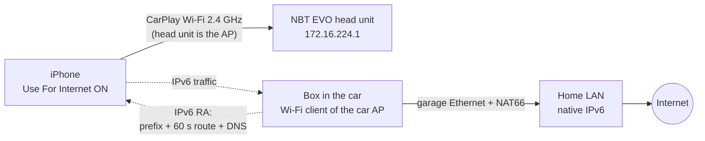

# internet-over-wireless-carplay

[](https://github.com/ParkWardRR/internet-over-wireless-carplay/releases)
[](https://go.dev/)
[](https://www.kernel.org/)
[](https://openwrt.org/)
[](https://developer.apple.com/ios/)
[](https://www.bmw.com/)
[](https://www.apple.com/ios/carplay/)
[](https://github.com/ParkWardRR/internet-over-wireless-carplay/blob/main/docs/status.md)
[](https://en.wikipedia.org/wiki/IEEE_802.11n)
[](https://en.wikipedia.org/wiki/IPv6)

Your car's wireless CarPlay creates its own private Wi-Fi network so your phone can talk to the dashboard. That network has no internet — it's just a direct link between phone and car. Normally your phone falls back to cellular for everything else, but in a basement or underground garage there is no cellular signal. Maps stops loading, search stops working, and you are stuck.

This project fixes that. A small Linux box — a Raspberry Pi, Banana Pi, or similar — joins the car's CarPlay Wi-Fi as a second device and bridges it to your home internet through a wired Ethernet connection. Your phone sees a working internet connection right on the CarPlay network and offers a **Use For Internet** toggle. Turn it on, and Google Maps search and routing work underground. Nothing about the car changes. Nothing about the phone's IP settings changes.

**Use case:** a basement garage with Ethernet and power but zero LTE/GSM coverage. The box sits near the car, plugged into the garage network. When you park and CarPlay connects, the box does the rest automatically.

## Quick start

1. **Get the CarPlay Wi-Fi password.** On iOS 27: Settings → Wi-Fi → Edit → Known Networks → the car's network → Password. Copy it.

2. **Set up a Linux box** (Raspberry Pi, Banana Pi, or any small Linux machine) with a wired Ethernet connection to your home network and a Wi-Fi adapter.

3. **Store the password** in `secrets/carplay.env` (copy `secrets.example.env` as a template):

   ```
   CAR_SSID='BMW12345 CarPlay'
   CAR_PSK='your-password-here'
   ```

4. **Run the setup script** on the box:

   ```sh
   sudo scripts/carplay-box.sh install
   ```

   This makes the box join the car's Wi-Fi whenever it appears and share the home internet connection automatically.

5. **In the car**, connect your phone to wireless CarPlay as usual. Go to Settings → Wi-Fi → the CarPlay network → tap **Check For Internet Access** → turn on **Use For Internet**.

6. **Open Google Maps on CarPlay.** Search and routing now work, even with no cell signal.

For a one-off test instead of a permanent install, see `scripts/poc-linux.sh`.

---

## Result: it works (2026-11-02)

A small Linux box in the car (garage-sbc, a Banana Pi, wired to the garage LAN) joins the car's CarPlay Wi-Fi as a second client and advertises an **IPv6 route + DNS** with NAT66 to the home connection. On the iPhone (iOS 27): Settings → Wi-Fi → the CarPlay network → **Check For Internet Access** → **Use For Internet**. Google Maps search and routing then work on CarPlay underground. Nothing on the car changes, and no IP settings change on the phone.

**Status, plan and open items: [docs/status.md](docs/status.md).** External review and our response: [docs/review-response.md](docs/review-response.md). **Full write-up: [docs/findings.md](docs/findings.md).** Raw results: [docs/test-log.md](docs/test-log.md). Run it: `scripts/poc-linux.sh` (see *P2 on garage-sbc* in the test log).



## What it does now

- **Joins whichever configured car appears** and gives its phones internet over IPv6,
  with NAT66 and an nftables table that isolates each car link (internet only: not
  the box, not the home LAN, not the other car).
- **Leaves before the link dies, with a goodbye.** Departures here do not fade —
  the signal stays flat and the link drops — so it leaves on the driver's
  `tx_failed` rate rising, which gives about 8 seconds of warning where RSSI gives
  none. Validated on a real departure: 3 leaves, 3 goodbyes, no stranded routes.
- **Learns its own thresholds.** Absolute dBm cannot be configured for this: the
  box is behind a cinderblock wall where parked and dying signal overlap, and every
  number moves when a car parks elsewhere or a radio is swapped. Each car's healthy
  band is learned at runtime, persisted, and re-learned when the world changes.
- **A radio per car serves them all at once.** Cars sharing a radio take turns.
- **Recovers a deaf radio.** The AR9271 stops receiving while the driver reports
  nothing wrong; a run of empty scans on a channel that always has neighbours means
  the radio, and it is rebuilt without disturbing the other cars' links.
- **Records both sides of a drive.** `carrecon` runs in the car in monitor mode so a
  departure can be reconstructed from the air, not just from the box's own view.

See [findings.md](docs/findings.md) for what the measurements actually showed —
including a leading hypothesis that the data did not support.

> [!IMPORTANT]
> **You have to tap "Use For Internet" on the phone every time the car
> restarts.** iOS gives a CarPlay network's service rank `Never`: it gets a
> scoped route and nothing more, so background daemons use it and your *apps do
> not*. Until iOS validates the network — Settings → Wi-Fi → the car network →
> **Check For Internet Access**, then **Use For Internet** — Maps will not load
> even though the box is working perfectly, and the setting does **not** carry
> over to the next time you start the car.
>
> The box detects this and logs `phone_unvalidated` with the fix in the hint, so
> you are not left guessing; `validated` confirms the tap took effect. It cost a
> whole instrumented drive to work this out, which is why it is the first thing
> in this README after the feature list.

## The problem

Wireless CarPlay puts the iPhone's Wi-Fi on the car's own access point (`BMW<5 digits> CarPlay`). That network hands out an address but no router and no DNS, and its beacon says "no internet". So the phone keeps cellular as its internet path, and underground there's no cellular: Google Maps can't search or route until you drive out.

## Key facts

| Fact | Source | Checked |
|---|---|---|
| **The F32's CarPlay Wi-Fi** (observed): 2.4 GHz (channel 11, HT20, one stream), WPA/WPA2 mixed with a TKIP group cipher (iOS calls it "Weak Security"). The beacon's **802.11u Interworking element has the Internet bit clear** (Private, venue Vehicular). No Apple Device IE | `iw` scan from the box | ✅ 2026-11-02 |
| DHCP gives 172.16.224.0/24 with **no router and no DNS**. Head unit = AP at `172.16.224.1`, sends **no IPv6 RAs**. A second client is allowed (box got `.127`, iPhone `.110`). The car's LTE hotspot (if fitted) is a separate 172.16.222.x network | box; [gearshifters](https://gearshifters.org/bmw/how-to-find-bmw-carplay-password/) copy of the Bimmerfest post; [Apple forum 76449](https://developer.apple.com/forums/thread/76449) | ✅ |
| SSID digits = last 5 of the VIN. PSK = 10 random alphanumerics, sent to the phone over Bluetooth. **iOS 27 shows it, no jailbreak**: Settings → Wi-Fi → Edit → Known Networks → the CarPlay network → Password | the iPhone | ✅ 2026-11-02 |
| **iOS 27**: the CarPlay network page hides IP settings and shows a **Check For Internet Access** button. If the network passes, a **Use For Internet** switch appears ("your iPhone will also use your vehicle's hotspot to access the internet. If the hotspot loses connectivity, the iPhone will use its cellular connection"). The Known Networks page still has **Configure IP** | the iPhone; [betaprofiles iOS 27 beta notes](https://forum.betaprofiles.com/t/whats-new-in-ios-27-beta-3/23195?page=2); [DiPlay #393](https://github.com/shihabal3amri/DiPlay/issues/393) | ✅ |
| **Prior art on this head unit (Feb 2022)**: ksweber put a Teltonika RUT850 LTE router on the CarPlay Wi-Fi at `.254` and set the iPhone to manual `.5`, gateway + DNS `.254`: "Finally the iPhone providing Carplay with the NBT head unit was able to fetch internet". We found no other public implementation, and no prior description of the IPv6 / iOS 27 route | [Bimmerfest thread](https://www.bimmerfest.com/threads/nbt-evo-carplay-wifi-password.1376809/) (read via `r.jina.ai`); ~30 searches in 4 languages | ✅ |
| Two kinds of wireless CarPlay car. **Wi-Fi pairing**: CarPlay over the car's normal hotspot, so the phone uses hotspot data. **Bluetooth pairing**: a private CarPlay-only network with no internet. BMW's NBT EVO is the second kind | Audi TSBs [2021](https://static.nhtsa.gov/odi/tsbs/2021/MC-10189148-0001.pdf), [2024](https://static.nhtsa.gov/odi/tsbs/2024/MC-10250567-0001.pdf) | ✅ |
| Why a CarPlay network normally carries no internet: configd gives a service ranked `Never` only a scoped default route (wired CarPlay is `Never`); *Use For Internet* presumably lifts it (hypothesis, not traced on the device). Darwin asks for AAAA on a ULA-only network, so no public prefix is needed | Apple's open-source configd, Libinfo, xnu ([iphone-diagnostics.md](docs/iphone-diagnostics.md#reading-the-probes)) | ✅ |
| Home LAN is 172.16.0.0/16, which overlaps the car's 172.16.224.0/24. Harmless: nothing at home uses .224.x, the box NATs, and the scripts refuse to start unless they really got a car address | Kea config | |
| Home has native IPv6 (Spectrum); Google Maps answers over IPv6. A few hosts are IPv4-only (`gsp1.apple.com`, push, Mapbox): DNS64 + NAT64 would cover them | AAAA lookups ([ipv6-route.md](docs/ipv6-route.md)) | ✅ |

## Approaches

| # | Approach | Cost | Touches car | Status |
|---|---|---|---|---|
| **1** | **Box in the car on the CarPlay Wi-Fi, IPv6 RA + RDNSS, NAT66 to garage Ethernet.** No phone settings; the route goes with a withdrawal RA, or expires 20 s after an abrupt loss | a Linux SBC or ~$70–90 travel router | no | ✅ **works** (P2) |
| 0b | Manual IPv4: box at `.254` with NAT44, phone Configure IP → Manual `.5` / router `.254`. `poc-linux.sh` already holds `.254` | same box | no | proven by ksweber (2022); not needed, and the static router setting outlives the garage |
| 1b | USB-C Ethernet on the phone, cabled to a travel router on the garage Wi-Fi | ~$50 | no | untested backup; needs no PSK |
| 0 | Offline maps: Apple Maps with *Only Use Offline Maps* ([105084](https://support.apple.com/en-us/105084)); Google Maps offline areas ([6291838](https://support.google.com/maps/answer/6291838?hl=en&co=GENIE.Platform%3DiOS)) | $0 | no | works for known places, no live traffic |
| 2 | Cellular booster (weBoost ~$570, Cel-Fi GO ~$1,300; femtocells mostly discontinued) | $570–1,400 + install | no | fallback |
| 3 | OBD-II ENET recon ([obd-enet.md](docs/obd-enet.md)) | ~$15 | read-only | exploration |
| 4 | Root the head unit | time + risk | yes | not planned |

## Plan

| Phase | Do | Status |
|---|---|---|
| **P0** | iPhone checks: CarPlay page, PSK, Configure IP | ✅ PSK and Configure IP via Edit → Known Networks |
| **P1** | Read the car AP: band, security, beacon flags (`poc-linux.sh ie`) | ✅ 2.4 GHz ch 11, WPA/WPA2 TKIP, Interworking Internet = 0 |
| **P2** | Proof of concept: garage-sbc in the car, `poc-linux.sh up`; Check For Internet Access → Use For Internet; Maps | ✅ works; traffic, latency and goodbye RA checked |
| **P3** | Permanent box. **Interim: garage-sbc in the garage, automatic** (`scripts/carplay-box.sh`: NM auto-joins the car Wi-Fi, a dispatcher hook starts radvd + NAT). **Final: an OpenWrt router** ([docs/openwrt-box.md](docs/openwrt-box.md), `scripts/openwrt-carplay.sh`) | **carplayd** running on garage-sbc since 2026-11-03 (replaced carplay-box.sh); OpenWrt/EWS377 to do |
| **L / P** | **Lab telemetry, then fast connect / leave / reconnect for one or both cars** on the EnGenius EWS377AP (OpenWrt, IPQ8072A): [docs/fast-connect-plan.md](docs/fast-connect-plan.md) | planned |
| **2C** | **Two cars** (F32 + F22): per-car ULA, no IPv4 on car links, carplayd, build-host hwsim simulator, F22 survey from garage-sbc ([docs/two-cars.md](docs/two-cars.md)) | carplayd handles both; F22 channel + survey pending |
| **P4** | Exit test: drive out, time the return to cellular (60 s router lifetime) | to do |
| **P4b** | Restart test: does iOS remember *Use For Internet* across car restarts? | to do |
| **P5** | OBD ENET exploration | optional |

Car: factory NBT EVO (wireless CarPlay only). Garage: Ethernet, home Wi-Fi and power at the parking spot.

## Getting the CarPlay Wi-Fi password (no jailbreak)

On iOS 27 it's under **Settings → Wi-Fi → Edit → Known Networks → `BMW… CarPlay` → Password** (Face ID, with a Copy button). It's stored in `secrets/carplay.env`. If a future iOS hides it, other routes are:

- the Passwords app → Wi-Fi;
- Apple's *Share Password* to a Mac that tries to join the network ([102635](https://support.apple.com/en-us/102635)). `poc-mac-nat.sh` works without a PSK if the Mac is already joined;
- an encrypted local backup, last resort.

Sniffing it is out (10 random characters) and so is Bluetooth (encrypted).

## Repo

| Path | What |
|---|---|
| [docs/findings.md](docs/findings.md) | What we learned and why it works |
| [docs/fast-connect-plan.md](docs/fast-connect-plan.md) | Lab telemetry + fast connect/leave/reconnect plan (EnGenius OpenWrt) |
| [docs/two-cars.md](docs/two-cars.md) | F32 + F22: scenarios, per-car prefixes, carplayd, radios, arbitration, build-host simulator |
| [docs/emulator.md](docs/emulator.md), [docs/emulator-results.md](docs/emulator-results.md) | The box firmware emulated on build-host; stock vs carplayd numbers |
| `carplayd/` | The Go controller (deployed on garage-sbc) |
| `emu/` | Emulator: OpenWrt image build, `emu.sh`, Go agent + harness |
| [docs/test-log.md](docs/test-log.md) | Every test, dated |
| [docs/review-response.md](docs/review-response.md) | External review of status.md: findings, changes, evidence |
| [docs/ipv6-route.md](docs/ipv6-route.md) | IPv6 design, reachability, permanent-box recipe |
| [docs/iphone-diagnostics.md](docs/iphone-diagnostics.md) | rvictl capture, iOS logs, CarNet Probe |
| [docs/ipv4-options.md](docs/ipv4-options.md) | IPv4 alternatives |
| [docs/obd-enet.md](docs/obd-enet.md) | OBD ENET recon |
| `scripts/poc-linux.sh` | The working setup on a Linux box (`ie`, `up`, `capture`, `status`, `down`) |
| `scripts/carplay-box.sh` | garage-sbc hands-off mode (`install`, `status`, `uninstall`) |
| `scripts/openwrt-carplay.sh`, [docs/openwrt-box.md](docs/openwrt-box.md) | The OpenWrt replacement |
| `scripts/poc-mac-nat.sh` | Same on a Mac (rtadvd + pf) |
| `scripts/car-ie.sh`, `scripts/car-ie.swift` | Beacon decoder for the Mac |
| `ios/CarNetProbe`, `scripts/install-probe.sh` | iPhone diagnostics app |

## Rules

- Never commit the car's PSK, VIN, SSID digits (they're the end of the VIN), MACs or keys. Put them in `secrets/` (gitignored), captures included.
- Car work is read-only unless a step says otherwise: no coding, no flashing.
- Log every test in [docs/test-log.md](docs/test-log.md): date, firmware, what was run, result.
