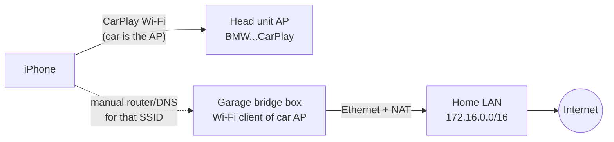

# bmw-f32-carplay-wan

Give the iPhone internet while it's on **wireless CarPlay** in the basement garage, where there's no LTE/GSM.

## The problem

Wireless CarPlay puts the iPhone's Wi-Fi on the car's own access point (`BMW<last 5 of VIN> CarPlay`-style SSID). That network hands out an address but **no router and no DNS**, so the phone keeps cellular as its internet path. Underground there's no cellular, so Google Maps can't search or route until you drive out.

## The key fact

If something on the CarPlay Wi-Fi offers a gateway, iOS uses that Wi-Fi for **both** CarPlay and internet ([Apple dev forum, BMW G30](https://developer.apple.com/forums/thread/76449)). Another owner set the router and DNS by hand on the phone: the "No Internet" warning went away and CarPlay kept working. So the car doesn't need to be modified. A box in the garage just has to join the car's Wi-Fi and route to the house.

## Approaches, ranked

| # | Approach | Cost | Touches car | Expected | Status |
|---|---|---|---|---|---|
| 0 | Offline maps (Google Maps offline area / Apple Maps offline) + start the route on home Wi-Fi before CarPlay connects | $0 | no | Works today for known places; search outside the area fails | to test |
| 1 | **Garage Wi-Fi bridge**: box joins the car's CarPlay SSID as a client, NATs to garage Ethernet; phone gets router/DNS for that SSID | ~$40–90 | no | Best bet | **main track** |
| 1b | iPhone (USB-C models) + USB Ethernet adapter, cabled to a small travel router in the car that's a client of the garage Wi-Fi. Wi-Fi stays on CarPlay; internet goes over Ethernet. No PSK needed | ~$50 | no | Should work; adds a cable to the phone | backup if the PSK can't be found |
| 2 | Cellular booster (donor antenna outside, indoor antenna in garage) | $400–1,000 | no | Works for everyone and every app | fallback |
| 3 | OBD-II ENET: talk to the ZGW/head unit over the diagnostic Ethernet and look for an IP path to the head unit's Wi-Fi | ENET cable ~$15 | read-only | Learning; a usable route is unlikely without rooting the head unit | exploration |
| 4 | Root the head unit (QNX) and NAT Wi-Fi ↔ ENET | time + risk | yes | Possible in theory, high risk of bricking | not planned |

## Plan

| Phase | Do | Proves |
|---|---|---|
| **P0** | iPhone: Settings → Wi-Fi → (i) on the car network: note IP, mask, router (expected empty), DNS, and whether **Password** can be revealed. Test offline maps in the garage | Car subnet, PSK source, the free option |
| **P1** | Mac in the garage, car on: scan the car AP (band, channel, security, BSSID) — `docs/test-log.md` has the commands | Box radio requirements (5 GHz? DFS?) |
| **P2** | **MacBook proof of concept**: Mac joins the car SSID with the PSK, USB-C Ethernet to the garage LAN, IP forwarding + pf NAT; phone's router/DNS for the car SSID = Mac | Second client allowed, no client isolation, CarPlay survives, Maps works |
| **P3** | Permanent box: OpenWrt travel router (e.g. GL.iNet) in WISP/client mode on the car SSID, Ethernet uplink, static IP on the car subnet, masquerade | Hands-off: car on → internet |
| **P4** | Exit test: drive out with the manual config in place; time the fallback to cellular | No dead zone when leaving |
| **P5** | OBD ENET exploration (`docs/obd-enet.md`) | What's reachable from the OBD port |

## Known

- **Head unit:** factory NBT EVO (wireless CarPlay).
- **Garage:** Ethernet, home Wi-Fi and power at the parking spot.

## Blocker: the CarPlay Wi-Fi password (PSK)

The iPhone doesn't show it (checked 2026-11-01), and the Mac's iCloud keychain has no car entry. Ways to get it, in order:

| # | Route | Notes |
|---|---|---|
| 1 | [Bimmerfest: "NBT EVO CarPlay WiFi password"](https://www.bimmerfest.com/threads/nbt-evo-carplay-wifi-password.1376809/) | Linked from the Apple thread as a working method. Paywalled for bots (HTTP 402), so open it in a browser |
| 2 | Encrypted Finder backup of the iPhone → decrypt its keychain | The phone has the PSK saved for the car network. Needs a backup decryptor (small Go tool); the CarPlay entry may be device-only and excluded |
| 3 | NBT EVO service menu ([BMW SIB B65 09 16](https://bmwtechinfo.bmwgroup.com/sib_attachments/B65%2009%2016%20Service%20Menu%20for%20NBT%20and%20NBT%20EVO%20Head%20Units.pdf)) | Look for a WLAN/CarPlay page. Read-only browsing |
| 4 | Approach 1b | Avoids the PSK entirely |

Still unknown: whether the car AP allows a second client, and whether it isolates clients (P2 answers both).

## Rules

- Never commit the car's PSK, VIN or keys. Put them in `secrets/` (gitignored).
- Car work is read-only unless a step says otherwise: no coding, no flashing.
- Log every test in `docs/test-log.md`: date, firmware, what was run, result.
