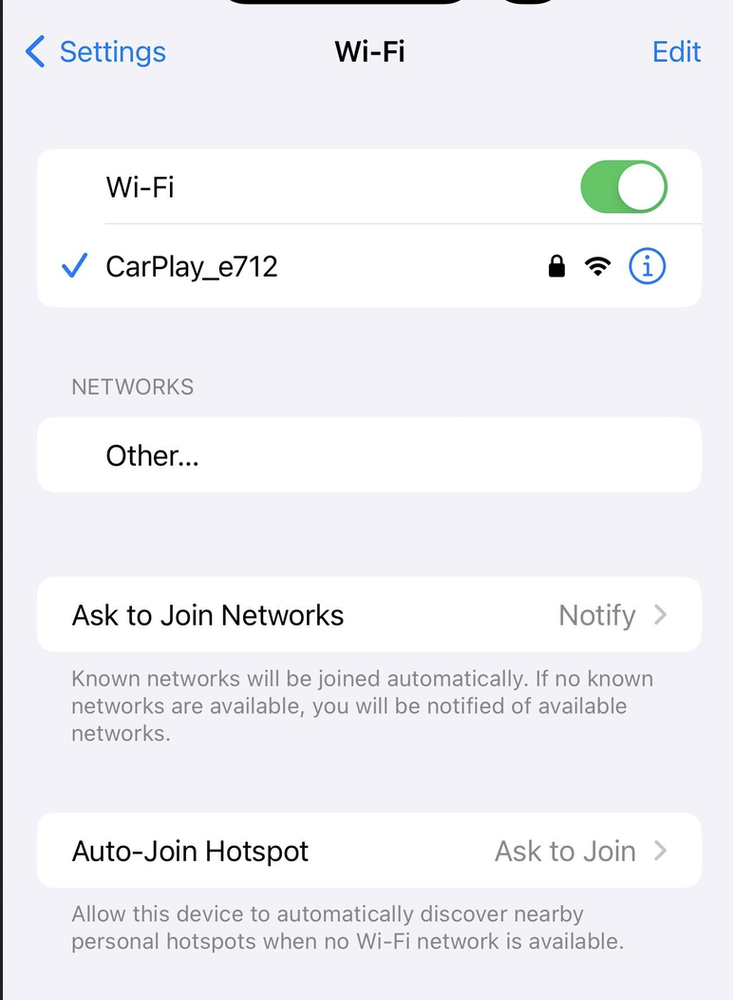
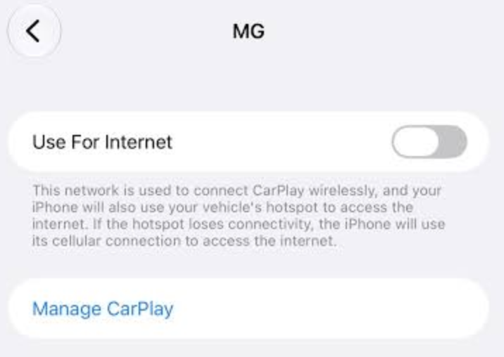
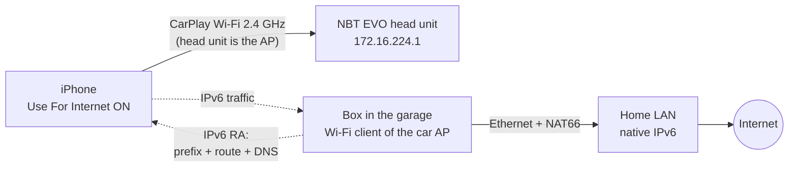

# internet-over-wireless-carplay

[](https://github.com/ParkWardRR/internet-over-wireless-carplay/releases)
[](https://go.dev/)
[](https://www.kernel.org/)
[](https://openwrt.org/)
[](https://developer.apple.com/ios/)
[](https://www.bmw.com/)
[](https://www.apple.com/ios/carplay/)
[](https://github.com/ParkWardRR/internet-over-wireless-carplay/blob/main/docs/status.md)

**Get internet on wireless CarPlay in a garage with no cell signal.**

Your car's wireless CarPlay runs its own little Wi-Fi network. It carries no internet — it is a cable replacement, not a hotspot. Normally you never notice, because your phone uses cellular for everything else. Park underground and that stops working: CarPlay still shows Maps, and a map you already downloaded still routes with no signal at all — but anything new fails. No search, no route through an area you haven't downloaded, no uncached tile.

This puts a small Linux box on that same car network and hands your phone a route out to a wired internet connection. The car is not modified. Your phone's IP settings are not changed. You tap one switch the first time.

## What you need

- A small Linux box — Raspberry Pi, Orange Pi, or similar.
- Wired Ethernet from that box to your internet.
- A 2.4 GHz USB Wi-Fi adapter that can run as a client. **One per car** — they can't be shared.
- An iPhone on **iOS 27 or newer**. The *Use For Internet* switch does not exist before that.
- The car's CarPlay Wi-Fi password.

## Set it up

**1. Get the CarPlay Wi-Fi password.**
On the iPhone: Settings → Wi-Fi → Edit → Known Networks → the car's network → Password. Face ID, then Copy. No jailbreak needed.

**2. Put it in `secrets/carplay.env`.** Copy `secrets.example.env` as a template:

```
CAR_SSID='BMW12345 CarPlay'
CAR_PSK='your-password-here'
```

**3. Install on the box:**

```sh
sudo scripts/carplay-box.sh install
```

The box now joins that car whenever it appears, and shares the wired connection automatically. For a one-shot test instead, run `scripts/poc-linux.sh up`.

**4. Start CarPlay in the car as usual.**

**5. On the phone, tap it once:** Settings → Wi-Fi → the car's network → **Check For Internet Access** → turn on **Use For Internet**.

**6. Open Maps on CarPlay.** Search and routing work with no cell signal.

For a permanent multi-car setup — one daemon per car, learned signal thresholds, clean handling of drive-offs — install `carplayd` instead of `carplay-box.sh`. See [docs/status.md](docs/status.md).

## About that tap

It is the one thing that catches everyone out, so it is worth being blunt about.

iOS gives a CarPlay network the lowest possible priority. It gets a limited route that background services use and **your apps ignore**. The box can be working perfectly and Maps will still fail. That is exactly what happened on one instrumented drive: 1.36 MB moved through the box and not one user-facing app touched it.

So you tap *Check For Internet Access*, then *Use For Internet*, and it works.

<p align="center">
  
  &nbsp;&nbsp;
  
</p>

**Left:** the car's CarPlay network in Settings → Wi-Fi. Tap the **ⓘ** beside it.
**Right:** the switch, with Apple's own wording — *"your iPhone will also use your vehicle's hotspot to access the internet. If the hotspot loses connectivity, the iPhone will use its cellular connection."*

That wording is worth reading carefully: iOS is describing **the car acting as a hotspot**, which on these head units it is not. What the box does is make the claim true.

These two screenshots are from other vehicles — an MG, and a head unit that names its network `CarPlay_e712` — not the BMWs this project was measured on. They are here because the screen is the same wherever you find it, and because they are evidence the switch is **not BMW-specific**. Everything else in this README is scoped to two NBT EVO head units; this is not.

**After that first tap, iOS mostly re-checks by itself.** Across sessions where the car was gone for 15–29 minutes, the phone came back on its own 4–24 seconds after the box started serving. Nobody taps that fast.

**But not always.** Two sessions in one morning never validated and moved zero bytes, and after a real car restart — engine off for 54 minutes — it needed the tap again. Treat the tap as required and the automatic re-check as a bonus.

The box tells you which state you are in rather than leaving you guessing. It logs `phone_unvalidated` with the fix in the message, and `validated` once the phone's traffic appears. `nft list counters` answers "did the tap land?" directly.

## Don't saturate it

The second thing that catches people out, and it is worse than the tap.

Your phone and the box are both clients of the car's AP, and the head unit **relays between them** — so every byte you download crosses the air twice, on the same channel, sharing it with CarPlay's own audio and screen. Push it hard and CarPlay suffers: audio stutters, and on this head unit a sustained saturation **dropped CarPlay entirely and needed a hard reset of the NBT EVO to pair again.**

Measured: unshaped, the round trip from box to phone reached **2051 ms** at three packets per second, and throughput collapsed to 1–4 kB/s.

So the box now caps its own traffic to the car. With `rate = 2mbit` the same load gave a **378 ms** worst case, 30–130 ms typically, and no disconnect. The cost is honest and you will notice it: **bulk downloads are capped at roughly 250 kB/s.** Set `rate = off` if you would rather have the speed and take the risk.

That is a mitigation, not a cure. Residual jitter remains, and the parts that cause it — your phone's Wi-Fi power save, the head unit's relay, CarPlay sharing one 2.4 GHz channel — are not ours to change.

## How much Wi-Fi is actually left after CarPlay

Measured from inside the car, not guessed. Every frame is converted to the microseconds it held the medium, because at 1×1 HT20 a frame at 1 Mbit/s costs roughly ten times the airtime of the same frame at MCS 7 — a byte counter calls a slow neighbour negligible when it is eating 5% of your channel.

| | Median | p95 |
|---|---|---|
| **CarPlay's own airtime** (phone + head unit) | **26.5%** | 38.0% |
| phone → head unit | 1,179 kB/s (9.4 Mbit/s) | 1,784 kB/s |
| Channel busy with CarPlay up | 37.1% | 46.5% |
| Channel busy with the car away (your neighbours) | 17.2% | 30.8% |
| **Headroom left, halved for the relay** | **20.4 Mbit/s** | 17.2 (p5) |

**But that headroom is not usable, and this is the important part.** The head unit's relay collapses at about 3.8 Mbit/s of our traffic — 60–87% packet loss, 2051 ms round trips, CarPlay dropped — while airtime is still largely free. **The bottleneck is the relay, not the air.** So the cap stays low on purpose: `rate_max` is 3 Mbit/s, chosen from the relay's breaking point, not from the 20 Mbit/s of idle channel.

Full method and caveats: **[docs/bandwidth.md](docs/bandwidth.md)**. The tool is `recon/airtime` — it runs in the car on battery with no network.

## Does it work?

Yes, on a real car, measured — most recently **44,327 packets / 6.2 MB** forwarded to a phone in a single day.

**Both cars are proven.** Each has been served on the current two-radio build, and on each, iOS validated the link — meaning apps could actually use it, not just background services.

On 2026-11-16 the F32 and the F22 were served simultaneously for **1 minute 53 seconds**: two routes up, a prefix each, a phone attached to each, on independent radios. Both sessions ended with the head units deauthenticating at −60 and −53 dBm, which is what they send when the car is switched off.

The evidence is not equally strong for both, and it is worth saying which is which. The F22 has validated **11 times** across three days. The F32 has validated **once**, on 2026-11-16, eleven seconds before that session ended — real, and thin.

What is still open is narrower again: **both cars validated at the same time.** In the 1m53s window where both were served, neither phone validated, so only background traffic moved (386 kB and 216 kB). Each car works; both working *simultaneously* has not been shown. Nor has a long session on the F32.

**NAT64 was quietly broken until 2026-11-16.** It is what lets the phone reach IPv4-only hosts over an IPv6-only path, and it only ever worked for three hardcoded addresses: the synthesised prefix sits inside `fc00::/7`, which the isolation rules reject, and the only exceptions were the named home hosts. So every IPv4-only *public* site was refused while DNS handed the phone a perfectly routable-looking address for it — Reddit, which has no native IPv6, is how it surfaced. Fixed by rejecting the synthesised form of each private IPv4 range and then permitting the rest. Deployed; **not yet confirmed by a phone**, so the box counts it (`nat64_public`) rather than assuming.

Full status, per car, with dates: **[docs/status.md](docs/status.md)**. Every test ever run: **[docs/test-log.md](docs/test-log.md)**.

---

# Technical detail

## How it works



The car hands out IPv4 with no router and no DNS, and sends no router advertisements of its own. So the box doesn't fight it: it leaves IPv4 alone and becomes the only IPv6 router on the link, advertising a ULA prefix, itself as the route, and a DNS server, then NATs out to the house. The phone picks that up with plain SLAAC. Nothing is configured on the phone beyond the one switch.

## What the box does

- **Serves whichever configured car turns up**, one daemon per radio, with an nftables table per car link that permits the internet and nothing else: not the box, not the home LAN, not the other car.
- **Leaves before the link dies, and says goodbye.** Departures here don't fade politely — the signal stays flat and then the link drops. So it leaves on the driver's `tx_failed` rate climbing, which buys about 8 seconds of warning where RSSI gives none. On a real drive: 3 leaves, 3 goodbye RAs, no stranded routes.
- **Learns its own thresholds.** Fixed dBm can't work here: the box sits behind a cinderblock wall where "parked" and "dying" overlap, and every number moves when a car parks differently or a radio is swapped. Each car's healthy band is learned at runtime, persisted, and re-learned when the world changes.
- **Recovers a deaf radio.** The AR9271 sometimes stops receiving while reporting itself healthy. A run of empty scans on a channel that always has neighbours means the radio, not the world, and it gets rebuilt without disturbing the other car.
- **Caps its own traffic to the car** so it cannot take CarPlay down with it (see above). HTB with a short queue, per car, off by default — or `rate = auto`, which tunes the cap from the p95 latency to the phone and learns it per car ([docs/bandwidth.md](docs/bandwidth.md)).
- **Reaches IPv4-only hosts** through DNS64 + NAT64: the public IPv4 internet, plus named private hosts by allowlist. Private ranges are rejected by range rather than by enumeration, so opening the internet did not open the home LAN.
- **Stops scanning on a channel it is already serving.** With a radio per car and both cars on channel 11, the idle radio was probing the live link's channel every second from an antenna inches away. It now backs off eightfold while a sibling serves — a backoff, not a halt, or a second car would never be found.
- **Records both sides of a drive.** `carrecon` runs in the car in monitor mode, so a departure can be reconstructed from the air rather than only from the box's point of view.

See [docs/findings.md](docs/findings.md) for what the measurements showed — including a leading hypothesis the data killed.

## Where this stands, per car

Measured on the box and the phone, not inferred.

| | F22 M240i (`car B`) | F32 (`car A`) |
|---|---|---|
| **Box joins the car's CarPlay Wi-Fi** | ✅ repeatedly, 2026-11-14, on its own USB radio | ✅ 2026-11-02/03, on the old shared radio |
| **Phone gets a route and real app traffic** | ✅ **44,327 packets / 6.2 MB forwarded**, 5 × `validated` | ✅ 2026-11-02, Maps search + routing on CarPlay |
| **On the current two-radio build** | ✅ in service, **validated 11×** over three days | ✅ served and **validated once** (2026-11-16), plus 1m53s alongside the F22 |
| **Clean departures (goodbye before the link dies)** | ✅ 3/3 on a real drive | ⚠️ an early departure stranded a route; fixed, re-tested on the F22 only |

> **Resolve cars by SSID, never by letter.** `carplayd.conf`'s `[car A]` is the F32 and `[car B]` is the F22. `secrets/carplay.env` uses the opposite convention.

## Key facts

| Fact | Source | Checked |
|---|---|---|
| **The CarPlay AP** (both cars): 2.4 GHz channel 11, HT20, one stream; beacon offers WPA + WPA2 with a **TKIP group cipher** (iOS calls it "Weak Security"); negotiated **WPA2-PSK / CCMP pairwise / TKIP group**, Wi-Fi 4. The 802.11u Interworking **Internet bit is clear**; no Apple Device IE | `iw` scan + carplayd on both cars | ✅ 2026-11-03, re-confirmed on the F22 2026-11-14 |
| DHCP gives 172.16.224.0/24 with **no router and no DNS**. Head unit is the AP at `172.16.224.1` and sends **no IPv6 RAs**. A **second client is allowed** and there is no client isolation, so the box can sit next to the phone | the box; [gearshifters](https://gearshifters.org/bmw/how-to-find-bmw-carplay-password/) copy of the Bimmerfest post; [Apple forum 76449](https://developer.apple.com/forums/thread/76449) | ✅ |
| Phone ↔ box traffic is **relayed by the head unit** (no TDLS), so the box's RSSI to the car is not the phone's path quality — and every forwarded byte crosses the air twice, competing with CarPlay's own stream. Saturating it reached **2051 ms** round trip and dropped the CarPlay session | measured | ✅ 2026-11-16 |
| `ath9k_htc` reports `tx_retries`, `tx_failed`, `tx_duration` and `rx_duration` as **always 0** — they are unimplemented. Judge the link by its MCS rate instead. `iw survey dump` returns nothing on it either | measured | ✅ 2026-11-16 |
| SSID digits are the last 5 of the VIN. The PSK is 10 random alphanumerics, delivered to the phone over Bluetooth, and **iOS 27 will show it** | the iPhone | ✅ 2026-11-02 |
| **iOS 27** hides IP settings on the CarPlay network page and offers **Check For Internet Access**; passing it reveals **Use For Internet**. Known Networks still has **Configure IP** | the iPhone; [betaprofiles notes](https://forum.betaprofiles.com/t/whats-new-in-ios-27-beta-3/23195?page=2); [DiPlay #393](https://github.com/shihabal3amri/DiPlay/issues/393) | ✅ |
| Why such a network carries no internet by default: configd gives a service ranked `Never` only a scoped default route, and *Use For Internet* lifts it. **Hypothesis from Apple's open source, not traced on the device.** Darwin asks for AAAA on a ULA-only network, so no public prefix is needed | configd, Libinfo, xnu ([iphone-diagnostics.md](docs/iphone-diagnostics.md#reading-the-probes)) | source only |
| **Prior art, Feb 2022, same head unit**: ksweber put a Teltonika LTE router on the CarPlay Wi-Fi at `.254` with the iPhone set to manual `.5` and got internet. We found no other public implementation, and none at all of the IPv6 / iOS 27 route | [Bimmerfest](https://www.bimmerfest.com/threads/nbt-evo-carplay-wifi-password.1376809/) (via `r.jina.ai`); ~30 searches in 4 languages | ✅ |
| Two kinds of wireless CarPlay car. **Wi-Fi pairing**: CarPlay rides the car's own hotspot, internet included. **Bluetooth pairing**: a private CarPlay-only network with none. The NBT EVO is the second kind, which is why this project exists | Audi TSBs [2021](https://static.nhtsa.gov/odi/tsbs/2021/MC-10189148-0001.pdf), [2024](https://static.nhtsa.gov/odi/tsbs/2024/MC-10250567-0001.pdf) | ✅ |
| The home LAN overlaps the car's 172.16.224.0/24. Harmless: the box NATs, and the scripts refuse to start unless they really got a car address | config | |

## Approaches considered

| # | Approach | Cost | Touches car | Status |
|---|---|---|---|---|
| **1** | **Box on the CarPlay Wi-Fi, IPv6 RA + RDNSS + NAT66 to Ethernet.** No phone IP settings; the route leaves with a goodbye RA, or expires on its own after an abrupt loss | a Linux SBC, or ~$70–90 travel router | no | ✅ **the one that works** |
| 0b | Manual IPv4: box at `.254` with NAT44, phone set to Configure IP → Manual | same box | no | proven by ksweber (2022); not needed, and a static router setting outlives the garage |
| 1b | USB-C Ethernet on the phone, cabled to a travel router | ~$50 | no | untested backup; needs no PSK |
| 0 | Offline maps ([Apple](https://support.apple.com/en-us/105084), [Google](https://support.google.com/maps/answer/6291838?hl=en&co=GENIE.Platform%3DiOS)) | $0 | no | works for known places, no live traffic |
| 2 | Cellular booster (weBoost ~$570, Cel-Fi GO ~$1,300) | $570–1,400 + install | no | fallback |
| 3 | OBD-II ENET recon ([obd-enet.md](docs/obd-enet.md)) | ~$15 | read-only | exploration |
| 4 | Root the head unit | time + risk | yes | not planned |

## Roadmap

The short version: **get both cars in the garage at once, and tap the switch on both phones.** Two cars served simultaneously is now done; what it did not show is either phone actually *using* the link while both were up. That drive also settles whether a phone really uses NAT64.

Full roadmap, acceptance criteria and open items: **[docs/status.md](docs/status.md)**.

## Documentation

The **[wiki](https://github.com/ParkWardRR/internet-over-wireless-carplay/wiki)** is the place to start: setup, how it works, what the car's network actually is, what CarPlay costs, troubleshooting by symptom, and what is still unproven. Its source is in `wiki/` and is published with `scripts/wiki-sync.sh`.

There is also a plain-language write-up of **[what was learned about wireless CarPlay](https://gist.github.com/ParkWardRR/0ac5011206022c1e42ef9c8ddf815e5a)** for people who want the findings without the implementation.

## Repo

| Path | What |
|---|---|
| [docs/status.md](docs/status.md) | Status, roadmap, open items, risks |
| [docs/findings.md](docs/findings.md) | What we learned and why it works |
| [docs/test-log.md](docs/test-log.md) | Every test, dated. The primary evidence |
| [docs/two-cars.md](docs/two-cars.md) | Two cars: scenarios, per-car prefixes, arbitration, simulator |
| [docs/usb-radios.md](docs/usb-radios.md) | One radio per car: two AR9271 dongles, stable naming, the traps |
| [docs/kernel-modules.md](docs/kernel-modules.md) | Building modules the vendor kernel left out (TUN, ath9k) |
| [docs/ipv4-options.md](docs/ipv4-options.md) | Reaching IPv4-only hosts: DNS64 + NAT64, and why a plain DNS relay can't work |
| [docs/bandwidth.md](docs/bandwidth.md) | What CarPlay needs, what is left for us, and the auto-rate controller — with the test to run on both cars |
| [docs/ap-signalling.md](docs/ap-signalling.md) | Could a beacon remove the *Use For Internet* tap? Staged, gated, unmeasured |
| [docs/ipv6-route.md](docs/ipv6-route.md) | The IPv6 design and the permanent-box recipe |
| [docs/fast-connect-plan.md](docs/fast-connect-plan.md) | Lab telemetry + fast connect/leave/reconnect (EnGenius OpenWrt) |
| [docs/emulator.md](docs/emulator.md), [docs/emulator-results.md](docs/emulator-results.md) | The box emulated in hwsim; stock vs carplayd numbers |
| [docs/iphone-diagnostics.md](docs/iphone-diagnostics.md) | rvictl capture, iOS logs, CarNet Probe |
| [docs/openwrt-box.md](docs/openwrt-box.md) | The OpenWrt replacement box |
| [docs/review-response.md](docs/review-response.md) | External reviews: findings, changes, evidence |
| `carplayd/` | The Go controller that runs in production |
| `carrecon/`, `tbeam/` | In-car recorder and the GPS/IMU beacon that timestamps a drive |
| `emu/` | Emulator: OpenWrt image, `emu.sh`, Go agent and harness |
| `recon/ieaudit/` | Decoder/validator for the Interworking and Apple Device elements |
| `wiki/`, `scripts/wiki-sync.sh` | Source of the GitHub wiki, and the publisher that refuses to push if the scrub check hits |
| `recon/airtime/` | Per-frame airtime accounting from inside the car: what CarPlay costs and what is left. `-report` analyses a run |
| `scripts/rate-trial.sh` | Steps a car link through rates and records loaded latency, drops and your audio verdict |
| `test-ap/`, `scripts/ap-signal-test.sh` | Controlled hostapd AP for the signalling experiment |
| `ios/CarNetProbe` | iPhone diagnostics app |
| `scripts/poc-linux.sh` | The one-shot setup on Linux (`ie`, `up`, `capture`, `status`, `down`) |
| `scripts/carplay-box.sh` | Hands-off mode (`install`, `status`, `uninstall`) |
| `scripts/poc-mac-nat.sh` | The same on a Mac (rtadvd + pf) |

## Rules

- **Never commit** a car's PSK, VIN, SSID digits (they are the end of the VIN), MACs or keys. They go in `secrets/`, which is gitignored — captures included. A pre-commit hook blocks the known values; it has caught a real one twice.
- **Scanning your own refs is not enough.** This repo published unscrubbed history twice: once in the tree, and once because a rewrite force-pushed `main` but left two release tags pointing into the old history. Check what the *remote* serves.
- **Car work is read-only** unless a step says otherwise. No coding, no flashing.
- **Log every test** in [docs/test-log.md](docs/test-log.md): date, what ran, what happened, what changed as a result. A claim with no row is not a result.
- **Label every claim** measured / source / emulator / inferred. The emulator is a Linux stand-in, not an iPhone; it can't tell you anything about iOS policy.
