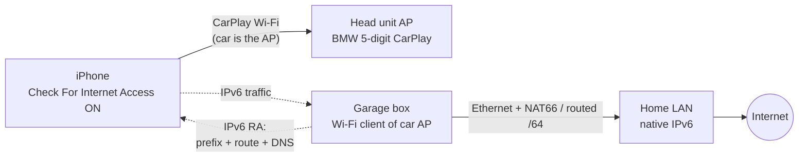

# bmw-f32-carplay-wan

Give the iPhone internet while it's on **wireless CarPlay** in the basement garage, where there's no LTE/GSM.

## The problem

Wireless CarPlay puts the iPhone's Wi-Fi on the car's own access point (`BMW<5 digits> CarPlay`). That network hands out an address but no router and no DNS, so the phone keeps cellular as its internet path. Underground there's no cellular, so Google Maps can't search or route until you drive out.

## The key facts

| Fact | Source | Checked |
|---|---|---|
| Car DHCP gives the phone an address in **172.16.224.0/24** (typically `.100`) and **no default gateway**. The car's LTE hotspot (if fitted) hands out 172.16.222.x and can't reach the CarPlay network | Bimmerfest poster, copied at [gearshifters](https://gearshifters.org/bmw/how-to-find-bmw-carplay-password/); BMW 540 owner, [Apple forum 76449](https://developer.apple.com/forums/thread/76449) (2017: "no router IP and no DNS entries") | ✅ 2026-11-01 |
| **A second client works**: a laptop on the CarPlay Wi-Fi pinged the iPhone (no client isolation) | same gearshifters copy | ✅ |
| SSID digits = last 5 of the VIN. PSK = 10 random alphanumerics, sent to the phone over Bluetooth at pairing (read out on a jailbroken phone back then) | same | ✅ |
| **Manual router on the CarPlay network works**: setting Router/DNS on the phone removed "No Internet" and CarPlay kept running (BMW, 2017). In 2022 another owner ran an LTE router in station mode on the CarPlay Wi-Fi and got internet through it | [Apple forum 76449](https://developer.apple.com/forums/thread/76449) | ✅ (thread text); the `.254`/`.5` addresses below come from Bimmerfest and couldn't be re-read |
| iOS showed **Configure IP → Manual** on a car's CarPlay Wi-Fi as late as March 2025 (Mercedes MBUX) | [Apple Community 255998108](https://discussions.apple.com/thread/255998108) | ✅ |
| This iPhone's CarPlay network page has **no IP/router/DNS settings**, only a **Check For Internet Access** toggle ("If your car offers hotspot internet access… you may be able to use that hotspot") | the iPhone | 2026-11-01 |
| The head unit announces internet availability to the iPhone in its Wi-Fi beacon (Apple Device IE). A box on the network can't change that | [WWDC17 session 717](https://developer.apple.com/videos/play/wwdc2017/717/) | ✅ |
| iPhones do use a car's CarPlay Wi-Fi for internet when the car offers it (Audi MIB2+/MIB3) | [Audi TSB 2062466/1, 2021](https://static.nhtsa.gov/odi/tsbs/2021/MC-10189148-0001.pdf) | ✅ |
| iOS labels the car network **Weak Security**: WPA/WPA2 mixed or TKIP. The box must allow it | the iPhone | 2026-11-01 |
| Home LAN is 172.16.0.0/16, which overlaps the car's 172.16.224.0/24. Nothing at home uses .224.x and the box NATs, so it's harmless (the PoC script refuses to start unless it's really on .224.x) | Kea config | |
| Home has native IPv6 (Spectrum); Google Maps APIs answer over IPv6 | AAAA lookups | ✅ 2026-11-01 |

The [Bimmerfest thread](https://www.bimmerfest.com/threads/nbt-evo-carplay-wifi-password.1376809/) is the original source but sits behind a bot wall (no archive copy); read it in a browser for the 2022 router details and whether a later post says where iOS reveals the PSK.

If iOS still exposes IP settings for the CarPlay network somewhere (Settings → Wi-Fi → **Edit** → the network's ⓘ), the manual-IPv4 setup is enough. If not, the route has to come from the network. **Plan: IPv6 router advertisements.** A box on the car Wi-Fi advertises an IPv6 prefix, a default route and DNS (RDNSS), and NAT66es (or routes) to the home connection. The car's IPv4 is left alone, so there's no DHCP fight. With Check For Internet Access on, iOS should probe the network, find internet, and use it. IPv4 options that work with the car instead of racing its DHCP: [docs/ipv4-options.md](docs/ipv4-options.md). **Design, reachability table and the permanent-box recipe: [docs/ipv6-route.md](docs/ipv6-route.md).**

## Biggest risk

The car tells the iPhone "no internet here" in every beacon, and that's what makes the phone keep cellular. Everything hinges on **Check For Internet Access** making iOS probe the network (`captive.apple.com`, which has an AAAA record) and believe the result. Nobody has documented what the toggle does. P2 answers it in an afternoon with a laptop, so nothing gets bought before then.

## Approaches, ranked

| # | Approach | Cost | Touches car | Expected | Status |
|---|---|---|---|---|---|
| 0 | Offline maps (Google Maps offline area / Apple Maps offline) + start the route on home Wi-Fi before CarPlay connects | $0 | no | Works today for known places; search outside the area fails | to test |
| 0b | Manual IPv4 on the iPhone, if **Edit → Known Networks** still shows Configure IP for the CarPlay network: IP `172.16.224.5`, router + DNS `.254` (the box) | $0 + the box | no | Proven 2017–2022 | check in P0 |
| 1 | **Garage Wi-Fi bridge**: box joins the car's CarPlay SSID as a client, advertises an IPv6 route + DNS, NAT66 or a routed /64 to garage Ethernet | ~$70–90 | no | Best bet if iOS accepts it | **main track** |
| 1b | iPhone + wired Ethernet (USB-C adapter, or Lightning→USB 3 Camera Adapter + USB Ethernet), cabled to a small travel router in the car that's a client of the garage Wi-Fi. Wi-Fi stays on CarPlay; iOS should prefer the wired route (to test). No PSK, no car-network tricks | ~$50 | no | Should work; adds a cable to the phone | backup |
| 2 | Cellular booster (donor antenna outside, indoor antenna in garage) | $400–1,000 | no | Works for everyone and every app | fallback |
| 3 | OBD-II ENET: talk to the ZGW/head unit over the diagnostic Ethernet and look for an IP path to the head unit's Wi-Fi | ENET cable ~$15 | read-only | Learning; a usable route is unlikely without rooting the head unit | exploration |
| 4 | Root the head unit (QNX) and NAT Wi-Fi ↔ ENET | time + risk | yes | Possible in theory, high risk of bricking | not planned |

## Plan

| Phase | Do | Proves |
|---|---|---|
| **P0** | ✅ CarPlay network page checked (no IP settings, Weak Security, toggle exists). ☐ Settings → Wi-Fi → **Edit** → CarPlay network ⓘ: password? Configure IP? ☐ Passwords app → Wi-Fi. ☐ Turn **Check For Internet Access** on. ☐ Offline maps in the garage | The free options, and the PSK |
| **P1** | Mac in the garage, car on: scan the car AP (band, channel, security). Commands in [docs/test-log.md](docs/test-log.md) | Box radio requirements (5 GHz? DFS? TKIP?) |
| **P2** | **MacBook proof of concept**. First a passive capture (does the head unit send RAs? what's its address?), then `sudo scripts/poc-mac-nat.sh up`: the Mac joins the car SSID, runs `rtadvd` (ULA /64, 60 s router lifetime, RDNSS) and NAT66 out of USB-C Ethernet. If the iPhone takes the address but stays offline, rerun with `PREFIX6=` a routed public /64 | Second client allowed, iOS takes the IPv6 route, the toggle's effect, CarPlay survives, Maps works |
| **P3** | Permanent box: GL.iNet GL-MT3000 on vanilla OpenWrt as a Wi-Fi client of the car SSID, odhcpd RA + RDNSS + PREF64, routed /64 from OPNsense, DNS64 + NAT64 | Hands-off: car on → internet |
| **P4** | Exit test: drive out; the 60 s router lifetime should hand the phone back to cellular within a minute | No dead zone when leaving |
| **P5** | OBD ENET exploration ([docs/obd-enet.md](docs/obd-enet.md)) | What's reachable from the OBD port |

Car: factory NBT EVO (wireless CarPlay only). Garage: Ethernet, home Wi-Fi and power at the parking spot.

## Blocker: the CarPlay Wi-Fi password (PSK)

The box (and the Mac in P2) has to join the car's Wi-Fi, so it needs the PSK. Where to look, in order:

| # | Route | Notes |
|---|---|---|
| 1 | Settings → Wi-Fi → **Edit** → Known Networks → ⓘ next to `BMW… CarPlay` → Password | Apple's documented path for saved networks ([104961](https://support.apple.com/en-us/104961)). Unknown whether CarPlay-provisioned networks are listed. May also show Configure IP |
| 2 | **Passwords app → Wi-Fi** | iOS 18+. Same unknown |
| 3 | Encrypted Finder backup of the iPhone → decrypt its keychain | Needs a backup decryptor (small Go tool) |
| 4 | Approach 1b | Avoids the PSK entirely |

Not on the Mac: this Mac's keychain and preferred-network list have no CarPlay network (checked 2026-11-01), so iCloud Keychain doesn't sync it. Brute force is out: 62^10 keyspace.

## Rules

- Never commit the car's PSK, VIN, SSID digits (they're the end of the VIN) or keys. Put them in `secrets/` (gitignored), captures included.
- Car work is read-only unless a step says otherwise: no coding, no flashing.
- Log every test in [docs/test-log.md](docs/test-log.md): date, firmware, what was run, result.
