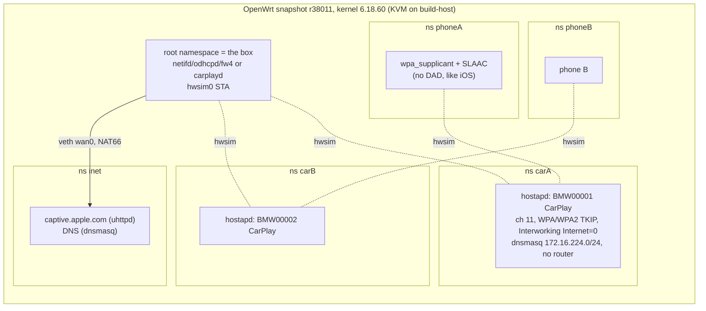

# The emulator: the box's firmware, two cars and phones on build-host

The EWS377AP's hardware (IPQ8072A, ath11k) can't be emulated: QEMU has no model for either. Its **software stack** can, and the stack is what decides how fast and how reliably the box serves a car: netifd, wpa_supplicant/hostapd, the ucode wifi-scripts, odhcpd, fw4, ubus, and now carplayd. The emulator runs that stack, on the same OpenWrt revision and kernel series as the [EWS377 fork](https://github.com/ParkWardRR/openwrt-engenius-ews377ap-ecw230-ews377fit), against simulated cars and phones on virtual Wi-Fi radios.



## What's real and what's simulated

| Real (the same code as on the box) | Simulated |
|---|---|
| OpenWrt snapshot userspace: netifd, wpad-openssl 2.12, odhcpd, fw4/nftables, ubus, ucode wifi-scripts, `scripts/openwrt-carplay.sh`, carplayd | The radio (mac80211_hwsim instead of ath11k): no RF timing, no firmware quirks, scans are near-instant |
| Kernel 6.18 networking: SLAAC, NDP, routing, NAT66 masquerade | The car: hostapd copying the F32's measured AP (2.4 GHz ch 11, WPA+WPA2 TKIP group, Interworking Internet=0, DHCP without a router). Not the NBT EVO's own software |
| WPA/WPA2 mixed handshake (`PTK=CCMP GTK=TKIP`, same as the real F32) | The phone: Linux wpa_supplicant + kernel SLAAC with DAD off (iOS uses "DAD with no delay"). **iOS's internet check and "Use For Internet" are not emulated** |
| | Distance: hwsim `rx_rssi` sets how strongly a car is heard (fades); the hwsim `group` bitmask makes a car vanish from the box while its phone stays connected (drive-out) |

So emulator numbers are good for **comparing configurations and code** (stock vs scan_list vs carplayd), finding bugs and regressions, and testing two-car logic. Absolute RF timings come from the real car: garage-sbc, then the EWS377.

## Running it (on build-host, in `~/builds/<checkout>`)

```sh
emu/run.sh build                          # go test carplayd; build carplayd (amd64+arm64), emuagent; bake the image
emu/run.sh boot                           # VM up in ~6 s, SSH on 127.0.0.1:2290
emu/run.sh ssh '/root/carplay/emu.sh setup'
emu/run.sh test -box stock -n 5           # every scenario, a fresh VM per repetition
emu/run.sh test -box carplayd -n 5 -scenarios fade-out,two-cars
emu/run.sh console '<cmd>'                # serial console, works when the VM network is broken
emu/run.sh stop
```

Two checkouts can run at once: `EMU_NAME=… EMU_SSH_PORT=…`. Results: `emu/out/results/<stamp>-<box>.{md,json,log}`.

In the VM, `emu.sh` drives everything:

| Command | Does |
|---|---|
| `setup` | namespaces, radios, fake internet, box `wan` |
| `box-apply A` | stock box: `openwrt-carplay.sh` (netifd + odhcpd). `SCAN_LIST=2462` adds the channel list |
| `box-carplayd A [B]` | carplayd box: netifd off the radio, fw4 zone + masq6, carplayd with both cars |
| `car A on\|off`, `car A signal -80`, `car A range out\|in` | car start/stop, fade, drive-out/return |
| `phone A join\|leave\|check` | phone joins (channel known, like an iPhone), internet check via captive.apple.com |
| `wait box-assoc\|box-disassoc\|phone-assoc A\|phone-route A\|phone-noroute A` | emuagent (Go) polls every 20 ms, stamps ms |

## Scenarios

`emu/run.sh test -list`:

| Scenario | Boxes | What |
|---|---|---|
| detect | both | box hunting, car starts (random phase): join, phone route, internet |
| detect-scanlist | stock | same with `scan_list = 2462` |
| box-late | both | phone joined first (its 3 RS spent), then the box: first-RA timing |
| drive-out | both | car leaves the box's range abruptly; phone stays in the cabin |
| return | both | car back in range |
| cycle | both | car off/on ×5 |
| fade-out | carplayd | signal falls 3 dB/s: leave + goodbye before the link is lost |
| fade-return | carplayd | signal back 3 dB/s: rejoin only above the rejoin threshold |
| two-cars | carplayd | A served, drives out; B starts: B served with its own prefix |
| both-on | carplayd | both start together: priority picks A |

Results and their interpretation: [emulator-results.md](emulator-results.md).
