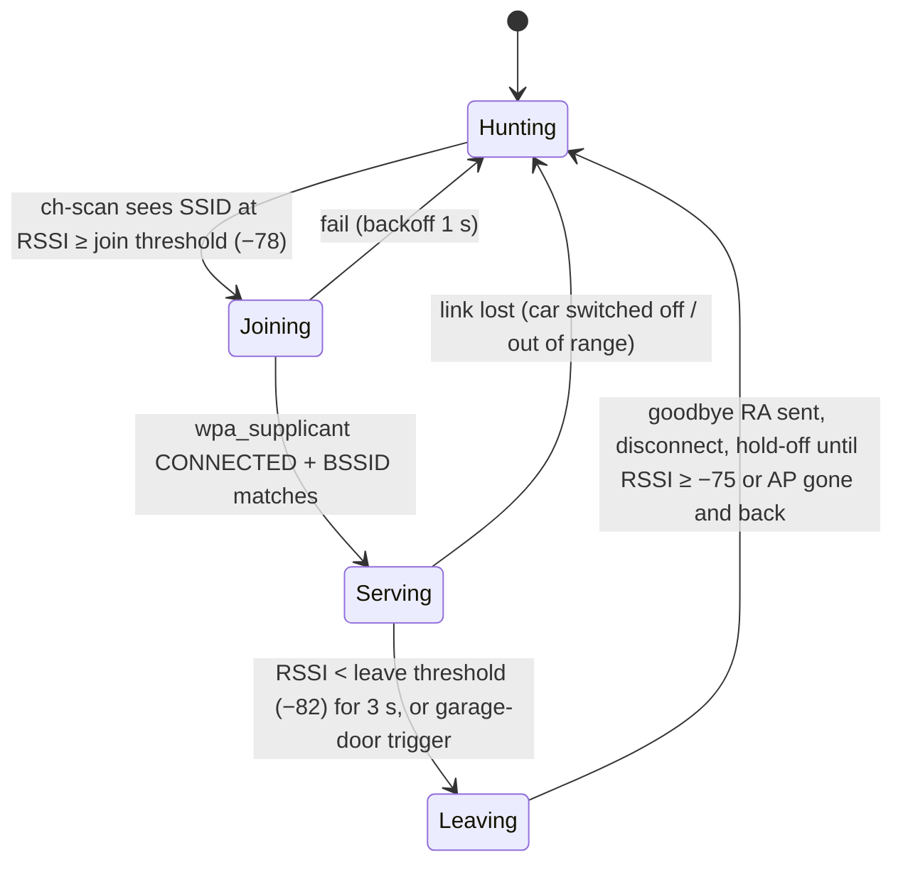

# Plan: lab telemetry, then fast connect / disconnect / reconnect

Two-car design and the controller (`carplayd`): [two-cars.md](two-cars.md).

P2 proved the route ([findings.md](findings.md)). This plan covers the next two phases:

- **Lab / testing.** Poll the car often and capture everything, to build an exact timeline of what happens and where the seconds go.
- **Functional / production.** Pick up either car (or both) **very quickly** when it starts. Let go cleanly when it leaves. Pick it up again just as fast when it returns.

Target hardware: an **EnGenius EWS377AP v3** running [ParkWardRR/openwrt-engenius-ews377ap-ecw230-ews377fit](https://github.com/ParkWardRR/openwrt-engenius-ews377ap-ecw230-ews377fit) (IPQ8072A, ath11k 4×4 dual-band, one 2.5 GbE port, NSS offload, kernel 6.18). garage-sbc (Banana Pi, brcmfmac) stays as the lab probe and interim box.

## Where the time goes

```mermaid
sequenceDiagram
  participant Car as Head unit (AP)
  participant Box as Garage box (STA)
  participant Ph as iPhone
  Note over Car: ignition on
  Car->>Car: boot, AP beacons start (T_ap)
  Box->>Car: targeted ch-11 scan finds it (T_seen)
  Box->>Car: auth + assoc + 4-way (T_assoc)
  Box-->>Ph: RA (kick on connect)
  Car->>Ph: CarPlay over Bluetooth, then phone joins AP (T_phone)
  Ph->>Box: Router Solicitation
  Box->>Ph: RA (route + RDNSS) (T_ra)
  Ph->>Ph: SLAAC + DAD, iOS internet check (T_check)
  Ph->>Box: first NAT66 flow (T_flow)
  Note over Car,Ph: ... drive out ...
  Box->>Box: RSSI falls below leave threshold (T_leave)
  Box-->>Ph: goodbye RA, router lifetime 0 (T_bye)
  Ph->>Ph: back to cellular (T_cell)
```

The goal is **box associated before the phone joins** (`T_assoc < T_phone`), so the phone's own Router Solicitation gets an answer immediately and `T_flow − T_phone` is just SLAAC plus iOS's check. Nothing the box does can speed up `T_ap` (head-unit boot) or `T_phone` (CarPlay's Bluetooth handshake), but the lab phase measures them.

### Targets

| Interval | Today (interim box) | Target |
|---|---|---|
| `T_seen − T_ap` (detect) | up to **120 s** (NetworkManager's idle scan backoff, below) | **≤ 1.5 s** |
| `T_assoc − T_seen` | ~0.3–2 s + DHCP wait | ≤ 0.5 s, no DHCP wait |
| `T_ra − max(T_assoc, T_phone)` | up to 16 s (radvd initial RA spacing) | ≤ 0.1 s (answer to RS) / ≤ 4 s worst |
| `T_flow − T_phone` | unmeasured | ≤ 5 s |
| `T_cell − T_leave` (exit) | up to 60 s (router lifetime) | ≤ 2 s (goodbye RA before link loss) |
| Reconnect on return | same as detect | same as detect, with hysteresis |

## What the research and measurements say

| Fact | Source | Status |
|---|---|---|
| A **channel-11-only scan for the car's SSID takes 131–156 ms**; a full scan takes 3.9 s (garage-sbc, brcmfmac) | measured 2026-11-03 | ✅ measured |
| NetworkManager 1.42 rescans while disconnected at `SCAN_INTERVAL_SEC_MIN 3`, `STEP 20`, `MAX 120`: once idle, a car can sit unnoticed for up to two minutes | [nm-device-wifi.c (nm-1-42)](https://gitlab.freedesktop.org/NetworkManager/NetworkManager/-/blob/nm-1-42/src/core/devices/wifi/nm-device-wifi.c) | ✅ source |
| garage-sbc's Wi-Fi: **no scheduled scan / PNO** (`max # sched scan SSIDs: 0`), **no monitor mode**; up to 4 managed vifs on **2 channels** | `iw phy` on garage-sbc | ✅ measured |
| ath11k on **IPQ8074 (= IPQ8072A)**: `support_dual_stations = false` → **one STA per radio**, one channel per radio; monitor mode supported alongside other vifs on the same channel | Linux `ath11k/core.c`, `mac.c` | ✅ source |
| ath11k sched scan / PNO only if the firmware advertises `WMI_TLV_SERVICE_NLO`; AP firmware on IPQ807x is not expected to | `ath11k/mac.c` | check on the box: `iw phy \| grep sched` |
| ath11k scan dwell defaults: active 50 ms, passive 150 ms per channel | `ath11k/wmi.c` (research agent) | source, not re-checked |
| OpenWrt STA options: `bssid`, `scan_list` (→ wpa_supplicant `freq_list`); **no `bgscan`, no `autoscan`** in `supplicant.uc` | [supplicant.uc](https://github.com/openwrt/openwrt/blob/main/package/network/config/wifi-scripts/files-ucode/usr/share/ucode/wifi/supplicant.uc) | ✅ source |
| wpa_supplicant `autoscan=periodic:N` (disconnected only) and per-network `scan_freq` exist; **Debian 12's build has autoscan/bgscan, OpenWrt's wpad builds (mini/basic/full) don't**, but **OpenWrt already patches the disconnected rescan interval to 1 s** (`310-rescan_immediately.patch`: `scan_interval = 5` → `1`) | hostap `wpa_supplicant.conf`; garage-sbc binary; [OpenWrt hostapd package](https://github.com/openwrt/openwrt/tree/main/package/network/services/hostapd) | ✅ source |
| radvd: `MinRtrAdvInterval` ≥ 3 s, `MaxRtrAdvInterval` ≥ 4 s, `MinDelayBetweenRAs` (solicited RAs) configurable; initial RAs ≤ 16 s apart | `radvd.conf(5)` on garage-sbc | ✅ |
| iPhone sends up to 3 Router Solicitations, 4 s apart, on join (RFC 4861) | RFC 4861 | ✅ |
| NSS offload accelerates routing/NAT throughput, **not** scanning or association. NSS ECM refuses IPv6 NAT flows (`ecm_ported_ipv6.c`), so NAT66 stays on the CPU, which is fine at Maps scale. ath11k NSS offload does support STA (TKIP mapped); monitor vifs aren't offloaded | research agent, source pins in [two-cars.md](two-cars.md) context | agent-fetched, not re-checked |
| NetworkManager: a channel lock only **filters** candidates (`freq_list`), it doesn't narrow scans; a BSSID lock turns off bgscan; manual rescans are throttled to one per 1.5 s; a profile is blocked 300 s after 4 failed autoconnects unless `autoconnect-retries 0` | NM 1.42 source (research agent) | agent-fetched |
| Kernel DAD on the box's link-local delays the first RA by 1–2 s: odhcpd won't send until the link-local isn't tentative (and has a fixed 1 s first-RA timer); radvd retries a failed setup after **10 × MaxRtrAdvInterval**. `accept_dad=0` on the STA avoids both | odhcpd `router.c`, radvd source (research agents) | agent-fetched |
| The iPhone sends its 3 RS only when *its* link comes up; it doesn't re-solicit when the box joins later. So the unsolicited RA interval bounds the late-box case | Apple IPConfiguration `rtadv.c` (macOS source; iOS assumed same) | agent-fetched |
| wpa_supplicant bans a network 10→20→30→60…300 s after auth failures; `ENABLE_NETWORK`/`SELECT_NETWORK` clears it | hostap `wpa_supplicant.c` | agent-fetched |
| On OpenWrt, any AP on the same radio is taken down while the STA hunts | `wpa_supplicant.uc` | agent-fetched |

**Conclusion: no hardware accelerator makes the car show up faster.** Speed comes from:
1. scanning only channel 11 for the car's SSID, every second (cheap: ~150 ms);
2. connecting on the wpa_supplicant event, not after DHCP;
3. having the RA ready the instant the link comes up;
4. tracking signal to leave cleanly.

NSS and flow offloading are irrelevant at Maps-scale traffic. Leave NSS Wi-Fi offload **off** on the STA interface unless a test shows it's harmless.

## Phase L: lab / testing

Run on garage-sbc now and on the EnGenius when it's flashed. Both boxes keep the same clock (chrony / sysntpd to the same server), so their timelines merge with the phone's.

### What to collect

| Stream | How | Cadence | Where |
|---|---|---|---|
| Car presence + signal (per SSID) | targeted scan `iw dev wlan0 scan freq <ch> ssid <car>` while disconnected; `iw dev wlan0 station dump` while connected | every 1 s | `events.jsonl` + Prometheus |
| STA state changes | wpa_supplicant events (`wpa_cli -a` action script / ubus `wpa_supplicant.<if>`), `iw event -t -f` | event-driven | `events.jsonl` |
| Link quality | signal, tx/rx bitrate, retries, failures, beacon loss | 1 s | Prometheus textfile collector (node_exporter already runs on garage-sbc) |
| RS/RA, DHCP, mDNS on the car network | `tcpdump` ring buffer on `wlan0`: `icmp6 or port 67 or 68 or 5353` full; everything else headers only (`-s 128`) | always on, rotate 5 min × 288 | `captures/` |
| iPhone neighbours + SLAAC address | `ip monitor neigh` | event-driven | `events.jsonl` |
| NAT flows | `conntrack -E` (install `conntrack`) | event-driven | `events.jsonl` (first flow, counts) |
| 802.11 frames (beacons, probes, auth/assoc, deauth, the phone's join) | **monitor mode**: EnGenius 2.4 GHz radio as an extra monitor vif on ch 11 (ath11k allows it on the STA's channel); garage-sbc can't, so add a USB **AR9271** (ath9k_htc, 2.4 GHz, ~$15) | always on in lab | `captures/` (radiotap: signal per frame) |
| Phone side | CarNet Probe **Watch** (bound / Wi-Fi-only / default internet check every 10 s), optional `rvictl` + `log collect` | per session | `secrets/` |

Event schema (one JSON object per line): `{"t":"<RFC3339 ms>","mono":<s>,"src":"box|phone","car":"A|B","ev":"ap_seen|assoc|disassoc|lease|ra_sent|rs_rx|phone_neigh|nat_first|leave_trigger|bye_ra|...","rssi":-71,...}`. One script per box (`scripts/carplay-lab.sh`, to write) runs the pollers and writes the JSONL plus a `.prom` file every 5 s.

### Experiments

| # | Experiment | Measures |
|---|---|---|
| L1 | Cold start ×10 (car off ≥ 30 min, then on) | `T_ap`, `T_phone`, every interval in the table above |
| L2 | Does iOS remember **Use For Internet** across car restarts and days? | prompt needed or not; `T_check` |
| L3 | RA tuning: radvd 6–20 s vs 3–4 s vs kick-on-connect | `T_ra`, `T_flow` |
| L4 | Drive-out ×10: with and without goodbye RA; RSSI vs distance log | `T_leave`, `T_cell`, Maps gap |
| L5 | Return ×10 (car on, driving in) | detect at what RSSI, reconnect time |
| L6 | Placement map: RSSI at 3–4 mounting spots, car doors closed | pick the EnGenius spot |
| L7 | Car B: P1 scan (band, channel, security, beacon), then L1 | second car's parameters |
| L8 | Both cars on at once | which one wins; two-STA options |
| L9 | NSS offload on vs off on the EnGenius STA | traffic works, CPU, flows |
| L10 | Phone locked / screen off / Low Power Mode | RS/RA behaviour, `T_flow` |

## Phase P: functional / production

### State machine (per car)



**Hysteresis** (join −78, leave −82, rejoin only above −75 or after the AP disappears) stops flapping at the garage door. Tune the thresholds from L4/L5/L6.

### Tricks, in order of payoff

| # | Trick | SBC (Debian, NM) | EnGenius (OpenWrt) | Saves |
|---|---|---|---|---|
| 1 | **Fast targeted scan while disconnected**: only the car's channel, only its SSID, every 1 s | own poller (`iw … scan freq 2462 ssid …`) → join; or take `wlan0` from NM and run wpa_supplicant with `autoscan=periodic:1`, `disable_scan_offload=1`, per-car `scan_freq` (NM's channel lock doesn't narrow scans) | already rescans every 1 s (OpenWrt patch); add `scan_list '<car channels>'` on the 2.4 GHz radio so each scan is one or two channels (~100 ms) | up to 120 s → ≤ 1.5 s |
| 2 | **Lock the car**: BSSID + channel | `802-11-wireless.bssid`, `.channel 11`, `.band bg` | `option bssid '<car AP MAC>'` | candidate selection, ~0.1 s |
| 3 | **Act on CONNECTED, not on DHCP** | static `172.16.224.254/24` + ULA on the connection, BSSID as the "is this the car" guard; DHCP lease optional | ULA + `.254` on a static alias; react to the ubus `wpa_supplicant.<if>` state event | 1–3 s |
| 4 | **RA ready at link-up, answer RS at once** | carplayd sends the RA itself on CONNECTED, then every 3–4 s; `accept_dad=0` on the STA. (radvd fallback: `IgnoreIfMissing on`, `MinRtrAdvInterval 3; MaxRtrAdvInterval 4`, reload on connect) | carplayd as on the SBC; or odhcpd `ra_default 1`, `ra_mininterval 3`, `ra_maxinterval 4`, `accept_dad=0` | ≤ 16 s → ≤ 0.1–4 s |
| 5 | **Power save off** on the STA | `iw dev wlan0 set power_save off` (NM already sets `wifi.powersave=2` when connected) | `iw dev <sta> set power_save off` from the CONNECTED hook (no UCI option assumed) | tens to hundreds of ms per RS/RA |
| 6 | **Leave cleanly**: RSSI below threshold → goodbye RA (router lifetime 0) while still associated, then disconnect | carplayd `SIGNAL_POLL` 1 s, per-car goodbye | `ubus call wpa_supplicant.<sta> control '{"command":"SIGNAL_MONITOR THRESHOLD=-82 HYSTERESIS=4"}'` (ath11k uses software CQM from beacons; works because OpenWrt has no bgscan) or carplayd `SIGNAL_POLL` | 60 s → ≤ 2 s |
| 7 | **Precomputed PSK** (`psk=<64 hex>`) | wpa_supplicant config | `option key` with 64-hex | ~10 ms |
| 8 | **Watchdog**: N failed joins in a row → bounce the radio | systemd timer | procd/cron | recovery from driver stalls |

### Two cars

- Configure **both** networks with their own channel and BSSID.
- **One car at a time** works with a single 2.4 GHz STA: hunt on both channels (two ~150 ms scans per second) and join whichever appears.
- **Both cars on at once** needs two STAs:
  - The IPQ8072A allows **one STA per radio**, and its other radio is 5 GHz, which these cars don't use.
  - Options: the EnGenius serves one car and garage-sbc the other. garage-sbc's brcmfmac allows 2 channels and 4 managed vifs, so it might even serve both. Or add a USB 2.4 GHz adapter to a box that has USB.
  - L8 decides.
- The RA prefix can be shared (`fd5c:ba1e:f32:1::/64` on both car networks). Each car network is a separate link, so there's no conflict.

### EnGenius specifics

- **Single 2.5 GbE port:** it is both the garage-LAN uplink (`wan`, NAT66 out) and management. PoE-powered, ceiling/wall mount near the parking spot.
- **Radios:** 2.4 GHz radio = car STA, plus a monitor vif on ch 11 in the lab. 5 GHz radio = optional management AP, or off.
- **Build:** stock `wpad` is fine (1 s rescan built in; autoscan/bgscan aren't needed). Add `conntrack`, `tcpdump`, `iw-full` for the lab image, plus carplayd (static arm64 binary).
- **Config:** start from `scripts/openwrt-carplay.sh` ([openwrt-box.md](openwrt-box.md)). Extend it with `scan_list`, `bssid`, `powersave`, the RA intervals, and a `carplay-fast` ucode/shell service: per-car hunting, CONNECTED handler, RSSI leave/rejoin, goodbye RA, and the lab JSONL/metrics writer.
- **Before trusting it:**
  - `iw phy` (sched scan? interface combinations on this firmware);
  - NSS Wi-Fi offload on/off with STA;
  - ath11k reconnect stability over a few hundred join/leave cycles (L1/L4/L5 double as soak tests).

## Rollout

1. **Now (garage-sbc):** write `scripts/carplay-lab.sh` (pollers + JSONL + textfile metrics + tcpdump ring). Switch `carplay-box.sh` to the fast-hunt design: own channel-11 scanner every 1 s, BSSID guard, static addresses, radvd 3–4 s pre-started, power save off, RSSI leave/rejoin. Run L1–L5, L7.
2. **Flash the EnGenius**, mount it in the best spot from L6, run the same lab script (ucode/ash port), add monitor capture, run L1–L10.
3. **Production:**
   - Lab polling drops to presence + RSSI and the state machine.
   - Captures off; metrics stay (Prometheus alert if a car session fails to reach `nat_first` within 30 s).
   - garage-sbc's `carplay-box.sh` is uninstalled once the EnGenius passes L1–L5 for both cars.
