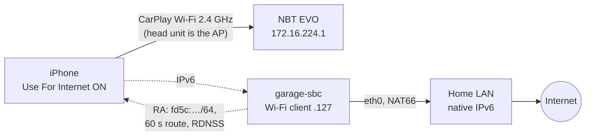

# Findings

What we learned getting an iPhone online over a BMW F32's wireless CarPlay Wi-Fi in an underground garage, and why it works. Raw results are in [test-log.md](test-log.md).

## Result

**It works (2026-11-02).** A Banana Pi in the car (garage-sbc, Debian 12), wired to the garage LAN, joined the car's CarPlay Wi-Fi as a second client and sent IPv6 router advertisements: a ULA /64, a 60 s default route and DNS servers (RDNSS), with NAT66 out of the garage Ethernet. The iPhone (iOS 27.0.1) took an address, **Check For Internet Access** offered **Use For Internet**, and Google Maps search and routing worked on CarPlay.

- Nothing changed on the car, and no IP settings changed on the phone.
- The car's IPv4 network was left alone: 0 IPv4 packets went through the box.
- The phone's traffic was 134 of 135 frames IPv6: HTTPS, QUIC, and its Tailscale tunnel.
- Latency: 12 ms from the box to the internet, 38 ms average from the box to the phone over the car Wi-Fi, 0 % loss.

## Why it works

1. **The car never says "you have internet".** Its CarPlay network gives the phone an IPv4 address with no router and no DNS. Its beacon carries an 802.11u Interworking element with the **Internet bit clear** (network type Private, venue Vehicular). It carries no Apple Device IE.
2. **iOS 27 tests instead of trusting.** On a CarPlay network, *Check For Internet Access* makes iOS probe the network. If the probe gets through, iOS offers *Use For Internet*, which sends the phone's traffic over the car Wi-Fi and falls back to cellular when that fails. Earlier iOS versions only offered a hidden manual IP setting.
3. **IPv6 lets a second device supply the route without touching the car.** The head unit owns IPv4 (DHCP server, no gateway) and sends no IPv6 router advertisements. So a box's RA is the only IPv6 router on the link, nothing conflicts, and iOS's probe (`captive.apple.com` has an AAAA record) succeeds over it.
4. **A 60 s router lifetime keeps it tidy.** When the box stops, radvd's last RA has router lifetime 0 (confirmed on the air). When the car drives off, the route expires within a minute.

## The car (NBT EVO, F32)

| | Value | How we know |
|---|---|---|
| CarPlay Wi-Fi | `BMW<last 5 of VIN> CarPlay`, observed on **2.4 GHz**, channel 11, HT20, one stream (F32) | `iw` scan from the box |
| Security | Beacon offers WPA + WPA2, TKIP group cipher, TKIP/CCMP pairwise (why iOS says "Weak Security"). The negotiated pairwise/group wasn't recorded in P2; carplayd now logs it on every join | same |
| "Internet available" signal | 802.11u Interworking, Internet bit **0**; no Apple Device IE | same |
| Head unit | `172.16.224.1`, is the access point, sends **no** IPv6 RAs | neighbour table, 30 s capture |
| DHCP | 172.16.224.0/24, no router, no DNS; iPhone `.110`, box `.127` | box and phone |
| Second client | allowed, no client isolation | box joined and reached the phone |
| Password | 10 random characters, sent to the phone over Bluetooth. **Visible on iOS 27, no jailbreak needed**: Settings → Wi-Fi → Edit → Known Networks → the CarPlay network | the iPhone |
| Car hotspot (if fitted) | separate network (172.16.222.x), can't reach CarPlay. Never carries the phone's CarPlay internet | Bimmerfest thread, Audi TSB on "Bluetooth pairing" cars |

## The iPhone (iOS 27)

- **The CarPlay network page** hides IP settings and shows *Check For Internet Access* and *Manage CarPlay*. The same network under **Settings → Wi-Fi → Edit → Known Networks** shows the full page: Password (with Copy), Private Wi-Fi Address and **Configure IP**.
- **Check For Internet Access is a button, not a toggle.** If the network passes, *Use For Internet* appears ([DiPlay #393](https://github.com/shihabal3amri/DiPlay/issues/393) screenshots match what we saw). iOS 27 beta 3 added it ([betaprofiles](https://forum.betaprofiles.com/t/whats-new-in-ios-27-beta-3/23195?page=2)).
- **iOS took the SLAAC address and RDNSS from the box with no settings changed.** Its probe passed over an IPv6-only path.
- **Why a CarPlay network normally carries no internet** (Apple's open-source configd and xnu): a service ranked `Never` keeps only a *scoped* default route, and the kernel installs an unscoped default only on configd's primary interface. Wired CarPlay is configured `PrimaryRank = Never`. Our hypothesis is that *Use For Internet* lifts that for the Wi-Fi network; it hasn't been traced on the device.
- **Darwin asks for AAAA records on a ULA-only network.** configd requests AAAA for any IPv6 service with a default route and never checks for ULA. A routed public /64 wasn't needed.

## Other ways that work or would work

| Way | Status |
|---|---|
| Manual IPv4: a router on the car Wi-Fi at `.254`, phone set to manual `.5` / router `.254` | Proven on an NBT EVO in Feb 2022 by ksweber (Teltonika RUT850 LTE router). Configure IP still exists on iOS 27. Not needed now, and a static router setting outlives the garage |
| USB-C Ethernet on the phone | Untested; doesn't need the password |
| Offline maps (Apple Maps with *Only Use Offline Maps*, Google Maps offline areas) | Works for known places; no live traffic |
| Cellular booster | $570–1,400 plus installation; femtocells mostly discontinued |

## What didn't pan out, and dead ends

- **Reading the password** by sniffing the WPA handshake (10 random characters is out of reach) or from Bluetooth (encrypted). Unnecessary anyway: iOS shows it.
- **The Apple Device IE** (OUI `00:A0:40`, flag bit 11 *InternetAccess*, from a copy of Apple's AccessorySDK header). The layout is real, but the NBT EVO doesn't send it. It signals with the 802.11u Interworking element instead.
- **Prior art.** Apart from ksweber's 2022 manual-IPv4 setup, ~30 searches in four languages and GitHub code search found no public implementation that gives a factory CarPlay network internet from a second device. We found no prior description of the IPv6/iOS 27 route; that doesn't prove there is none.
- **Several research-agent "quotes" were made up.** Every claim in these docs was re-checked against a fetched source or the device. Bimmerfest and the Apple forums block bots; `https://r.jina.ai/<url>` reads them.

## Departures: what actually goes wrong (2026-11-11)

The box works while parked. The hard part is leaving, and a day of recording both
sides of two real departures changed what we think the problem is. Raw numbers in
[test-log.md](test-log.md); the procedure is [drive-runbook.md](drive-runbook.md).

**The garage decides everything.** The box sits behind a cinderblock wall 6–11 ft
from the cars. A parked car reads **−74…−82 dBm** where free space at that range
would give about −40, the car 5 ft *further* away often reads *stronger*, and
parked signal overlaps the signal at which the link dies. Every absolute dBm
threshold in this repo was meaningless outside that one garage, which is why
carplayd now learns them per car instead (see below).

**RSSI cannot detect a departure here.** Measured on the F32 drive: the signal sat
**flat at −77…−83 for 35 seconds** and then the link simply died. The absolute
rule needed below −85; the trend rule's baseline tracked the signal down, so its
own threshold slid to −86…−88. Neither could ever fire. Driving out of a basement
is abrupt obstruction, not a fade.

**`tx_failed` is the only advance warning.** Flat at 2848 for minutes, then
climbing ~10/s for the last 8 seconds, with tx_bitrate pinned at the 1 Mb/s floor.
Across 606 serving polls the rate is **bimodal — 0–1/s healthy, 7–21/s failing,
and never anything between 2 and 6** — so a threshold of 5/s sits in an empty gap
and needs no tuning. Leaving on that instead of on signal produced **3 leaves out
of 3 with a goodbye sent, and zero `link_lost`**, against the F32's
`link_lost reason=0` with no goodbye two hours earlier.

**The airtime hypothesis looks wrong.** It had been the leading explanation: the
head unit relays the far box's traffic at 1–2 Mb/s and starves CarPlay. Against
it: CarPlay throughput rose 312 → 1209 kB/s when the box dropped out, which looks
like relief, but the phone's **retry rate went up (3.0 % → 4.7 %)**, the opposite
of what contention predicts, and the owner parked at exactly the moment the rate
collapsed again. Parked static screen ≈ 300 kB/s, moving map ≈ 1200 kB/s: the
jump is *demand*. Estimated occupancy was ~2.4 % box against ~3.8 % CarPlay,
nowhere near saturation. [Heusse et al.](https://infocom2003.ieee-infocom.org/papers/21_01.PDF)
still describes a real effect, but it does not appear to be what breaks CarPlay here.

**CarPlay did not drop on either car, with the box on.** Three drives — the same
short lap on each car, then a long one with stops — no drop, confirmed by the
owner and corroborated independently by the in-car recorder (the phone→head-unit
rate's per-second minimum never fell below 160 kB/s through a departure). The
original "drops on every departure" is not reproducing. Personal Hotspot, the
other obvious candidate, is never on.

**The trend rule defeats itself on a slow fade.** The 19:01 road departure is the
clearest example yet of why. The trend rule fires when the signal sits `drop` dB
under a baseline taken from 5–20 s ago, and it got to **1.9 s of the required
2 s** — then its own baseline decayed from −77 to −78, the gap closed, and the
timer reset. A rule whose threshold follows the thing it measures cannot catch
anything slower than its own window; it only ever catches a cliff. `fail_rate`
fired instead, and the goodbye went out **0.74 s** later. Of the three leave
rules, the one built on signal strength has still never been the one that worked.

**One real cost remains, and it is ours.** Every leave emits a burst of disassoc
frames the head unit never ACKs: 5–8 distinct frames, each retried 7 times by the
driver, **19–51 transmissions in a 40–48 ms burst, all at 1 Mb/s** — solid channel
occupancy at the moment CarPlay is live, on all three of the F22 drive's leaves,
and at −81 dBm rather than out of range. One redundant disconnect request has been
removed; the driver's retries are not ours to suppress.

**Wireless CarPlay rides the same BSS the box joins.** Apple's
[WWDC17 #717](https://developer.apple.com/videos/play/wwdc2017/717/) states the
Wi-Fi link carries all CarPlay audio, video and iAP2, with Bluetooth only for
discovery and reconnect. The head unit also runs a second BSS on the same channel,
`DIRECT-xx-BMW#####`, a Wi-Fi Direct group owner — but it sits idle with no
associated stations, and the phone associates to the `CarPlay` AP. So the box and
CarPlay share one BSS and one AP radio, not merely one channel. The head unit
advertises **no BSS Load element**, so there is no channel-utilisation figure to
read; airtime has to be computed from the capture.

### Learned thresholds

Since every dBm number above is a property of one basement and one pair of
dongles, carplayd does not take them from the config file except as a cold-start
fallback. Each car gets a profile of how its own link behaves when it is working:
a decaying mean and variance of RSSI over healthy polls only, plus the same for
`tx_failed`. Join, rejoin and leave are derived from that band, `fail_rate` only
ever rises from the configured floor, and all of it is clamped to −95…−30 dBm.

Three things it has to get right, each learned the hard way:

- **Only healthy polls teach it.** A dying link would otherwise teach the profile
  that dying is normal, and the measured bimodality of `tx_failed` (0–1/s against
  7–21/s) makes that split clean.
- **A regime shift must not be absorbed as variance.** Folding a 15 dB jump into
  the running estimate inflated the standard deviation to ~15 dB, which raised
  every derived threshold enough that none of them could fire again. The estimate
  is held while outliers are counted, and restarted once they persist — a new
  dongle or a new parking spot reconverges instead of averaging against the old
  world forever.
- **It has to reach the decision.** It did not. For one evening the box collected
  141 samples on the F32 (mean −78.6, sd 2.2), persisted them, and fed join and
  rejoin from them, while every *leave* decision used the static config values —
  an edit that was lost before it was ever committed, in a code path whose tests
  re-implemented the rules instead of calling them. There was nothing to see in
  the log, because the trace field that would have shown it was lost with it. The
  decision now lives in one function that derives the effective car itself, and
  the test asserts behaviour: at a signal between the learned and configured
  thresholds, the box must leave.

The last one is the general lesson. An adaptive system that is not wired to
anything fails silently and looks healthy the whole time — it keeps producing
plausible numbers, and nothing goes red.

## Still open

1. **Why it ever dropped.** Three instrumented departures did not reproduce it,
   including the long drive with stops that the short laps were meant to rule
   out. The F22 *did* fail on the morning of 2026-11-11, with the box clinging at
   1 Mb/s for 25 s before the link died — which the `fail_rate` rule now
   prevents, but that is n=1 either way, and it happened on the car that has had
   one instrumented drive to the F32's two. The remaining untested difference is
   the F22 itself, not the length of the drive.
2. **The disassoc burst.** Does cutting the redundant request measurably shrink it,
   and does the burst matter to CarPlay at all?
3. **Car restart:** does iOS remember *Use For Internet*, or must it be tapped each time?
4. **IPv4-only services:** a few Apple endpoints and Mapbox have no AAAA. DNS64 + NAT64 on the box would cover them.
5. **Scaling.** The software serves a car per radio without limit; the RF does not.
   Ten AR9271s in one box all on channel 11 would contend with the very CarPlay
   sessions they serve, and draw 4–5 A of USB power. Three or four is the likely
   practical ceiling.

## Tools in this repo

| Tool | What it does |
|---|---|
| `scripts/poc-linux.sh` | The working setup on a Linux box: `ie` (decode the car's beacon), `up`, `capture`, `status`, `down` |
| `scripts/poc-mac-nat.sh` | The same on a Mac (rtadvd + pf) |
| `scripts/car-ie.sh` | Beacon decoder for the Mac (needs Location permission) |
| `ios/CarNetProbe` | iPhone app: path state, Wi-Fi-bound vs default probes, AAAA check, Bonjour, Watch mode ([iphone-diagnostics.md](iphone-diagnostics.md)) |
| `carplayd` | The daemon: joins whichever car appears, advertises the route, leaves on link failure with a goodbye, learns its own thresholds. One radio per car serves them all at once |
| `recon/carrecon` | In-car passive recorder: monitor mode on the car channel, pcap ring, per-second per-station counters, head-unit RSSI from beacons, 4-way-handshake message numbers ([recon-box.md](recon-box.md)) |
| `emu/` | A VM harness that replays scripted departures against the real daemon |
