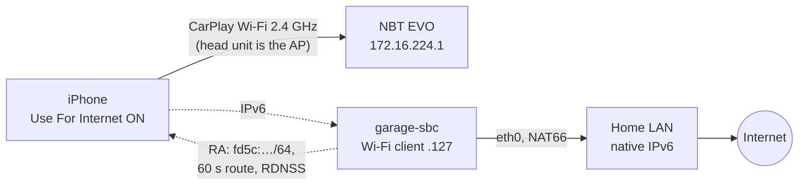

# Findings

What we learned getting an iPhone online over a BMW F32's wireless CarPlay Wi-Fi in an underground garage, and why it works. Raw results are in [test-log.md](test-log.md).

## Result

**It works (2026-11-02).** A Banana Pi in the car (garage-sbc, Debian 12), wired to the garage LAN, joined the car's CarPlay Wi-Fi as a second client and sent IPv6 router advertisements: a ULA /64, a 60 s default route and DNS servers (RDNSS), with NAT66 out of the garage Ethernet. The iPhone (iOS 27.0.1) took an address, **Check For Internet Access** offered **Use For Internet**, and Google Maps search and routing worked on CarPlay.

- Nothing changed on the car, and no IP settings changed on the phone.
- The car's IPv4 network was left alone: 0 IPv4 packets went through the box.
- The phone's traffic was 134 of 135 frames IPv6: HTTPS, QUIC, and its Tailscale tunnel.
- Latency: 12 ms from the box to the internet, 38 ms average from the box to the phone over the car Wi-Fi, 0 % loss.

## Why it works

1. **The car never says "you have internet".** Its CarPlay network gives the phone an IPv4 address with no router and no DNS. Its beacon carries an 802.11u Interworking element with the **Internet bit clear** (network type Private, venue Vehicular). It carries no Apple Device IE.
2. **iOS 27 tests instead of trusting.** On a CarPlay network, *Check For Internet Access* makes iOS probe the network. If the probe gets through, iOS offers *Use For Internet*, which sends the phone's traffic over the car Wi-Fi and falls back to cellular when that fails. Earlier iOS versions only offered a hidden manual IP setting.
3. **IPv6 lets a second device supply the route without touching the car.** The head unit owns IPv4 (DHCP server, no gateway) and sends no IPv6 router advertisements. So a box's RA is the only IPv6 router on the link, nothing conflicts, and iOS's probe (`captive.apple.com` has an AAAA record) succeeds over it.
4. **A 60 s router lifetime keeps it tidy.** When the box stops, radvd's last RA has router lifetime 0 (confirmed on the air). When the car drives off, the route expires within a minute.

## The car (NBT EVO, F32)

| | Value | How we know |
|---|---|---|
| CarPlay Wi-Fi | `BMW<last 5 of VIN> CarPlay`, **2.4 GHz only**, channel 11, HT20, one stream | `iw` scan from the box |
| Security | WPA + WPA2 mixed, TKIP group cipher, TKIP/CCMP pairwise (why iOS says "Weak Security") | same |
| "Internet available" signal | 802.11u Interworking, Internet bit **0**; no Apple Device IE | same |
| Head unit | `172.16.224.1`, is the access point, sends **no** IPv6 RAs | neighbour table, 30 s capture |
| DHCP | 172.16.224.0/24, no router, no DNS; iPhone `.110`, box `.127` | box and phone |
| Second client | allowed, no client isolation | box joined and reached the phone |
| Password | 10 random characters, sent to the phone over Bluetooth. **Visible on iOS 27, no jailbreak needed**: Settings → Wi-Fi → Edit → Known Networks → the CarPlay network | the iPhone |
| Car hotspot (if fitted) | separate network (172.16.222.x), can't reach CarPlay. Never carries the phone's CarPlay internet | Bimmerfest thread, Audi TSB on "Bluetooth pairing" cars |

## The iPhone (iOS 27)

- **The CarPlay network page** hides IP settings and shows *Check For Internet Access* and *Manage CarPlay*. The same network under **Settings → Wi-Fi → Edit → Known Networks** shows the full page: Password (with Copy), Private Wi-Fi Address and **Configure IP**.
- **Check For Internet Access is a button, not a toggle.** If the network passes, *Use For Internet* appears ([DiPlay #393](https://github.com/shihabal3amri/DiPlay/issues/393) screenshots match what we saw). iOS 27 beta 3 added it ([betaprofiles](https://forum.betaprofiles.com/t/whats-new-in-ios-27-beta-3/23195?page=2)).
- **iOS took the SLAAC address and RDNSS from the box with no settings changed.** Its probe passed over an IPv6-only path.
- **Why a CarPlay network normally carries no internet** (Apple's open-source configd and xnu): a service ranked `Never` keeps only a *scoped* default route, and the kernel installs an unscoped default only on configd's primary interface. Wired CarPlay is configured `PrimaryRank = Never`. *Use For Internet* evidently lifts that for the Wi-Fi network.
- **Darwin asks for AAAA records on a ULA-only network.** configd requests AAAA for any IPv6 service with a default route and never checks for ULA. A routed public /64 wasn't needed.

## Other ways that work or would work

| Way | Status |
|---|---|
| Manual IPv4: a router on the car Wi-Fi at `.254`, phone set to manual `.5` / router `.254` | Proven on an NBT EVO in Feb 2022 by ksweber (Teltonika RUT850 LTE router). Configure IP still exists on iOS 27. Not needed now, and a static router setting outlives the garage |
| USB-C Ethernet on the phone | Untested; doesn't need the password |
| Offline maps (Apple Maps with *Only Use Offline Maps*, Google Maps offline areas) | Works for known places; no live traffic |
| Cellular booster | $570–1,400 plus installation; femtocells mostly discontinued |

## What didn't pan out, and dead ends

- **Reading the password** by sniffing the WPA handshake (10 random characters is out of reach) or from Bluetooth (encrypted). Unnecessary anyway: iOS shows it.
- **The Apple Device IE** (OUI `00:A0:40`, flag bit 11 *InternetAccess*, from a copy of Apple's AccessorySDK header). The layout is real, but the NBT EVO doesn't send it. It signals with the 802.11u Interworking element instead.
- **Prior art.** Apart from ksweber's 2022 manual-IPv4 setup, ~30 searches in four languages and GitHub code search found nobody giving a factory CarPlay network internet from a second device. The IPv6/iOS 27 route appears to be new.
- **Several research-agent "quotes" were made up.** Every claim in these docs was re-checked against a fetched source or the device. Bimmerfest and the Apple forums block bots; `https://r.jina.ai/<url>` reads them.

## Still open

1. **Driving out (P4):** how fast the phone returns to cellular. The goodbye RA can't reach the phone once the car is out of range, so it's up to the 60 s router lifetime.
2. **Car restart:** does iOS remember *Use For Internet*, or must it be tapped each time?
3. **Permanent box (P3):** join automatically when the car's Wi-Fi appears, start radvd and NAT with it, survive reboots. garage-sbc can do it as is, or use a dedicated 2.4 GHz-capable box.
4. **IPv4-only services:** a few Apple endpoints and Mapbox have no AAAA. DNS64 + NAT64 on the box would cover them.

## Tools in this repo

| Tool | What it does |
|---|---|
| `scripts/poc-linux.sh` | The working setup on a Linux box: `ie` (decode the car's beacon), `up`, `capture`, `status`, `down` |
| `scripts/poc-mac-nat.sh` | The same on a Mac (rtadvd + pf) |
| `scripts/car-ie.sh` | Beacon decoder for the Mac (needs Location permission) |
| `ios/CarNetProbe` | iPhone app: path state, Wi-Fi-bound vs default probes, AAAA check, Bonjour, Watch mode ([iphone-diagnostics.md](iphone-diagnostics.md)) |
