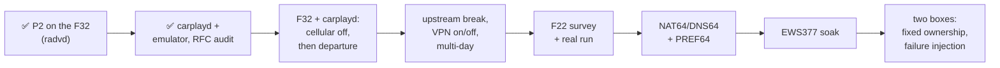

# Status: what we learned, tested, built, plan, open items

*As of 2026-11-13 (At a glance); the detail sections below still carry their 2026-11-03 dates and were revised after an external review ([review-response.md](review-response.md)).* Goal: Google Maps, and as much else as possible, on wireless CarPlay in the underground garage where there's no cellular. Two cars: the **F32** and the **F22 M240i** (SSIDs `BMW##### CarPlay`; the digits are VIN digits and stay in `secrets/`).

Claims are labelled: **measured** (on the car, phone or box), **source** (code or docs we read), **emulator** (hwsim, Linux stand-in hosts), **inferred**.

## At a glance

| | |
|---|---|
| **Proven** | On the tested **F32**, an iPhone (iOS 27.0.1) on the wireless CarPlay network used an added IPv6 internet gateway: *Check For Internet Access → Use For Internet*, then Google Maps search and routing. The phone's IPv4 settings were unchanged (2026-11-02, P2, measured) |
| **Answered since** | **iOS does not remember *Use For Internet*** — it must be re-tapped after every car restart, and until it is, apps get nothing while every box-side metric reads healthy (2026-11-11 capture, confirmed live 2026-11-12 by watching `probe_A` go 0 → 15 the moment it was tapped) |
| **Not yet proven** | Unattended repeatability with carplayd on a real car · cellular handoff timing on the real iPhone · F22 equivalence · EWS377 firmware reliability · two-box failover · **association on the two new USB radios**, and **a phone actually using NAT64** — both were built and verified from the box while the cars were away |
| **Fixed since** | IPv4-only hosts on the home LAN are reachable from a car link: DNS64 + NAT64 on the box, allowlisted to three hosts ([ipv4-options.md](ipv4-options.md)). This is the app-wide compatibility gap that used to sit under *Not yet proven* |
| **Running now** | **carplayd** on **garage-sbc** (an Orange Pi 4A, Allwinner T527, in the basement), serving **one radio per car**: two USB AR9271 dongles, `car-a` and `car-b`, so both cars can be served at once rather than time-shared ([usb-radios.md](usb-radios.md)). Driver and TUN had to be cross-built — the vendor kernel ships neither ([kernel-modules.md](kernel-modules.md)). Events to `/var/lib/carplayd/events.log`, rotated daily, 14 days kept |
| **Next** | **One drive with a car present**, which settles the three things standing open at once: association on the two new USB radios, a phone actually using NAT64 to reach `nas`/`media`/`dns`, and whether both cars can be served at the same time |

## What we learned

### The car (NBT EVO; measured on the F32 only)

| Observation | Consequence |
|---|---|
| CarPlay Wi-Fi observed on **2.4 GHz, channel 11**, HT20, one stream | Box needs a 2.4 GHz STA that handles this AP's security, client-to-client IPv6 through the head unit, and reliable reconnects |
| Beacon offers WPA + WPA2, **TKIP group**, TKIP/CCMP pairwise (iOS: "Weak Security") | **Negotiated (both cars, 2026-11-03): WPA2-PSK, CCMP pairwise, TKIP group, Wi-Fi 4.** The box needs WPA2 with a TKIP group cipher allowed; WPA1 isn't used |
| DHCP **172.16.224.0/24, no router, no DNS**; head unit = AP at `.1` | No IPv4 internet path. **The link stays dual-stack**: car-local IPv4 plus our IPv6-only internet path |
| **802.11u Interworking Internet bit = 0**; no Apple Device IE | A box can't change the beacon; iOS 27 tests the network anyway |
| Head unit sent **no IPv6 RAs**; no head-unit SLAAC address seen in the P2 capture | Our RA was the only router. carplayd counts devices per prefix, so a change would show up |
| **A second client was allowed**, no client isolation | The box can join next to the phone. Phone ↔ box traffic is **relayed by the head unit**, so the box's car RSSI isn't the phone's path quality |
| Password: 10 random characters, **visible on iOS 27 without a jailbreak** (Settings → Wi-Fi → Edit → Known Networks → the car → Password) | Stored in `secrets/carplay.env` |
| F22 (measured by carplayd, 2026-11-03): **channel 11**, same ciphers; a phone joined and solicited. Beacon, DHCP and iOS behaviour not yet checked | Both cars share channel 11. One ULA /64 per car; no IPv4 on car links |
| Real departure/return with carplayd (F32, 2026-11-03): parked −68…−82 dBm from garage-sbc, edge of range −86…−91; link lost at −89 | Leave −92 is too loose (no goodbye was sent); ≈ −85 would have been |

### The iPhone (iOS 27.0.1; measured unless noted)

- **Check For Internet Access** is a button that makes iOS probe the network. If the probe passes, a **Use For Internet** switch appears. With it on, the phone uses the car Wi-Fi for internet and, per Apple's on-screen text, falls back to cellular when that fails. It also exists on non-factory CarPlay receivers (DiPlay #393). "Introduced in iOS 27 beta 3" comes from one betaprofiles forum post and isn't independently confirmed.
- iOS accepted an **IPv6 route with a ULA prefix**: SLAAC, RDNSS, internet check. 134 of 135 frames were IPv6; HTTPS, QUIC and the phone's Tailscale all went through the box.
- **Why a CarPlay network normally carries no internet** (hypothesis, source: Apple's open-source configd/xnu): a `PrimaryRank = Never` service gets only a scoped default route, and *Use For Internet* lifts that. Not traced on the device.
- In the P2 capture the phone sent Router Solicitations at link-up. carplayd doesn't rely on later ones: periodic RAs every 3–4 s, plus an answer to a new device's MLD report.

### Prior art (source)

- **ksweber (Bimmerfest, Feb 2022) did it on an NBT EVO** with manual IPv4: an LTE router on the CarPlay Wi-Fi at `.254`, iPhone set to manual `.5`. Configure IP still exists on iOS 27 via Known Networks.
- We found **no public implementation of the IPv6 / iOS 27 route** in ~30 searches in 4 languages plus GitHub code search ([findings.md](findings.md)). Not finding one doesn't prove nobody has done it.
- How cars normally do it (Audi TSBs): "Wi-Fi pairing" cars run CarPlay over their own hotspot, internet included; "Bluetooth pairing" cars like the NBT EVO use a private CarPlay-only network.

### Standards we now follow (source)

| Rule | carplayd |
|---|---|
| RFC 4861: periodic RAs at a random [Min, Max]RtrAdvInterval, Min ≥ 3 s, Max ≥ 4 s; multicast RAs ≥ 3 s apart; RS answers delayed 0–0.5 s | One scheduler for every RA: 3–4 s random, 3 s spacing on all multicasts, RS answered by **unicast** (RFC 7772) after 0–0.5 s |
| RFC 8106: router lifetime 0 does **not** remove DNS servers; RDNSS lifetime 0 does | Withdrawal = router 0 + RDNSS 0 + preferred 0; RDNSS lifetime ≤ router lifetime (12 s vs 20 s) |
| RFC 4862 5.5.3e: hosts ignore valid-lifetime cuts below 2 h | Valid lifetime left alone; preferred 0 deprecates the address instead |
| Linux: with forwarding on, kernel RAs need `accept_ra=2` | Checked on garage-sbc: NetworkManager handles the uplink's RAs in userspace; the default route stays |

### Hardware and software (source unless noted)

| Fact | Source |
|---|---|
| **EWS377AP (IPQ8072A, ath11k): one STA per radio**, no firmware PNO scan; the 5 GHz radio is useless for these cars, so one car at a time per box. The community firmware's quick start names EWS377AP **v3**, ECW230v3 and EWS377-FIT; check the hardware revision before flashing | Linux ath11k source; ParkWardRR wiki |
| **NSS offload doesn't speed up finding/joining a car**, and NSS ECM doesn't offload NAT66 | qosmio/openwrt-ipq, ECM source |
| OpenWrt's wpa_supplicant rescans every 1 s while disconnected (patch 310 in the snapshot we built, r38011); its wpad builds lack autoscan/bgscan; `scan_list` limits scans | OpenWrt source at that revision |
| NetworkManager backs off to **one scan per 120 s** when idle | NM 1.42 source |
| garage-sbc's brcmfmac: single-channel scan **131–156 ms** vs full 3.9 s; no monitor mode | measured |
| odhcpd took 3.8–6.9 s to give a new emulated host the route, and with a ULA-only prefix advertises router lifetime 0 unless `ra_default 1` | emulator + source |
| Apple: `NEHotspotNetwork.fetchCurrent` gives SSID, BSSID, security type (entitlement + location permission). **No supported API for current Wi-Fi RSSI** | Apple docs, DTS forum reply |

### How we work (lessons)

- **Research agents fabricated quotes three times.** Everything in the docs was re-checked against a fetched source or the device.
- **The emulator found five carplayd bugs** before they reached a car. An outside review then found a sixth class of problem (standards compliance) that no scenario asserted. Scenarios now check the wire format too (ra-audit).
- **Secrets leaked once:** test PSKs and SSID digits sat in tracked files until the review. A pre-commit hook now blocks them.

## What we tested

| Where | What | Result |
|---|---|---|
| F32 + garage-sbc (P1) | Beacon decode, scan | 2.4 GHz ch 11, TKIP group, Interworking Internet = 0 |
| F32 + garage-sbc (P2) | ULA /64 RA + RDNSS + NAT66 (radvd), iPhone iOS 27 | ✅ Use For Internet, Maps works; 81 NAT66 flows, 11.5 MB; goodbye RA (router lifetime 0) seen on air. carplayd wasn't used |
| CarNet Probe on the iPhone | Path state, Wi-Fi-bound vs default probes, AAAA | Works at home; bound probe 38 ms |
| garage-sbc | carplayd deployed, hunting both cars; uplink route with forwarding on | Running; no real car yet |
| Emulator (OpenWrt r38011, kernel 6.18), rounds 1–2 | 33 stock + 82 carplayd runs | Each run's assertions and timeouts passed ([results](emulator-results.md)) |
| Emulator, round 3 (after the review) | RFC timing on the wire, upstream loss, isolation, full carplayd suite again | 17 scenarios × 3 runs: every run that booted passed its assertions (one soak VM failed to boot). One target missed: car B join 1.78 s in 1 of 3 two-cars runs (target 1.5 s) |

**Emulator: carplayd vs the stock netifd/odhcpd box.** The hosts are Linux stand-ins, not iPhones. "Route" means the emulated host installed or removed the box's default route. Time zero is the harness command (hostapd started, signal changed, link cut). ([Full results](emulator-results.md).)

| Emulated event | stock | carplayd |
|---|---|---|
| hostapd started → box associated (median) | 1.47 s | **0.71 s** (0.39 s in round 2; association is untouched by the RA changes, so this is run-to-run noise with 3 VMs in parallel) |
| Host associated → default route | 3.8–6.9 s | **0.47 s** (0.45–0.76; was 0.32 s with the non-compliant 1 s RAs) |
| Box joins after the host → route | 4.25 s | **0.01 s** |
| Signal fades → host removes the route | never | **3.7–4.1 s** (unicast withdrawal) |
| Car cut off abruptly → route expires | 60 s | **20 s** (router lifetime) |
| Back in range → box associated | 1.33 s | **0.21 s** |
| Upstream dies, car link fine → route withdrawn / restored | never / – | **6.3–7.1 s / 1.9 s**, box stays on the car |
| Host on the car link reaches the box, home LAN, other car | yes (fw4 zone input ACCEPT) | **no** (0 of 6 targets) |

Not covered by the emulator: real RF, the head unit's AP, iOS policy (*Use For Internet*, its internet check, DNS and app behaviour), and the real iPhone's move back to cellular.

**Bugs the emulator found in carplayd (fixed):** ghost car (cached scan results), lost first Router Solicitation, priority ignored, silent metrics failure, slow sweeps. **Found by the review (fixed):** non-compliant RA timing, incomplete withdrawal, no upstream gating, no car-link isolation, phones counted by address.

## What we built

| Piece | What |
|---|---|
| `carplayd/` (Go) | The controller: • per-car hunting (the car's channel only, every 1 s), join thresholds + hysteresis, per-car ULA `fd5c:ba1e:f32:a::/64` / `:b::`; • RFC 4861 RA scheduler (3–4 s random, 3 s multicast spacing, unicast RS answers after 0–0.5 s, MLD-triggered answers); • full withdrawal (router + RDNSS + preferred lifetime 0), goodbye on fade-out, upstream health gating; • nftables isolation of the car link, NAT66 (nft, ip6tables or fw4); • two-car arbitration + priority preemption, phones counted by MAC, negotiated cipher logged; • wpa_supplicant watchdog, Prometheus metrics. Unit tests; systemd + procd packaging |
| `emu/` | Emulator on build-host: OpenWrt image with hwsim radios, `emu.sh` (cars, hosts, fades, drive-outs, upstream failure, isolation probes, RA capture), Go agent, Go harness with 18 scenarios |
| `scripts/` | `deploy-carplayd-sbc.sh` (+ `rollback`), `check-secrets.sh` (pre-commit), `poc-linux.sh` / `poc-mac-nat.sh` (P2), `openwrt-carplay.sh` (stock OpenWrt config), `car-ie.sh` (beacon decoder) |
| `ios/CarNetProbe` | iPhone diagnostics app |

## The plan (reordered after the review)

| # | Test or change | Accepted when |
|---|---|---|
| 1 | ✅ RA scheduler, RDNSS lifetimes, withdrawal | Capture shows the intended behaviour on normal, withdrawal and goodbye paths (ra-audit) |
| 2 | **F32 with cellular disabled**, carplayd on garage-sbc | A fresh, uncached search and route succeed through carplayd; negotiated cipher logged |
| 3 | Break the upstream with the car Wi-Fi intact | The box withdraws; no black hole; iPhone back on cellular |
| 4 | **Real departure with cellular on** | Time from leaving to the first successful new request over cellular (not just the goodbye) |
| 5 | Tailscale/VPN off and on | Base path and overlay judged separately |
| 6 | Reconnect over several days | Does *Use For Internet* persist per phone and per car? |
| 7 | F22 survey and real run | Channel, security, client forwarding, iOS behaviour |
| 8 | NAT64/DNS64 + PREF64 on the dual-stack link | Native IPv6, A-only names, IPv4 literals, representative apps, and local CarPlay all work |
| 9 | EWS377 soak | Repeated starts, departure/return, firewall reload, overnight |
| 10 | Two boxes, fixed ownership | Predictable ownership and bounded recovery through partitions and reboots |

**Two boxes.** Production starts with **fixed ownership**: one box per car, the EWS377 in the garage and garage-sbc as standby. The standby advertises a car only after the owner has been silent for a bounded time, and stops when the owner returns, with hold-down so the boxes don't flap. If both advertise during a partition, the phone sees two routers with different prefixes. IPv6 allows that: it's degraded, not broken. New requests recover within the takeover time; open connections through the failed box don't survive (NAT state isn't shared).

## Open items

| # | Item | Needs | Who |
|---|---|---|---|
| 1 | **F32 + carplayd, cellular off** (plan 2): join time, route, Maps, negotiated cipher | F32 in the garage | you start the car; I read the log |
| 2 | **Real departure with cellular on** (plan 4): time to the first new request over cellular; also CarPlay audio while downloading, phone locked/unlocked, in pocket/mounted, doors closed | F32 | you drive; I time it |
| 3 | **Forwarded-path probe**: health check through the NAT path, not only from the box | — | me |
| 4 | Does iOS **remember Use For Internet** across car restarts and days? Per car, per phone | real use | you (observe), me (logs) |
| 5 | **F22 P1** + real run: channel, security, then pin `channel` | F22 on | you + me |
| 6 | **Signal and path survey** from garage-sbc's spot: car RSSI *and* phone RTT/loss through the head unit | each car on | you + me |
| 7 | **IPv4-only services** on the dual-stack link: DNS64 + NAT64 + PREF64 (plan 8) | after 1–6 | me |
| 8 | **EWS377AP v3**: flash, ath11k STA, `iw phy` limits, carplayd + nft on device, rollback, placement | the AP | you flash; I port + test |
| 9 | **Two boxes, fixed ownership** (emulator first, then real) | EWS up | me |
| 10 | **Phone moving between cars**, second driver's phone | real use | you |
| 11 | **CarNet Probe**: signing + Access Wi-Fi Information entitlement for SSID/BSSID/security. RSSI isn't available through a supported API | developer.apple.com | you |
| 12 | Ops: crash tests that need hardware (power loss, radio removal, firmware stall) | — | me |
| 13 | **Git history** still holds the car PSKs and SSID digits from before the scrub (d654b97). Rewrite (filter-repo + force push) or accept | your call | you |
| 14 | Fallbacks parked: USB-C Ethernet on the phone, offline maps, booster | — | parked |

## Risks

- **iOS changes:** *Use For Internet* is new in iOS 27; a later iOS could change it. Manual IPv4 (ksweber's method) is the fallback.
- **App compatibility:** Maps working proves Maps. IPv4-only services and apps with their own resolvers are untested (open item 7).
- **RF and path:** the F22 parks farther from garage-sbc. The box's car RSSI doesn't measure the phone's path through the head unit.
- **ath11k STA quirks on IPQ807x** (reconnect stalls reported upstream): carplayd's watchdog helps; real soak needed.
- **Car re-pairing changes the password:** carplayd hunts but never joins. Watch for repeated selects with no connect in the log.
- **Upstream black hole:** mitigated (health gating, emulator-tested). A broken NAT path behind a healthy box check isn't detected yet (open item 3).
