# Status: what we learned, tested, built, plan, open items

*At a glance is as of **2026-11-14**, from the live box; the detail sections below still carry their 2026-11-03 dates and were revised after an external review ([review-response.md](review-response.md)).* Goal: Google Maps, and as much else as possible, on wireless CarPlay in the underground garage where there's no cellular. Two cars: the **F32** and the **F22 M240i** (SSIDs `BMW##### CarPlay`; the digits are VIN digits and stay in `secrets/`).

Claims are labelled: **measured** (on the car, phone or box), **source** (code or docs we read), **emulator** (hwsim, Linux stand-in hosts), **inferred**.

> **Resolve cars by SSID, never by letter.** `carplayd.conf`'s `[car A]` is the **F32** and `[car B]` is the **F22**; `secrets/carplay.env` uses the opposite convention. Every letter below is the config's.

## At a glance

| | |
|---|---|
| **Proven, F22** (`car B`) | **The whole path works, on the current two-radio build** (2026-11-14, measured): repeated associations on the `car-b` AR9271 at WPA2-PSK / ch 11, five `validated` events, and **44,327 packets / 6.2 MB forwarded** to the phone in one day. This closes *association on the new USB radios* and most of *F22 equivalence* |
| **Proven, F32** (`car A`) | An iPhone (iOS 27.0.1) on the CarPlay network used an added IPv6 gateway: *Check For Internet Access → Use For Internet*, then Google Maps search and routing, IPv4 settings unchanged (2026-11-02, P2, measured). **That proof is on the old single-radio radvd setup.** On the two-radio build the F32 has never been served at all |
| **Changed since** | **iOS mostly re-validates on its own after the first tap** (2026-11-14, measured). Across F22 sessions split by 15–29 min absences, `validated` returned **4–24 s** after serving resumed — too fast to be a human tap. **But not always**: two sessions the same morning stayed `phone_unvalidated` with **0 bytes** forwarded, and a real car restart still needs the tap (2026-11-11, car off 54 min). Treat the tap as required and the re-validation as a bonus |
| **Not yet proven** | **Both cars served at the same time** — they have not been in the garage together since the per-car radios went in · **the F32 on the two-radio build** · **a phone actually using NAT64**: the translator is up and five names resolve, but its tun has carried **3 packets, all outbound** · cellular handoff timing on the real iPhone · EWS377 firmware reliability · two-box failover |
| **Not a fault** | The F32's absence is the car, not the box: `cara` scans 23 neighbours (same as `carb`), its `wpa_supplicant` is hunting, and `carplayd_detect_seconds{car="A"}` is 0 because the SSID has never entered a scan |
| **Running now** | **carplayd** on **garage-sbc** (an Orange Pi 4A, Allwinner T527, in the basement), **one radio per car**: two USB AR9271 dongles, `car-a` and `car-b`, so both cars *can* be served at once rather than time-shared ([usb-radios.md](usb-radios.md)). Driver and TUN had to be cross-built — the vendor kernel ships neither ([kernel-modules.md](kernel-modules.md)). Up since 06:17 on 2026-11-14, 0 restarts. Events to `/var/lib/carplayd/events.log`, rotated daily, 14 days kept |
| **Fixed since** | **Our own traffic could take CarPlay down.** Saturating the box's path made the F22's head unit drop CarPlay entirely (hard reset to re-pair). An HTB egress cap on the car link (`rate = 2mbit`, 16-packet leaf) cut the worst round-trip to the phone from **2051 ms to 378 ms** and held 120 s of the same load with zero disconnects (2026-11-16, measured; needs a soak) |
| **Next** | **One drive with both cars in the garage**, which settles all three open things at once: the F32 on this build, two cars served simultaneously, and a phone using NAT64 |

## What we learned

### The car (NBT EVO; the beacon/DHCP detail below is from the F32, the 2026-11-14 path result is the F22)

| Observation | Consequence |
|---|---|
| CarPlay Wi-Fi observed on **2.4 GHz, channel 11**, HT20, one stream | Box needs a 2.4 GHz STA that handles this AP's security, client-to-client IPv6 through the head unit, and reliable reconnects |
| Beacon offers WPA + WPA2, **TKIP group**, TKIP/CCMP pairwise (iOS: "Weak Security") | **Negotiated (both cars, 2026-11-03): WPA2-PSK, CCMP pairwise, TKIP group, Wi-Fi 4.** The box needs WPA2 with a TKIP group cipher allowed; WPA1 isn't used |
| DHCP **172.16.224.0/24, no router, no DNS**; head unit = AP at `.1` | No IPv4 internet path. **The link stays dual-stack**: car-local IPv4 plus our IPv6-only internet path |
| **802.11u Interworking Internet bit = 0**; no Apple Device IE | A box can't change the beacon; iOS 27 tests the network anyway |
| Head unit sent **no IPv6 RAs**; no head-unit SLAAC address seen in the P2 capture | Our RA was the only router. carplayd counts devices per prefix, so a change would show up |
| **A second client was allowed**, no client isolation | The box can join next to the phone. Phone ↔ box traffic is **relayed by the head unit**, so the box's car RSSI isn't the phone's path quality |
| Password: 10 random characters, **visible on iOS 27 without a jailbreak** (Settings → Wi-Fi → Edit → Known Networks → the car → Password) | Stored in `secrets/carplay.env` |
| F22: **channel 11**, same ciphers (carplayd, 2026-11-03), and on **2026-11-14 the full path** — phone validated, 6.2 MB forwarded. Its beacon and DHCP still haven't been decoded separately from the F32's | Both cars share channel 11. One ULA /64 per car; no IPv4 on car links |
| Real departure/return with carplayd (F32, 2026-11-03): parked −68…−82 dBm from garage-sbc, edge of range −86…−91; link lost at −89 | Leave −92 is too loose (no goodbye was sent); ≈ −85 would have been |

### The iPhone (iOS 27.0.1; measured unless noted)

- **Check For Internet Access** is a button that makes iOS probe the network. If the probe passes, a **Use For Internet** switch appears. With it on, the phone uses the car Wi-Fi for internet and, per Apple's on-screen text, falls back to cellular when that fails. It also exists on non-factory CarPlay receivers (DiPlay #393). "Introduced in iOS 27 beta 3" comes from one betaprofiles forum post and isn't independently confirmed.
- **iOS re-probes on its own after the first tap** (measured 2026-11-14, F22). Across serving sessions separated by 15–29 minutes of the car being absent, probe traffic reappeared **4–24 s** after the box resumed serving — no tap. The mechanism is not traced; all we observe is the probe. It is **not** reliable: two sessions the same morning produced no probe and forwarded 0 bytes, and a 54-minute car restart (2026-11-11) needed the tap.
- iOS accepted an **IPv6 route with a ULA prefix**: SLAAC, RDNSS, internet check. 134 of 135 frames were IPv6; HTTPS, QUIC and the phone's Tailscale all went through the box.
- **Why a CarPlay network normally carries no internet** (hypothesis, source: Apple's open-source configd/xnu): a `PrimaryRank = Never` service gets only a scoped default route, and *Use For Internet* lifts that. Not traced on the device.
- In the P2 capture the phone sent Router Solicitations at link-up. carplayd doesn't rely on later ones: periodic RAs every 3–4 s, plus an answer to a new device's MLD report.

### Prior art (source)

- **ksweber (Bimmerfest, Feb 2022) did it on an NBT EVO** with manual IPv4: an LTE router on the CarPlay Wi-Fi at `.254`, iPhone set to manual `.5`. Configure IP still exists on iOS 27 via Known Networks.
- We found **no public implementation of the IPv6 / iOS 27 route** in ~30 searches in 4 languages plus GitHub code search ([findings.md](findings.md)). Not finding one doesn't prove nobody has done it.
- How cars normally do it (Audi TSBs): "Wi-Fi pairing" cars run CarPlay over their own hotspot, internet included; "Bluetooth pairing" cars like the NBT EVO use a private CarPlay-only network.

### Standards we now follow (source)

| Rule | carplayd |
|---|---|
| RFC 4861: periodic RAs at a random [Min, Max]RtrAdvInterval, Min ≥ 3 s, Max ≥ 4 s; multicast RAs ≥ 3 s apart; RS answers delayed 0–0.5 s | One scheduler for every RA: 3–4 s random, 3 s spacing on all multicasts, RS answered by **unicast** (RFC 7772) after 0–0.5 s |
| RFC 8106: router lifetime 0 does **not** remove DNS servers; RDNSS lifetime 0 does | Withdrawal = router 0 + RDNSS 0 + preferred 0; RDNSS lifetime ≤ router lifetime (12 s vs 20 s) |
| RFC 4862 5.5.3e: hosts ignore valid-lifetime cuts below 2 h | Valid lifetime left alone; preferred 0 deprecates the address instead |
| Linux: with forwarding on, kernel RAs need `accept_ra=2` | Checked on garage-sbc: NetworkManager handles the uplink's RAs in userspace; the default route stays |

### Hardware and software (source unless noted)

| Fact | Source |
|---|---|
| **EWS377AP (IPQ8072A, ath11k): one STA per radio**, no firmware PNO scan; the 5 GHz radio is useless for these cars, so one car at a time per box. The community firmware's quick start names EWS377AP **v3**, ECW230v3 and EWS377-FIT; check the hardware revision before flashing | Linux ath11k source; ParkWardRR wiki |
| **NSS offload doesn't speed up finding/joining a car**, and NSS ECM doesn't offload NAT66 | qosmio/openwrt-ipq, ECM source |
| OpenWrt's wpa_supplicant rescans every 1 s while disconnected (patch 310 in the snapshot we built, r38011); its wpad builds lack autoscan/bgscan; `scan_list` limits scans | OpenWrt source at that revision |
| NetworkManager backs off to **one scan per 120 s** when idle | NM 1.42 source |
| garage-sbc's brcmfmac: single-channel scan **131–156 ms** vs full 3.9 s; no monitor mode | measured |
| odhcpd took 3.8–6.9 s to give a new emulated host the route, and with a ULA-only prefix advertises router lifetime 0 unless `ra_default 1` | emulator + source |
| Apple: `NEHotspotNetwork.fetchCurrent` gives SSID, BSSID, security type (entitlement + location permission). **No supported API for current Wi-Fi RSSI** | Apple docs, DTS forum reply |

### How we work (lessons)

- **Research agents fabricated quotes three times.** Everything in the docs was re-checked against a fetched source or the device.
- **The emulator found five carplayd bugs** before they reached a car. An outside review then found a sixth class of problem (standards compliance) that no scenario asserted. Scenarios now check the wire format too (ra-audit).
- **Secrets leaked once:** test PSKs and SSID digits sat in tracked files until the review. A pre-commit hook now blocks them — and earned its keep again on 2026-11-13, catching a real car SSID used as a test fixture in `recon/ieaudit`. The history was rewritten the same day, which removes them from future clones but cannot un-publish what was public for ten days. **A rewrite is not done when `git grep` across your own refs comes back clean:** only `main` had been force-pushed, so GitHub kept serving the unscrubbed history under two release tags for another day. Check the remote's refs, not the local ones.

## What we tested

| Where | What | Result |
|---|---|---|
| F32 + garage-sbc (P1) | Beacon decode, scan | 2.4 GHz ch 11, TKIP group, Interworking Internet = 0 |
| F32 + garage-sbc (P2) | ULA /64 RA + RDNSS + NAT66 (radvd), iPhone iOS 27 | ✅ Use For Internet, Maps works; 81 NAT66 flows, 11.5 MB; goodbye RA (router lifetime 0) seen on air. carplayd wasn't used |
| CarNet Probe on the iPhone | Path state, Wi-Fi-bound vs default probes, AAAA | Works at home; bound probe 38 ms |
| garage-sbc | carplayd deployed, hunting both cars; uplink route with forwarding on | Running; up since 2026-11-14 06:17, 0 restarts |
| **F22 + garage-sbc, own radio (2026-11-14)** | Real parked sessions over a day: association, validation, forwarded traffic | ✅ **the current headline.** Repeated joins on `car-b` (WPA2-PSK, ch 11), 5 × `validated`, **44,327 packets / 6.2 MB** forwarded. Also: `validated` recurred 4–24 s after serving resumed across 15–29 min absences, with no tap |
| **F32 + garage-sbc, own radio** | Same | ⬜ **never ran** — the car has not been in RF range during any logged window. `cara` itself is healthy (23 neighbours) |
| NAT64/DNS64 on the box (2026-11-13→14) | Five homelab names from a car link | ◐ names resolve and the translator is up, but the `nat64` tun has carried **3 packets, all outbound** — no phone has used it |
| Emulator (OpenWrt r38011, kernel 6.18), rounds 1–2 | 33 stock + 82 carplayd runs | Each run's assertions and timeouts passed ([results](emulator-results.md)) |
| Emulator, round 3 (after the review) | RFC timing on the wire, upstream loss, isolation, full carplayd suite again | 17 scenarios × 3 runs: every run that booted passed its assertions (one soak VM failed to boot). One target missed: car B join 1.78 s in 1 of 3 two-cars runs (target 1.5 s) |

**Emulator: carplayd vs the stock netifd/odhcpd box.** The hosts are Linux stand-ins, not iPhones. "Route" means the emulated host installed or removed the box's default route. Time zero is the harness command (hostapd started, signal changed, link cut). ([Full results](emulator-results.md).)

| Emulated event | stock | carplayd |
|---|---|---|
| hostapd started → box associated (median) | 1.47 s | **0.71 s** (0.39 s in round 2; association is untouched by the RA changes, so this is run-to-run noise with 3 VMs in parallel) |
| Host associated → default route | 3.8–6.9 s | **0.47 s** (0.45–0.76; was 0.32 s with the non-compliant 1 s RAs) |
| Box joins after the host → route | 4.25 s | **0.01 s** |
| Signal fades → host removes the route | never | **3.7–4.1 s** (unicast withdrawal) |
| Car cut off abruptly → route expires | 60 s | **20 s** (router lifetime) |
| Back in range → box associated | 1.33 s | **0.21 s** |
| Upstream dies, car link fine → route withdrawn / restored | never / – | **6.3–7.1 s / 1.9 s**, box stays on the car |
| Host on the car link reaches the box, home LAN, other car | yes (fw4 zone input ACCEPT) | **no** (0 of 6 targets) |

Not covered by the emulator: real RF, the head unit's AP, iOS policy (*Use For Internet*, its internet check, DNS and app behaviour), and the real iPhone's move back to cellular.

**Bugs the emulator found in carplayd (fixed):** ghost car (cached scan results), lost first Router Solicitation, priority ignored, silent metrics failure, slow sweeps. **Found by the review (fixed):** non-compliant RA timing, incomplete withdrawal, no upstream gating, no car-link isolation, phones counted by address.

## What we built

| Piece | What |
|---|---|
| `carplayd/` (Go) | The controller: • per-car hunting (the car's channel only, every 1 s), join thresholds + hysteresis, per-car ULA `fd5c:ba1e:f32:a::/64` / `:b::`; • RFC 4861 RA scheduler (3–4 s random, 3 s multicast spacing, unicast RS answers after 0–0.5 s, MLD-triggered answers); • full withdrawal (router + RDNSS + preferred lifetime 0), goodbye on fade-out, upstream health gating; • nftables isolation of the car link, NAT66 (nft, ip6tables or fw4); • two-car arbitration + priority preemption, phones counted by MAC, negotiated cipher logged; • wpa_supplicant watchdog, Prometheus metrics. Unit tests; systemd + procd packaging |
| `emu/` | Emulator on build-host: OpenWrt image with hwsim radios, `emu.sh` (cars, hosts, fades, drive-outs, upstream failure, isolation probes, RA capture), Go agent, Go harness with 18 scenarios |
| `scripts/` | `deploy-carplayd-sbc.sh` (+ `rollback`), `check-secrets.sh` (pre-commit), `poc-linux.sh` / `poc-mac-nat.sh` (P2), `openwrt-carplay.sh` (stock OpenWrt config), `car-ie.sh` (beacon decoder) |
| `ios/CarNetProbe` | iPhone diagnostics app |

## Roadmap

Everything to the left of the gate below is measured and closed. The gate is one drive, and it is the only thing standing between "works on a car" and "works on this fleet".

```mermaid
flowchart LR
  A["✅ P2 on the F32<br/>(radvd, single radio)"] --> B["✅ carplayd +<br/>emulator, RFC audit"]
  B --> C["✅ Departures:<br/>leave on tx_failed,<br/>3/3 with goodbye"]
  C --> D["✅ F22 end to end<br/>on its own radio<br/>(6.2 MB, 2026-11-14)"]
  D --> G{{"GATE: both cars<br/>in the garage,<br/>one drive"}}
  G --> E["F32 on this build<br/>+ both at once<br/>+ phone over NAT64"]
  E --> F["Cellular handoff<br/>timing, VPN,<br/>multi-day soak"]
  F --> H["EWS377 soak"]
  H --> I["Two boxes:<br/>fixed ownership,<br/>failure injection"]
```

**The gate is cheap and settles three things at once.** Both cars parked, one phone, one drive out and back. It closes: the F32 on the two-radio build, two cars served simultaneously, and a phone actually using NAT64. Nothing downstream is worth doing first, because all of it assumes the gate passes.

| # | Test or change | Accepted when | State |
|---|---|---|---|
| 1 | RA scheduler, RDNSS lifetimes, withdrawal | Capture shows the intended behaviour on the normal, withdrawal and goodbye paths (ra-audit) | ✅ |
| 2 | Leave before the link dies | A real departure produces a goodbye RA before the link drops, and no stranded route | ✅ 3/3 on the F22, `fail_rate` rule |
| 3 | **F22 end to end on its own radio** | Association, `validated`, and real app bytes forwarded | ✅ 2026-11-14, 6.2 MB |
| **4** | **GATE: both cars in the garage, one drive** | Both associate on their own radios **at the same time**; each phone gets its own prefix and forwards app traffic; the F32 reaches parity with the F22; `nat64` tun RX stops being 0 | ⬜ **next, blocks 5–10** |
| 5 | F32 with cellular disabled, carplayd | A fresh, uncached search and route succeed through carplayd; negotiated cipher logged | ⬜ after 4 |
| 6 | Break the upstream with the car Wi-Fi intact | The box withdraws; no black hole; iPhone back on cellular | ⬜ (emulator-passed, not real) |
| 7 | Real departure with cellular on | Time from leaving to the first successful **new** request over cellular, not just the goodbye | ⬜ |
| 8 | *Use For Internet* persistence, properly characterised | How long an absence iOS will re-validate across, and whether it survives a cold start next morning — per car, per phone. **Partly answered 2026-11-14**: yes for 15–29 min, no after a 54 min restart | ◐ in progress |
| 9 | Tailscale/VPN off and on | Base path and overlay judged separately | ⬜ |
| 10 | NAT64/DNS64 + PREF64 under real use | Native IPv6, A-only names, IPv4 literals, representative apps and local CarPlay all work from a phone | ⬜ deployed, unexercised |
| 11 | EWS377AP soak | Repeated starts, departure/return, firewall reload, overnight | ⬜ |
| 12 | Two boxes, fixed ownership | Predictable ownership and bounded recovery through partitions and reboots | ⬜ |

**Two boxes.** Production starts with **fixed ownership**: one box per car, the EWS377 in the garage and garage-sbc as standby. The standby advertises a car only after the owner has been silent for a bounded time, and stops when the owner returns, with hold-down so the boxes don't flap. If both advertise during a partition, the phone sees two routers with different prefixes. IPv6 allows that: it's degraded, not broken. New requests recover within the takeover time; open connections through the failed box don't survive (NAT state isn't shared).

## Open items

| # | Item | Needs | Who |
|---|---|---|---|
| 1 | ⬜ **THE GATE — both cars in the garage, one drive** (roadmap 4). Settles the F32 on this build, both cars at once, and a phone over NAT64. Everything else waits on it | both cars parked, one phone | you park and drive; I read the logs |
| 2 | ⬜ **F32 on the two-radio build** (roadmap 5): join time, route, Maps, negotiated cipher, cellular off. The car has not been in RF range during any logged window; nothing suggests a fault | F32 in the garage | you start the car; I read the log |
| 3 | ⬜ **A phone over NAT64** (roadmap 10). Deployed 2026-11-13, five names resolve, and the `nat64` tun has carried **3 packets, all outbound**. Until a phone uses it this is untested code in the path | a phone on a car link reaching `nas`/`media`/`dns` | you open the names; I watch the tun |
| 4 | ◐ **Characterise *Use For Internet* persistence** (roadmap 8). Known: re-validates by itself across 15–29 min absences (2026-11-14), does **not** survive a 54 min car restart (2026-11-11). Unknown: where the boundary is, whether it holds overnight, and whether it differs per car or per phone | real use over several days | you observe; I correlate against `validated` |
| 5 | ⬜ **Forwarded-path probe**: health check *through* the NAT path, not only from the box. A broken NAT path behind a healthy box check is still undetectable | — | me |
| 6 | ⬜ **Signal and path survey** from garage-sbc's spot: car RSSI *and* the phone's RTT/loss through the head unit, which is the number that actually matters and the one we never measure | each car parked | you + me |
| 7 | ⬜ **Link churn on the F22 is unexplained.** 2026-11-14 shows repeated `link_lost reason=4 why=inactivity locally_generated=1` at strong signal (−57 to −66 dBm), each followed by an immediate clean rejoin. Harmless so far — it re-validated every time — but a locally generated inactivity disconnect at −57 dBm is the box giving up, not the car | the events log; a capture | me |
| 8 | ⬜ **EWS377AP v3**: flash, ath11k STA, `iw phy` limits, carplayd + nft on device, rollback, placement | the AP | you flash; I port + test |
| 9 | ⬜ **Two boxes, fixed ownership** (emulator first, then real) | EWS up | me |
| 10 | ⬜ **Phone moving between cars**, and a second driver's phone | real use | you |
| 11 | ⬜ **CarNet Probe**: signing + Access Wi-Fi Information entitlement for SSID/BSSID/security. RSSI is not available through any supported API | developer.apple.com | you |
| 12 | ⬜ Ops: crash tests that need hardware (power loss, radio removal, firmware stall) | — | me |
| 13 | ✅ **Secrets in git history — closed 2026-11-14.** The 2026-11-13 rewrite cleaned every *local* ref but force-pushed only `main`, so GitHub kept serving the unscrubbed history under `refs/tags/v0.1.0` and `v0.2.0`; a pre-scrub blob read back through the public API with both real SSID digit groups and no placeholders. The repository was **deleted and recreated under the same name**, which also drops the objects a tag force-push would have left reachable by raw SHA; the pre-rewrite commits now 404 and a fresh clone carries only placeholders. **Residual, accepted and NOT closed by any of this:** the repo was public 2026-11-04 → 2026-11-14, so **both cars' PSKs are disclosed**. Re-pairing each car regenerates them; until then the leaked ones open both car networks to anyone in RF range | **re-pair both cars** | you |
| 14 | ⏸ Fallbacks parked: USB-C Ethernet on the phone, offline maps, booster | — | parked |
| 16 | ⬜ **Soak and tune the rate cap**: 2 Mbit/s was picked because the head unit broke near 3.8. Also **deploy** it — the live cap is a hand-applied qdisc that dies on a reboot or a radio rebuild, and deploying restarts carplayd, which drops the car link briefly | time in the car | you drive; I read the log |
| 17 | ⬜ **Proper AQM**: this vendor kernel has only `HTB`; `fq_codel`/`cake` need the out-of-tree build from [kernel-modules.md](kernel-modules.md). HTB caps the rate but leaves a dumb FIFO leaf, which is why the cap has to be set well below the link rate | — | me |
| 18 | ⬜ **Stop hunting co-channel while serving**: the idle radio scans channel 11, the channel the other radio is serving on, from an antenna inches away. Rates stayed high so it is not the stutter cause, but it is free to stop | — | me |
| 15 | ⬜ **AP signalling**: could a beacon remove the *Use For Internet* tap? Staged and gated, nothing measured ([ap-signalling.md](ap-signalling.md)). **Cheaper than it was**: the 2026-11-14 finding that iOS re-validates on its own across short absences removes much of the motivation, since the tap is now a once-per-session cost rather than once per return. Gate 0 is still one sysdiagnose | an iPhone sysdiagnose while parked | you capture; I read it |

## Risks

- **iOS changes:** *Use For Internet* is new in iOS 27, and the self-re-validation behaviour found on 2026-11-14 is undocumented by Apple — so it is exactly the kind of thing a point release can take away without notice. Manual IPv4 (ksweber's method) stays the fallback. Do not build anything that assumes the tap is unnecessary.
- **App compatibility:** Maps working proves Maps. 6.2 MB of forwarded traffic on the F22 proves apps use the path, but not *which* apps survive it. IPv4-only services and apps with their own resolvers are still untested through a phone (open item 3).
- **RF and path:** the F22 parked strong (−51 to −74 dBm from garage-sbc), so its 2026-11-14 result does not predict the F32's spot. The box's car RSSI still doesn't measure the phone's path through the head unit, which is the number that matters.
- **Unexplained link churn:** repeated `link_lost reason=4 why=inactivity locally_generated=1` on the F22 at −57 to −66 dBm. Every one rejoined and re-validated, so it is currently cosmetic, but a locally generated inactivity disconnect on a strong link means the box is deciding to drop a healthy car (open item 7).
- **ath11k STA quirks on IPQ807x** (reconnect stalls reported upstream): carplayd's watchdog helps; real soak needed.
- **Car re-pairing changes the password:** carplayd hunts but never joins. Watch for repeated selects with no connect in the log.
- **Upstream black hole:** mitigated (health gating, emulator-tested). A broken NAT path behind a healthy box check isn't detected yet (open item 3).
