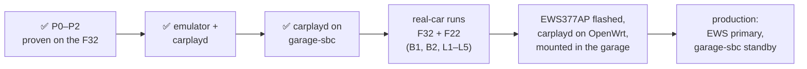

# Status: what we learned, tested, built, plan, open items

*As of 2026-11-03.* Goal: Google Maps (and everything else) on wireless CarPlay in the underground garage, where there's no cellular, for the **F32** (`BMW13031 CarPlay`) and the **F22 M240i** (`BMW39478 CarPlay`).

## At a glance

| | |
|---|---|
| **Does it work?** | **Yes, proven on the real F32 (2026-11-02).** A box on the car's CarPlay Wi-Fi advertised an IPv6 route; on the iPhone, *Check For Internet Access → Use For Internet*; Maps search and routing worked. No changes to the car or to the phone's IP settings |
| **Running now** | **carplayd** (our Go controller) on **garage-sbc** (Banana Pi in the basement), hunting both cars. Not yet exercised on a real car |
| **Tested** | Real car: P1 + P2 on the F32. Emulator: 115 scenario runs of the box's own OpenWrt firmware on build-host, stock vs carplayd |
| **Next** | Real-car runs with carplayd (both cars), F22 survey, signal thresholds, then the EWS377AP as the permanent box |

## What we learned

### The car (NBT EVO, measured on the F32)

| Fact | Consequence |
|---|---|
| CarPlay Wi-Fi is **2.4 GHz only**, channel 11, HT20, one stream | Any 2.4 GHz radio works; scan only that channel |
| WPA + WPA2 mixed, **TKIP group** cipher (iOS: "Weak Security") | Box must allow TKIP (`psk-mixed`) |
| DHCP **172.16.224.0/24, no router, no DNS**; head unit = AP at `.1` | No IPv4 internet path; IPv4 belongs to the car |
| Says "no internet" via the **802.11u Interworking Internet bit = 0**; no Apple Device IE | A box can't change the beacon, but iOS 27 tests the network anyway |
| Head unit sends **no IPv6 RAs** and takes no address from ours | Our RA is the only router; nothing conflicts |
| **A second client is allowed**, no client isolation | The box can join next to the phone |
| Password: 10 random characters, **visible on iOS 27 without a jailbreak** (Settings → Wi-Fi → Edit → Known Networks → the car → Password) | Stored in `secrets/carplay.env` |
| SSID digits = last 5 of the VIN | Kept out of git |
| F22: very likely the same NBT EVO behaviour, but **not measured yet** | Same subnet → no IPv4 on car links, one ULA /64 per car |

### The iPhone (iOS 27.0.1)

- **Check For Internet Access** (a button, not a toggle) makes iOS probe the network. If the probe passes, a **Use For Internet** switch appears; turn it on and the phone uses the car Wi-Fi for internet, falling back to cellular when that fails. iOS 27 beta 3 introduced it; it works on non-factory CarPlay receivers too.
- iOS accepted an **IPv6-only route with a ULA prefix**: SLAAC, RDNSS, internet check. 134 of 135 frames were IPv6; HTTPS, QUIC and the phone's Tailscale all ran through the box.
- Apple's open-source configd/xnu explain why a CarPlay network normally carries no internet: a `PrimaryRank = Never` service gets only a scoped default route. *Use For Internet* lifts that.
- The phone sends its 3 Router Solicitations **only when its own Wi-Fi link comes up**, so a box that joins later must announce on its own (carplayd: immediately, then every 1 s until a phone is there).

### Prior art

- **ksweber (Bimmerfest, Feb 2022) did it on an NBT EVO** with manual IPv4: an LTE router on the CarPlay Wi-Fi at `.254`, iPhone set to manual `.5`. Configure IP still exists on iOS 27 via Known Networks.
- Nobody published the IPv6/iOS 27 route before us (~30 searches in 4 languages, GitHub code search).
- How cars normally do it (Audi TSBs): "Wi-Fi pairing" cars run CarPlay over their own hotspot (internet included); "Bluetooth pairing" cars like the NBT EVO use a private CarPlay-only network.

### Hardware and software

| Fact | Source |
|---|---|
| **EWS377AP (IPQ8072A, ath11k): one STA per radio, one channel per radio**, no firmware PNO scan; the 5 GHz radio is useless for these cars → one car at a time | Linux ath11k source |
| **NSS offload doesn't speed up finding/joining a car**, and NSS ECM doesn't offload NAT66 anyway | qosmio/openwrt-ipq, ECM source |
| OpenWrt already rescans every 1 s (patch 310); its wpad builds lack autoscan/bgscan; `scan_list` limits scans to the car's channel | OpenWrt source |
| NetworkManager backs off to **one scan per 120 s** when idle; its channel lock doesn't narrow scans | NM 1.42 source |
| garage-sbc's brcmfmac: single-channel scan **131–156 ms** vs full 3.9 s; no monitor mode; up to 4 STAs on 2 channels | measured |
| odhcpd is slow to give a new phone the route (3.8–6.9 s) and, with a ULA-only prefix, advertises router lifetime 0 unless `ra_default 1` | emulator + source |

### How we work (lessons)

- **Research agents fabricated quotes three times.** Everything in the docs was re-checked against a fetched source or the device. Bimmerfest is readable via `r.jina.ai`.
- **The emulator found five real bugs** before they hit a car (below). Test there first, then the car.

## What we tested

| Where | What | Result |
|---|---|---|
| F32 + garage-sbc (P1) | Beacon decode, scan | 2.4 GHz ch 11, TKIP, Interworking Internet=0 |
| F32 + garage-sbc (P2) | ULA /64 RA + RDNSS + NAT66, iPhone iOS 27 | ✅ Use For Internet, Maps works; 81 NAT66 flows, 11.5 MB; goodbye RA (lifetime 0) seen on air |
| CarNet Probe on the iPhone | Path state, Wi-Fi-bound vs default probes, AAAA | Works at home; bound probe 38 ms |
| Emulator (OpenWrt r38011, kernel 6.18) | 33 stock + 82 carplayd scenario runs | All completed; numbers below |

**Emulator: carplayd vs the stock netifd/odhcpd box** ([full results](emulator-results.md)):

| | stock | carplayd |
|---|---|---|
| Car starts → box associated (median) | 1.47 s | **0.39 s** |
| Phone joins → route | 3.8–6.9 s | **0.32 s** |
| Box joins after the phone → route | 4.25 s | **0.01 s** |
| Signal fades → phone back on cellular | never | **3.8–4.8 s** (goodbye RA) |
| Car vanishes abruptly → phone drops the route | 60 s | **20 s** |
| Back in range → box associated | 1.33 s | **0.25 s** |
| F32 leaves, F22 starts → F22 served (own prefix) | n/a | **0.88 s** |
| Both start together → priority car (F32) served | n/a | **5/5** (preempts in 0.84 s) |
| Hovering signal / wpa_supplicant killed / carplayd killed | n/a | no false leaves / 3.0 s / 0.35 s |

**Bugs the emulator found in carplayd (all fixed and re-verified):**
- **Ghost car:** carplayd went back to a car that had left, because wpa_supplicant cached it in its scan results.
- **Lost Router Solicitation:** a phone's first RS can be lost on the car network.
- **Priority ignored:** whichever car was heard first won.
- **Silent metrics failure:** the metrics port was taken and carplayd didn't say so.
- **Slow sweeps:** unknown-channel sweeps slowed detection of the known car.

## What we built

| Piece | What |
|---|---|
| `carplayd/` (Go) | The controller: per-car hunting (car's channel only, every 1 s), join thresholds + hysteresis, per-car ULA `fd5c:ba1e:f32:a::/64` / `:b::`, its own RAs (eager 1 s → 3 s, RS answered at once, router lifetime 20 s), goodbye RA on fade-out, two-car arbitration + priority preemption, phone counting, NAT66 (ip6tables or fw4), wpa_supplicant watchdog, Prometheus metrics, unknown-channel hunting. Unit tests; systemd + procd packaging |
| `emu/` | Emulator on build-host: OpenWrt image with hwsim radios, `emu.sh` (cars, phones, fades, drive-outs), Go agent, Go harness with 14 scenarios, `run.sh build/boot/test/console` |
| `scripts/` | `deploy-carplayd-sbc.sh` (+ `rollback`), `poc-linux.sh` / `poc-mac-nat.sh` (P2 proof of concept), `carplay-box.sh` (old interim box), `openwrt-carplay.sh` (stock OpenWrt config), `car-ie.sh` (beacon decoder on the Mac) |
| `ios/CarNetProbe` | iPhone diagnostics app (installed on the phone) |
| `docs/` | [findings](findings.md), [two-cars](two-cars.md), [fast-connect-plan](fast-connect-plan.md), [emulator](emulator.md), [emulator-results](emulator-results.md), [openwrt-box](openwrt-box.md), [iphone-diagnostics](iphone-diagnostics.md), [test-log](test-log.md) |

## The plan

1. **Now: real cars with carplayd on garage-sbc.**
   - Every start of either car is a test: the event log is at `/var/log/carplayd.events`, metrics on `:9111`.
   - Get the F22's channel (B1) and a signal survey of both spots (B2).
   - Then tighten the join/leave/rejoin thresholds, which are deliberately loose now (−88/−92/−85).
2. **Lab telemetry** ([fast-connect-plan](fast-connect-plan.md)): timeline per session (car on → join → phone → route → flow), pcap ring, monitor capture (a USB AR9271 for garage-sbc, or the EWS377's radio).
3. **EWS377AP** (you're bringing it up):
   - carplayd already runs on the OpenWrt snapshot firmware in the emulator.
   - On the device, check ath11k STA with NSS offload and `iw phy`, then mount it in the garage near both spots.
4. **Production:**
   - The EWS377 serves whichever car is on; garage-sbc serves the second car when both are on, and covers if the EWS is down.
   - A peer heartbeat between the boxes, so each car gets exactly one router.
   - Polling and captures trimmed; metrics and alerts kept.

## Open items

| # | Item | Needs | Who |
|---|---|---|---|
| 1 | **First real-car run with carplayd** (F32): join time, phone route, Maps, drive-out goodbye | F32 on in the garage | you start the car; I read the log |
| 2 | **F22 P1**: channel, security, beacon; then pin `channel` in the config | F22 on | you + me |
| 3 | **Signal survey** from garage-sbc's spot for both cars, doors closed → real thresholds | each car on | you + me |
| 4 | Does iOS **remember Use For Internet** across car restarts and days? Per car, per phone | real use | you (observe), me (logs) |
| 5 | **Phone moving between cars** (one iPhone, two networks), and second driver's phone | real use | you |
| 6 | **EWS377AP**: flash, ath11k STA + NSS offload test, `iw phy` limits, carplayd on device, placement | the AP | you flash; I port + test |
| 7 | **Peer coordination** EWS ↔ garage-sbc (exactly one router per car) | EWS up | me (emulator first) |
| 8 | **Dual STA on garage-sbc** (both cars from one SBC) | two stand-in APs or both cars | me |
| 9 | **IPv4-only services** (a few Apple hosts, Mapbox): DNS64 + NAT64 on the box | after 1–3 | me |
| 10 | **Lab telemetry pipeline**: session timelines, pcap ring, Prometheus scrape of :9111, monitor capture | — | me |
| 11 | **Accept Apple's PLA** so CarNet Probe can show the Wi-Fi name/signal | developer.apple.com | you |
| 12 | Fallbacks not needed now: USB-C Ethernet on the phone (1b), offline maps (0), booster (2) | — | parked |

## Risks

- **iOS changes:** *Use For Internet* is new in iOS 27; a later iOS could change it. Manual IPv4 (ksweber's method) is the fallback.
- **RF in the garage:** the F22 parks farther from garage-sbc, and its signal may be too weak until the EWS377 is in the garage.
- **ath11k STA quirks on IPQ807x** (reconnect stalls reported upstream). carplayd's wpa_supplicant watchdog helps; real soak needed.
- **Car re-pairing changes the password:** carplayd hunts but never joins. Watch for repeated selects with no connect in the log.
