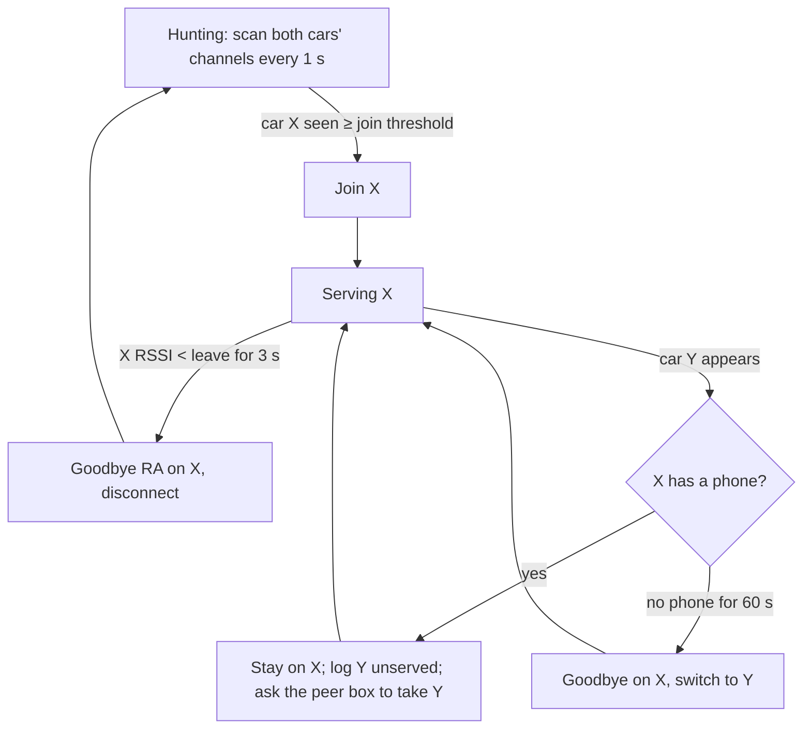
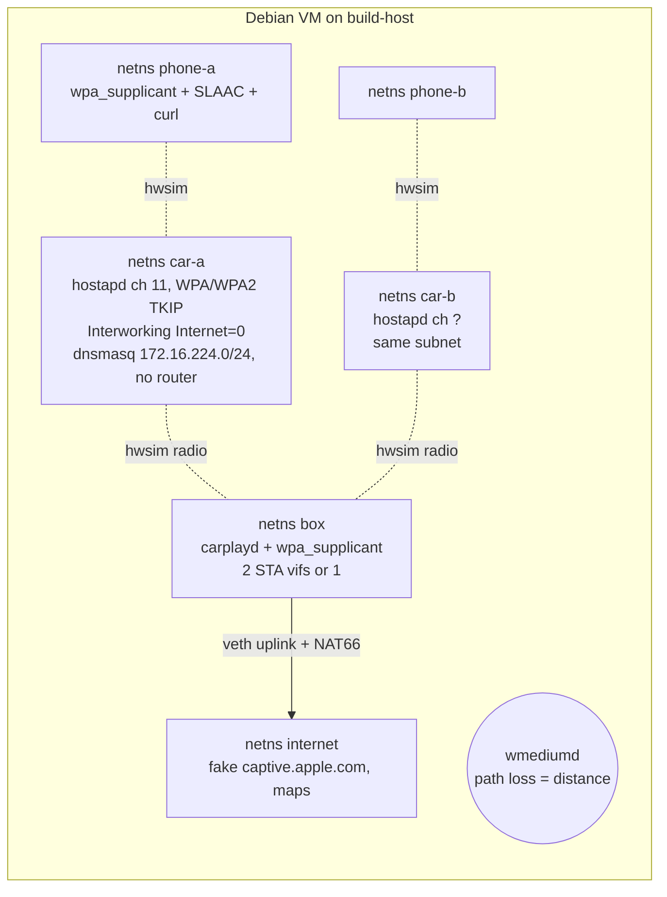

# Two cars

How the garage box serves the **F32** (car A, `BMW00001 CarPlay`) and the **F22 M240i** (car B, `BMW00002 CarPlay`): either one, or occasionally both at once. It builds on [fast-connect-plan.md](fast-connect-plan.md). The EWS377AP is the production box once flashed; until then **build-host** (simulation, builds, analysis) and **garage-sbc** (real cars) carry the work.

## What we know, and what we're assuming

| | Car A: F32 | Car B: F22 M240i | Consequence |
|---|---|---|---|
| Head unit | NBT EVO (measured) | NBT EVO, presumably: F-series, same CarPlay SSID pattern, same era (**verify**) | Same network behaviour |
| CarPlay Wi-Fi | 2.4 GHz, ch 11, HT20, WPA/WPA2 mixed, TKIP group, Interworking Internet = 0 (measured) | unknown: **P1 on the F22** | Hunting needs both channels; may be the same channel |
| Car network | 172.16.224.0/24, head unit `.1`, no router (measured) | almost certainly **the same 172.16.224.0/24 and `.1`** | IPv4 on two car links at once would collide, so the box doesn't use IPv4 on car links (below) |
| Distance to garage-sbc | nearest spot | farther, past the F32 | F22 signal at the SBC may be too weak: survey it |
| Both on at once | rare (your answer) | | Single-radio hunting covers almost every case; dual coverage is a bonus |
| Phones | mixed: one or two drivers' iPhones, sometimes passengers' | | Several phones per car network is fine (one RA serves all). *Use For Internet* is per network, so enable it once per car per phone |

## Scenarios

| # | What happens | Box behaviour (target) |
|---|---|---|
| S1 | A starts, B off | Hunt both; join A within ≤ 1.5 s of its first beacon; RA + NAT66 |
| S2 | B starts, A off | Same for B |
| S3 | A drives out | RSSI below leave threshold → goodbye RA on A → disconnect → back to hunting |
| S4 | A returns (on), parks | Hunting sees A above join threshold → join, RA |
| S5 | A on, then B starts (rare) | One STA: keep A if A has a phone, else switch to B. Two STAs: serve both |
| S6 | Both on, A leaves | Goodbye on A, then B within ≤ 1.5 s (or B already served by the second STA) |
| S7 | A idling in the garage for an hour | Keep serving; RAs every 3–4 s; nothing else |
| S8 | A on with no phone (passenger only / phone not paired) | Serve anyway (cheap); after 60 s with no phone, B may take priority if it appears |
| S9 | Signal hovers at the threshold (F22 at the far spot, doors opening) | Hysteresis: join −78, leave −82 for 3 s, rejoin only ≥ −75 or after the AP disappears |
| S10 | Wrong PSK / car re-paired (new PSK) | wpa_supplicant bans the network 10→300 s after failures; alert, re-read the PSK from the iPhone, `ENABLE_NETWORK` to clear the ban |
| S11 | Box reboots mid-session | Back to hunting at boot, re-join; the phone keeps its address (same prefix) |
| S12 | Two boxes (EWS + SBC) both see a car | Exactly one serves each car (coordination, below) |

## Design decisions

### 1. No IPv4 on car links; one ULA /64 per car

Both cars hand out the same 172.16.224.0/24, so a box on two car networks at once would have two interfaces in one subnet. IPv4 isn't needed: the iPhone gets everything over IPv6 (P2: 0 IPv4 packets through the box).
- **The box takes no IPv4 on car links:** `ipv4.method disabled` / no DHCP client.
- **Each car gets its own prefix:** car A `fd5c:ba1e:f32:a::/64`, car B `fd5c:ba1e:f32:b::/64`, with the box at `::1` on each.
- **Routing stays unambiguous with two links up:** per-prefix routes, link-locals scoped per interface. No VRFs or namespaces needed.
- **NAT66 per prefix** out of the uplink.

What we give up: the manual-IPv4 fallback (`.254`) only works when one car is served. It isn't used anyway.

### 2. "Is this the car?" by SSID + BSSID, not by DHCP lease

The DHCP-lease guard only existed because home is 172.16/16 too. With no IPv4 on car links that risk is gone. The guard becomes **SSID + BSSID match**: car A's BSSID is known, car B's is learned in P1. It's checked on the CONNECTED event, which also saves the DHCP wait.

### 3. One controller, `carplayd` (Go), on every box and in the simulator

| Part | What it does | Backend |
|---|---|---|
| Car config | `cars.yaml` (0600): id, ssid, psk, bssid, channel, prefix, join/leave/rejoin thresholds, priority | file |
| Hunter | targeted scans for all configured cars every 1 s while any STA is free (`SCAN freq=<chans> ssid=<…>`), ~150 ms per scan | wpa_supplicant control socket (Debian, simulator); `ubus call wpa_supplicant.<if> control` (OpenWrt) |
| Joiner | `SELECT_NETWORK` the chosen car; clears bans with `ENABLE_NETWORK` | same |
| Signal | `SIGNAL_POLL` every 1 s while serving (works on ath11k and brcmfmac; OpenWrt has no bgscan) | same |
| RA engine | sends RAs **itself** per car link: immediately on CONNECTED, then every 3–4 s, answers RS at once (unicast), RDNSS, router lifetime 20–60 s, **goodbye (lifetime 0) per car**. Replaces radvd/odhcpd, whose start-up traps cost seconds (odhcpd: fixed 1 s first-RA timer, waits for non-tentative link-local; radvd: a failed setup retries after 10 × MaxRtrAdvInterval) | raw ICMPv6 ([mdlayher/ndp](https://github.com/mdlayher/ndp)) |
| Addresses | per-car ULA `::1/64` on the STA, `accept_dad=0`, power save off | netlink |
| NAT66 | per prefix out of the uplink | nftables (Debian/sim); fw4 zone + `masq6` (OpenWrt, static config) |
| Phone detection | SLAAC neighbours in the car prefix, NAT flows from it | netlink neigh, conntrack |
| Telemetry | JSONL events + Prometheus `/metrics`; lab mode also runs the pcap ring | file, HTTP |
| Peer coordination | heartbeat with the other box: "serving A", "serving B", "free" | UDP on the LAN |

One static binary per arch (`arm64` for garage-sbc and the EWS377, `amd64` for the simulator), built on build-host. The state machine is the one in [fast-connect-plan.md](fast-connect-plan.md#state-machine-per-car), run per car.

### 4. Radios: who can serve what

| Box | Radio limits (from source / `iw phy`) | Two cars at once? |
|---|---|---|
| **EWS377AP** (IPQ8072A, ath11k) | **one STA per radio, one channel per radio** (`support_dual_stations = false`); the other radio is 5 GHz, useless for these cars. Any AP on the 2.4 GHz radio goes down while the STA hunts (OpenWrt's `wpa_supplicant.uc`), so keep that radio STA-only | **No**, one car at a time |
| **garage-sbc** (brcmfmac) | up to 4 managed vifs, **2 channels** concurrently, no monitor, no PNO | **Maybe**: two STA vifs (`wlan0`, `wlan1`). Different channels means the firmware time-slices, which is fine for Maps. **Test** |
| EWS + garage-sbc together | | **Yes**: one car each |

### 5. Arbitration with one STA (S5, S6, S8)

Watching for Y while serving X: if Y is on X's channel, a scan of the current channel never leaves it. Otherwise a ~150 ms off-channel scan every 5 s is a small hit on X's link. Do it only while X has no traffic, or rely on the peer box.

### 6. Two boxes (production): EWS primary, garage-sbc standby

- The **EWS377** (mounted in the garage, better RF for the far F22 spot) hunts both cars and serves the first one seen.
- **garage-sbc** serves only a car the EWS isn't serving: when both cars are on (S5), or when the EWS is down. Its peer heartbeat tells it which.
- **Exactly one router per car network**, so the phone never sees two RAs and two prefixes.
- If the heartbeat is lost for 5 s, garage-sbc assumes the EWS is gone and serves the nearest car.
- Same prefix per car on both boxes, so a hand-over doesn't renumber the phone.

## Using build-host and garage-sbc now

### build-host: simulation lab, builds, analysis

build-host has no Wi-Fi, and its AlmaLinux kernel has no `mac80211_hwsim`, but it has KVM, sudo and podman. So the lab is a **Debian VM** (qemu in a podman container with `/dev/kvm`) whose kernel has `mac80211_hwsim` and `wmediumd`:

- **Scenarios S1–S12 as scripts:** a car "starts" (hostapd up), "drives out" (wmediumd raises path loss step by step), "returns", both on, wrong PSK, box restart.
- **Each run asserts the timing targets** and writes the same JSONL as the real box.
- **CI:** it runs on the CI runner on build-host (`runs-on: build-host`) for every carplayd change.
- **Builds:** carplayd for arm64 and amd64.
- **Analysis:** collect the JSONL and pcaps from garage-sbc, merge them with the CarNet Probe logs into per-session timelines and SLO reports.
- **Later:** an OpenWrt x86 VM (it has `kmod-mac80211-hwsim`) to test the EWS377's ubus backend and fw4 config before touching the hardware.

The simulator can't reproduce brcmfmac/ath11k firmware quirks, iOS behaviour or the cars' real RF. Those stay real-car tests on garage-sbc and the EWS.

### garage-sbc: real cars

| Step | Needs | Answers |
|---|---|---|
| **B1** P1 on the F22: `poc-linux.sh ie` with the F22 on and the F32 off | F22 on | channel, security, beacon, BSSID; is it really NBT EVO-like |
| **B2** Signal survey from garage-sbc's spot: each car alone, doors closed, 2 min of RSSI | each car on | can the SBC serve the far F22 at all? Thresholds |
| **B3** Dual-STA feasibility on brcmfmac with two stand-in APs (iPhone Personal Hotspot on 2.4 GHz + Mac Internet Sharing), then both cars | no cars for the first part | two cars from one SBC: yes/no, throughput, latency |
| **B4** Replace `carplay-box.sh` with carplayd in lab mode | carplayd | real timings for S1–S4 per car |
| **B5** Both cars on (S5, S6) | both cars | arbitration and coverage in practice |

## Order of work

1. **build-host:** build the Debian hwsim VM + scenario harness (car A from measured parameters; car B as a copy until B1).
2. **carplayd v0:** hunter + joiner + RA engine + goodbye + NAT66 + JSONL, Debian/simulator backend. Make S1–S4, S9 and S10 pass in the simulator.
3. **garage-sbc:** B1, B2 (next time each car is on), B3 with stand-ins.
4. carplayd v1: arbitration (S5, S6, S8), dual-STA if B3 passes, Prometheus, lab pcap ring. Simulator S5–S12. Deploy to garage-sbc in lab mode (B4, B5).
5. **EWS377** (once you have it running): OpenWrt backend (ubus, fw4 static config), OpenWrt-in-simulator test, then on the wall in the garage. Peer coordination with garage-sbc (S12).
6. **Production mode:** polling trimmed to presence + RSSI, captures off, metrics and alerts kept.

## Open questions

- F22: same head unit, channel, security? (B1)
- Can garage-sbc in the basement reach the F22 reliably? (B2) If not, the F22 waits for the EWS in the garage.
- brcmfmac dual STA in practice (B3).
- Does iOS keep *Use For Internet* per network across days (L2), and does a phone that moves between cars need anything extra?
- With both cars on the same channel, do their beacons/traffic interfere enough to matter? (B5)
