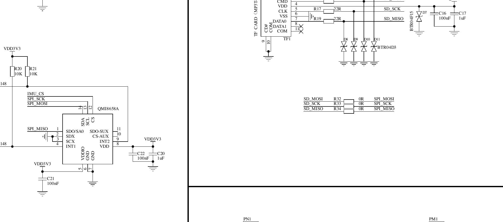

# imuprobe

> **The IMU was fixed on 2026-11-11 by a cold power cycle** -- USB out *and*
> the 18650 out for several minutes. That is the "something no test has done"
> listed at the bottom of this file. The part was never faulty; it had simply
> never lost power since manufacture, because VDD3V3 is a main rail fed from
> whichever source is still connected.
>
> This program is kept for the next time a sensor on a shared bus goes quiet.
> Its phase D (writes, 3-wire read-back on MOSI, INT1 watch) is still the right
> battery to run -- but **run the cold power cycle first**. It is free and it
> was the answer.


A read-only QMI8658 diagnostic for the T-Beam S3 Supreme. It tests the two
datasheet-conformance faults that both the CarNet Beam firmware and LILYGO's own
example share, and nothing else.

## The finding that matters

Reading the **V3.1 schematic** (`schematic/T-Beam-S3-Supreme/T-Beam-S3-Supreme-V3.1.pdf`
in LilyGo-LoRa-Series) settles two things that every previous attempt — including
LilyGO's own example, and the handoff document — got wrong.



**1. The IMU is powered from `VDD3V3`, not ALDO2.** The part is `QMI8658A`,
designator **UX1**, and the schematic shows **pin 5 VDDIO and pin 8 VDD both tied
to VDD3V3**, decoupled by C21 (100nF), C22 (100nF) and C20 (1uF). LilyGO's own
rail table lists ALDO2 as "Sensor" but never names the IMU, and everyone —
this project included — assumed that meant the IMU. It does not.

Consequences:

- The earlier "ALDO2 power cycle" test **cycled an unrelated rail**. The IMU
  never lost power.
- VDD3V3 also feeds the RTC and the programming header, so it is a main rail. An
  ESP32 reset does not drop it, and nothing in software can.
- **No test ever performed on this board has power-cycled the IMU.** Only a full
  cold power-down — USB out *and* the 18650 removed — will.
- Because it has been powered continuously, the **1.75 s turn-on time is long
  satisfied**, so that hypothesis cannot explain a failure on a board that has
  been running all along.

**2. The bus path is direct, and the 0R links are not the fault.** R32, R33 and
R34 are 0-ohm links bridging `SD_MOSI/SCK/MISO` to `SPI_MOSI/SCK/MISO`. The IMU
sits on the `SPI_*` side with the ESP32; the SD card sits behind the links. The
SD card works, so the links are populated. R20 and R21 are 10K pull-ups holding
`IMU_CS` high when the ESP32's pin is high-Z.

One hypothesis this also weakens: the datasheet makes the CS interface selection
level-based, not latched — *"(If 1: I2C-UI Mode …) (If 0: SPI-UI mode …)"* — and
CS is driven low for every transaction, so the part should be in SPI mode when
it is read.

## Why

`WHO_AM_I` reads a constant `0x3E` on this board. Earlier attempts cycled
through SPI modes, clock rates, dummy bytes, drivers and an ALDO2 power cycle.
Reading the QMI8658C datasheet afterwards showed two things every one of those
attempts had in common:

1. **System Turn On Time is 1.75 s**, and it "starts once VDDIO and VDD are
   within 1% of Final Value". Everything so far probed within a few hundred
   milliseconds of enabling the rail — about 35× inside spec.
2. **CS selects the interface.** Pin 12 is the "I2C/ I3C /SPI-UI selection Pin.
   (If 1: I2C-UI Mode: I2C/I3C communication enabled, SPI idle mode)". Every
   attempt let CS idle high while the part powered up.

## What it does

| Phase | Test |
|---|---|
| **A** | Control: read `WHO_AM_I` and `REVISION_ID` repeatedly |
| **dump** | Registers `0x00`–`0x1F` in both SPI modes at 100 kHz, 500 kHz and 4 MHz |

The register *pattern* is the evidence: a floating bus reads the same byte at
every address, while a part answering badly varies with the address.

Each read is done in both SPI mode 0 and mode 3 — not because that is
diagnostic (the part supports both, so matching results prove nothing) but
because it costs nothing and removes the question.

**It never writes to the sensor.** No soft reset, no CTRL registers. A write to
a part that is not answering only adds a variable.

## Reading the result

- Any line showing `WHO_AM_I m0=0x05` or `m3=0x05` — **the part works** and the
  cause was a datasheet-conformance bug, in which case CarNet Beam needs the
  same wait and CS handling.
- Every line `0x3E` — the next steps are physical, and the schematic now names
  exactly what to probe:
  - **VDDIO at C21** (100nF) and **VDD at C22** (100nF) / **C20** (1uF).
    Datasheet range is 1.71–3.6 V for both.
  - **Is UX1 populated at all?** A 14-pin LGA, roughly 2.5 × 3 mm.
  - Capture CS 34 / SCK 36 / MOSI 35 / MISO 37 during one register-0 read.
  - Try a reading after a genuine cold power-cycle (USB out, cell out, wait
    ~10 s) — something no test has done, because ALDO2 was the wrong rail.

Then send `LILYGO-REPORT.md`.

## Flash

Restores nothing by itself — reflash CarNet Beam from `../dist` afterwards.

```sh
cd tbeam/imuprobe/dist
esptool --chip esp32s3 -p "$PORT" -b 460800 --before default-reset --after hard-reset \
  write-flash --flash-mode keep --flash-freq keep --flash-size keep \
  0x0 bootloader.bin 0x8000 partitions.bin 0xe000 boot_app0.bin 0x10000 firmware.bin
```
